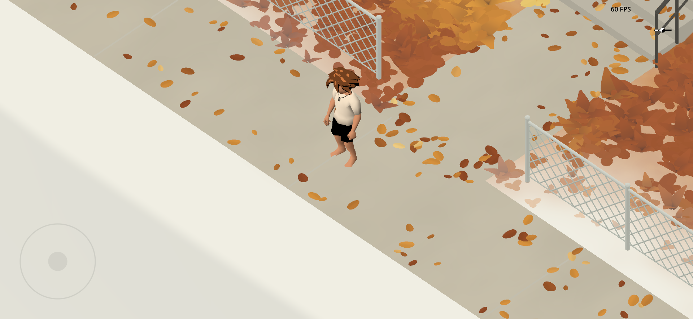
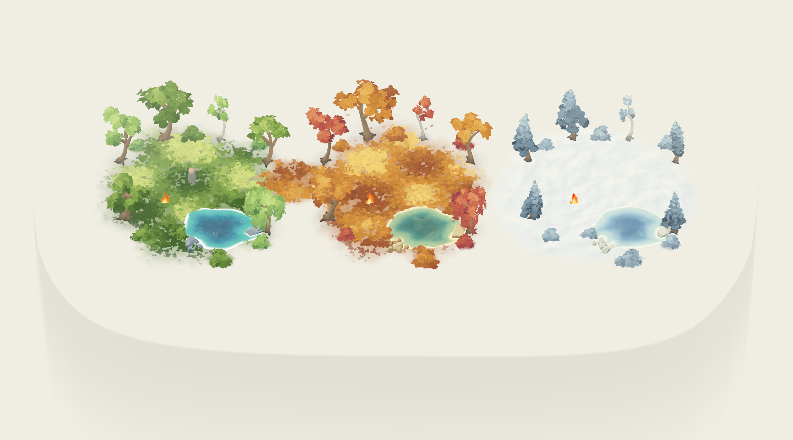
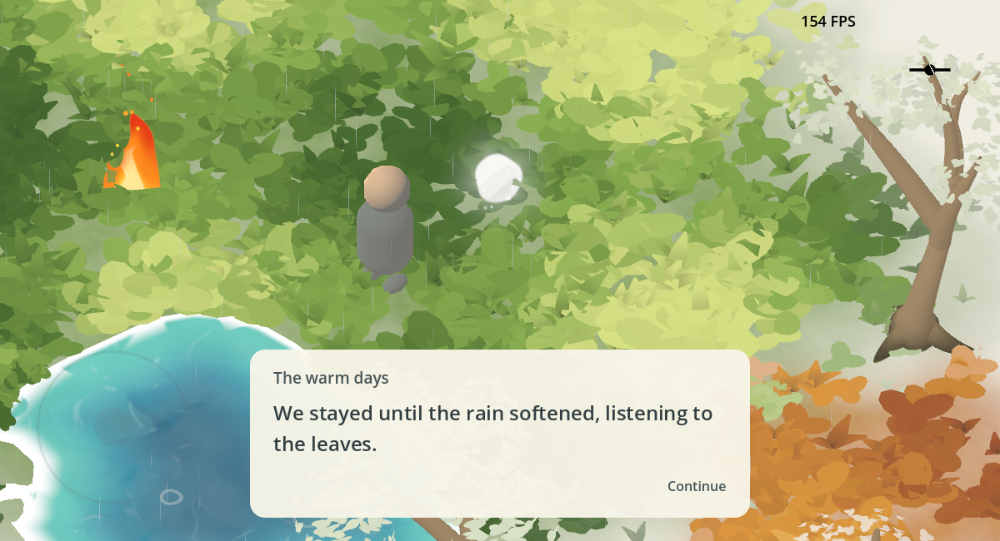
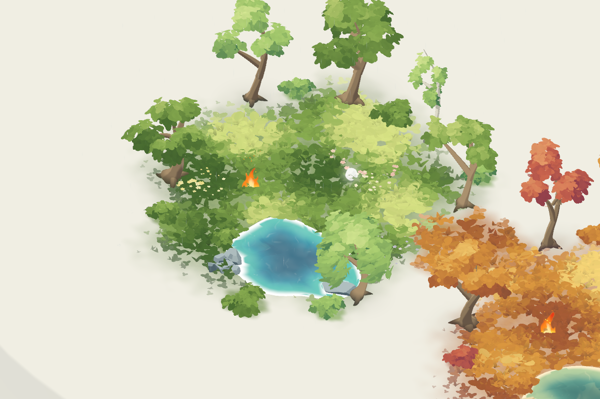
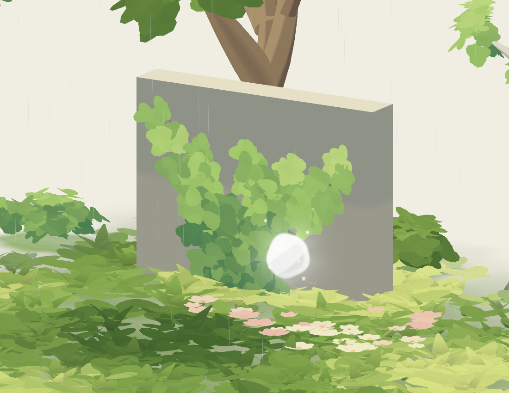

# memories

A shared relationship timeline told through small, dreamlike 3D memories. The demo memory contains three connected seasonal clearings—spring/summer, autumn, and winter—on a pale platform in the void. Each has a pond, fire, trees, and shrubs.

Designing a new memory? Start with the [memory design guide](docs/MEMORY_DESIGN_GUIDE.md) and [documentation index](docs/README.md).

## Play

Open `project.godot` in Godot 4.4 or newer and press **F5** for the EVERMORE title screen. Choose Soren (male symbol) or Vivian (female symbol) in the bottom-right corner; the unselected symbol is translucent. Tap or click infinity, or press Enter, to unfold Memory Lane. It contains **First Meeting — November 12, 2025**, **Football in the snow**, **Minneapolis Institute of Art — December 4, 2025**, **Christmas market — December 19, 2025**, and **Seasonal Demo**. First Meeting is selected by default. Swipe or drag, tap a mark, or use left/right arrows to choose, then **Recall →** to enter that memory with the selected character. See [the UI guide](UI/README.md). To run directly without the arrival fade, open `scenes/world/first_meeting_world.tscn` or `scenes/world/memory_world.tscn` and press **F6**.

- **WASD / arrow keys:** walk, relative to the screen.
- **Controller left stick:** analog movement.
- **Touch joystick:** drag the fixed stick in the bottom-left corner to walk. Its outline and center are faint at rest and become opaque while held; release to stop and gently recenter. Mouse dragging also works for desktop preview.
- **Return to timeline:** tap the small dot-and-line glyph at the top right, click it, or press Escape. The world fades back to the timeline with the selected memory preserved.

To play together, use the same build on the same Wi-Fi or LAN. Choose your character on the main menu. Hosting starts automatically on a fresh launch. In the bottom-left corner, the host shares the displayed address; the other player taps **Join**, enters that address, and taps the arrow. Both modes use the same address field and fixed icon slots, with an underline only for Join; the submit arrow fades in only for Join. Two rings at the left stay separated while unpaired and interlock when connected. Connecting leaves both players on the main menu. Each can enter the timeline and recall any memory independently. When both are in the same memory, their characters appear together; different memories or no connection behave like solo play. Returning to menus keeps the connection. Tap the active Host/Join choice to disconnect. The host keeps accepting a returning guest after they leave. Allow local-network access if your device asks; transport uses UDP port **24680**.

The current scene contains a simple character, a finite memory platform, three seasonal zones, procedural foliage, stones, ponds, and fires. It has gentle acceleration, deceleration, turning, a small walking motion, an elevated orthographic follow camera, warm ambient lighting, distance fog, and a soft contact shadow. Foliage, stones, and ponds recall independently as players approach; grass also has gentle wind and local player bending. The pale platform descends into the fog, with an invisible rim keeping exploration inside the memory. Blank-void memories without a platform retain the original infinite ground.

The game launches fullscreen at a fixed landscape phone aspect ratio (1920 × 886). Extra screen area is letterboxed in black, preserving proportions. A small black FPS counter appears at the top right of the game area. Rendering is uncapped with VSync disabled for performance testing. Movement stays on fixed physics ticks; physics interpolation smooths the character between them. The render-frame camera and grass sample the same interpolated player position. Reset player physics interpolation when teleporting or spawning after entering the scene tree.

## First Meeting

Memories share a small [audio framework](audio/README.md): independent Music, Ambience, SFX, and UI buses, with memory entry/exit fades and a Master limiter. Select **Audio** for shared music/cues and each **Zone** root for local ambience and coverage. First Meeting blends house wind into arcade room tone and has a fragment chime; the existing mechanical-band notes route through SFX. The Music slot is ready for a chosen soundtrack.

`scenes/memories/first_meeting.tscn` inherits `memory_base.tscn`. Its **Zones/House** and **Zones/Arcade** instances own scenery, one fragment each, and local ambient audio. The shared platform and connecting guidance remain under **Environment**; **Entry** is on the front sidewalk. See [the zone authoring guide](scenes/memories/README.md). The house study has been moved here. The paving groundcover mask now lives in `components/groundcover/paving/groundcover_exclusion.gd`.

`scenes/world/first_meeting_world.tscn` and the retained demo wrapper inherit `scenes/world/memory_world_base.tscn`, sharing players, camera, controls, arrival presentation, networking, and return navigation. First Meeting enables proximity recall on its 40 foliage, house, fence, arcade, vine, and leaf-litter components. Existing grass/bush/tree effects are reused; solid props and accents resolve upward with a cream-white edge. The platform, paving, and atmospheric arcade traces remain present as the setting. All effects use `components/effects/recall/recall_settings.tres`. First Meeting uses no extra recall spawn offset; the LAN guest spawns 1.2 m to the right of the host. Both memories use exactly the same close orthographic camera size, angle, centered follow, and controls. The demo retains its 10 m recalled arrival offset.


The yard is defined by a low diamond-mesh fence with a 2.3 m open gate. Full orange fall foliage with red accents, smooth rounded leaves across the paving and roof edges, and a fuller doorway vine arch give the outside space small details to discover. The autumn tree stands in the front yard left of the walk; there are no birds in First Meeting. The house uses broad plaster pigment, irregular shingle courses, painted curtains, and a warm porch lamp. The bungalow silhouette and sidewalk meeting point remain the focus. Thin paving collisions keep feet and contact shadows on the concrete.



[Garden close-up](docs/previews/first-meeting-garden.png) · [Composition overview (inspection camera)](docs/previews/first-meeting-overview.png)

First Meeting continues beyond the house into an ethereal arcade glade: pinball, a punching-bag machine, and a complete mechanical band sit in small autumn foliage islands, separated by the white void. Fading floorboard traces, pale pigment pools, and an interrupted strand of suspended warm bulbs suggest the bar. The machines form a loose triangle with open approaches. Their individual models, the original house, arrival, shared camera, timeline entry, and connected platform remain intact. See [the arcade component guide](components/activities/arcade/README.md).

[Expanded memory](docs/previews/first-meeting-expanded.png) · [Arcade area](docs/previews/first-meeting-arcade.png) · [Mechanical band](docs/previews/arcade-mechanical_band.png)

## Football in the snow

The second timeline memory, **Football in the snow**, places both explorers high in a snowy college-stadium seating section. Its compact upper cross-aisle has safe guardrails, benches, and a fragment, with existing ground snow/footprints and falling snow. Approaching the railing gently opens the camera across the painted football field and distant stands; walking back returns to closer exploration framing. The field and bowl are scenic, while the upper deck is walkable.

Open `scenes/world/snowy_stadium_world.tscn` to play it directly. Its field and stands are reusable components built with First Meeting's geometry/vertex-paint workflow. See [the stadium guide](scenes/memories/snowy_stadium/README.md) for layout, snow controls, fragment text, and validation.

## Minneapolis Institute of Art

The third authored memory is **Minneapolis Institute of Art — December 4, 2025**. Its isolated six-column portico leads through the white void to marble sculpture studies, a painting gallery with Mia collection reproductions, and a room of 34 painterly visitors. Four standard zones each own a fragment and ambient bed, connected by one finite floor. See [the museum guide](scenes/memories/art_museum/README.md), or run `scenes/world/art_museum_world.tscn` with F6.

## Christmas market

The fourth authored memory is **Christmas market — December 19, 2025**: two snowy zones connect a lane of six wooden market huts to a tree-and-music gathering with three acoustic performers. It reuses continuous footprint snow, pine trees, visitors, warm light washes, and the shared memory framework. See [the market guide](scenes/memories/christmas_market/README.md), or run `scenes/world/christmas_market_world.tscn`.

## Seasonal demo layout

The content is grouped under `Environment/SummerSpring`, `Environment/Autumn`, and `Environment/Winter` in `scenes/memories/foliage_demo.tscn`. Their centers are at world X=-13, 0, and 13 m. Entry starts in spring/summer, and Exit is inside winter. The open walking lane follows local Z=-1.2 across the three clearings; the front ponds and perimeter groves leave it clear.

| Zone | Groundcover | Foliage / pond palettes | Weather |
| --- | --- | --- | --- |
| Spring/summer | Grass | Summer Meadow + Spring / Turquoise | Local rain and pond impacts |
| Autumn | Grass | Autumn Gold + Autumn Red / Autumn Jade | None; seasonal falling leaves |
| Winter | Sculpted snow with temporary footsteps | Winter Frost / Winter Glass | Local snowfall |

Each zone has a pond, shore stones, and fire. A sparse transitional grass patch links the two grassy clearings. The winter snow reaches toward autumn and masks its pond through Ground Exclusions. Weather coverage and drift are constrained to their zones. Scenery keeps independent recall controllers; the hidden wisp component remains available for future work.

The common 46×26 m platform contains all scenery, the walking lane, and the recall arrival. Density is reduced per patch, with six trees and seven shrubs per zone rather than three full copies of the old dense forest. `tests/seasonal_demo.gd` verifies the seasonal configuration and walks the actual character from summer to winter with collision enabled.



## Foliage components

Instance `components/foliage/painterly_grass_patch.tscn` in a memory to add grass. Size, seed, density, height, palette, wind, and culling distance are editable in the Inspector with live editor previews. See [the foliage authoring guide](components/foliage/README.md) for controls and rendering budgets. The demo is `scenes/memories/foliage_demo.tscn`.

Instance `components/foliage/painterly_tree.tscn` to add a single tree. Choose Broadleaf, Spreading Oak, Slender Birch, Weeping Willow, Layered Pine, or Columnar Cypress under **Tree Shape → Tree Type**. Seeds, proportions, branches, canopy detail, bark, wind, and trunk collision are editable with live previews. Trees share the grass palette resources. See [the tree authoring guide](components/foliage/TREES.md).

Instance `components/foliage/painterly_bush.tscn` to add a low, spreading shrub. Seed, footprint, height, density, palette, wind, and culling distance are editable with live previews. See [the bush authoring guide](components/foliage/BUSHES.md).

Use **Foliage Colors → Palette Preset** on any grass, tree, or bush instance for seasonal and dreamlike color schemes. See [the palette guide](components/foliage/PALETTES.md).

## Scenery components

The [postcard cabin](components/buildings/postcard_cabin/README.md) is a reusable closed trailer-cabin exterior with charcoal siding, a sloping roof, large painted windows, a warm porch lamp, wheels and entry steps. Dimensions, colors and optional details are editable. Run `tests/scenes/postcard_cabin_test.tscn` with F6 for a playable component study.

Instance `components/scenery/boulders/painterly_boulder.tscn` for one seeded, painterly stone with six varied shape profiles, stone palettes, and convex collision. See [the boulder guide](components/scenery/boulders/README.md). The demo contains boulders and a reusable rock cluster beside the pond.

The [concert kit](components/scenery/concert/README.md) adds a walkable stage with an access ramp, modular speaker stacks with subtle cone motion, moving-head rave lights with painted shafts and floor pools, and a large animated visual screen. The screen mixes six GPU-driven graphic families with brush wipes and editable tempo, colors, dimensions, and glow. Run `tests/scenes/concert_test.tscn` with F6 for a playable arrangement using the existing crowd and component test framework.

## Create another memory

Use [the zone authoring guide](scenes/memories/README.md). Create an inherited memory from `scenes/memories/memory_base.tscn`, then instance authored `memory_zone.tscn` scenes under **Zones** in story order. Each zone contains **Scenery**, **Fragment**, and **Ambience**. The `memory_template.tscn` starter supplies one complete zone and shared ground.

Keep shared music, ground, Entry/Exit, and connecting paths at memory level. Wrap the memory with `scenes/world/memory_world_base.tscn` and add that wrapper to the timeline catalog. Player, camera, guidance controls, and LAN setup remain shared.

## Tune the foundation

- `Explorer` instance: `walk_speed`, `acceleration`, `turn_speed`.
- `CameraRig`: `follow_speed`, `framing_offset`; `Camera3D`: size, position, rotation, projection.
- `WorldEnvironment` and `Sun`: palette, haze, and lighting.
- `shaders/dream_surface.gdshader`: faint surface pigment.

The Mobile renderer is preserved. The scene uses no volumetric fog, particles, or real-time shadow maps; water uses shared paint/normal/caustic/foam masks and a small per-body shoreline field. The soft contact shadow is a single transparent quad. LAN sync covers character choice, position, facing, and walk/idle state; scenery effects and memory fragments run locally. Persistence and device performance verification are future work.

## Validate

```sh
godot --headless --path . --editor --quit
godot --headless --path . --script tests/scene_smoke.gd
godot --headless --path . --script tests/grass_patch_smoke.gd
godot --path . --script tests/tree_smoke.gd
godot --path . --script tests/bush_smoke.gd
```

The smoke check exercises scene loading, grounded movement, camera-relative direction, diagonal speed, stopping, camera follow, touch normalization/release, and replacement of the infinite ground by the finite memory platform. It exits nonzero on failure.

Run the LAN check in two terminals, starting the host first:

```sh
godot --headless --path . --script tests/lan_multiplayer.gd -- host
godot --headless --path . --script tests/lan_multiplayer.gd -- guest
```

This uses real ENet traffic on loopback to check connection from the main menu, independent memory selection, meeting up in First Meeting and Snowy Stadium, partner removal on menu/memory changes, both avatar choices, live movement, stale-packet rejection, reconnecting, and solo fallback after host loss. It also checks interpolation with simulated packet delay and loss. `tests/lan_menu.gd` covers native-touch IP entry, timeout recovery, and portrait layout. For two devices, use the main-menu LAN controls with the host’s Wi-Fi IP.

`docs/previews/first-scene.png` is a preview rendered with Godot 4.4.1's Mobile renderer on macOS. Touch input is checked synthetically; physical iOS hardware has not been tested.

`docs/previews/foliage-demo.png` shows the current grass demo rendered with the Mobile renderer.

For a rendered movement timing check, run `godot --path . --script tests/movement_render_smoke.gd`. It compares physics movement updates with interpolated player updates at the actual render rate.

`docs/previews/tree-demo.png` shows the current meadow and tree demo.

`docs/previews/bush-demo.png` shows the current meadow with a tree and three reusable bushes.

`docs/previews/forest-clearing-overview.png` shows the current clearing: an irregular horseshoe of autumn broadleaf, oak, and birch trees, with taller crowns at the back and an open entrance facing the player. Tree seeds, rotations, proportions, and density are authored on individual instances in `scenes/memories/foliage_demo.tscn`. The expanded meadow uses shorter grass and reduced per-area density to connect the tree bases.

Instance `components/scenery/water/painterly_water.tscn` for painterly ponds and modular stream sections. Choose Calm Pond, Flowing Stream, or Open Lake settings, then tune layered normals, painted depth, caustics, and view-dependent sky lighting. Custom pond outlines and curved, variable-width streams share the same shoreline/flow framework. The demo pond integrates grass exclusions, rock-aware foam, and optional shoreline collision. Run `scenes/memories/water_study.tscn` with F6 for standalone authoring examples. See [the water authoring guide](components/scenery/water/README.md).

The pond is framed by low shoreline shrubs, a willow and side trees, with short groundcover extending the meadow around it. The player’s approach stays open and the foreground shrubs stay low to preserve water visibility. `docs/previews/pond-detail.png` shows the upgraded pond surface and shoreline.

Instance `components/scenery/rock_clusters/painterly_rock_cluster.tscn` for smaller clustered stones inheriting the boulder generator. **Cluster → Rock Count, Rock Scale, Size Variation, and Cluster Footprint** control the group. See [the rock cluster guide](components/scenery/rock_clusters/README.md).

## Dream guides

Instance `components/guidance/wisps/dream_wisp_path.tscn` for sparse, ghostly brushstrokes drifting along an editable Path3D curve. Count, color, opacity, height, width, and speed are exposed in the Inspector. The demo retains this route hidden. See [the wisp authoring guide](components/guidance/wisps/README.md).

Instance `components/guidance/brushstroke/living_brushstroke.tscn` for a luminous white ribbon with a soft glow, uneven painterly bands, and a dissolving tail. It gathers at the start, blooms through the middle, and releases into fine strands near the destination. Set its two local-space endpoints in the Inspector, then tune width, glow, evolution, palette, timing, and sway. One white stroke guides across the summer clearing. See [the brushstroke guide](components/guidance/brushstroke/README.md).

## Memory boundaries

Instance `components/scenery/platforms/memory_platform.tscn` under Environment for a finite, walkable memory atop a pale pillar fading into the void. Shape, footprint, optional custom outline, depth, fade, colors, and rim clearance are editable. The demo includes a 46×26 m platform; the world automatically switches to its floor and perimeter collision. See [the platform guide](components/scenery/platforms/README.md).

## Weather

Instance `components/weather/rain/painterly_rain.tscn` for fine drifting rain, tiny ground splashes, and soft water ripples. Intensity, coverage, counts, wind, speed, and colors are editable. The spring/summer zone includes a localized shower. See [the rain guide](components/weather/rain/README.md).

Instance `components/weather/snow/painterly_snow.tscn` for soft drifting snow. Coverage, intensity, flake count/size, fall speed, wind, flutter, and colors are editable; it uses one GPU batch. The winter zone includes localized snowfall. See [the snow guide](components/weather/snow/README.md).

## Fire VFX

Instance `components/vfx/fire/painterly_fire.tscn` for curling painted flames, a gentle ground glow, and rising embers. Size, intensity, animation speed, wind, colors, and ember count are editable. Each seasonal zone includes a small fire. See [the fire guide](components/vfx/fire/README.md).

## Winter groundcover

Instance `components/groundcover/snow/painterly_snow_patch.tscn` for soft sculpted snow and temporary player footsteps. Footprint Linger and Fade Duration control how long impressions remain. Add it to grass Ground Exclusions to replace grass locally. The winter zone uses snow groundcover with temporary footsteps. See [the ground-snow guide](components/groundcover/snow/README.md).

## Memory fragments

Reusable glowing, floating painterly orbs live in [components/interactables/fragments](components/interactables/fragments/README.md). Tap or click an orb within its exported interaction range to queue its editable note pages. The demo contains two: `SummerSpring/SummerFragment` and `Winter/WinterFragment`. `Controls/FragmentInteraction` manages picking and a shared note queue, with native touch support, drag cancellation, and collision occlusion checks. Fragments expose activation signals for future discoveries beyond text.



## Flower patches

The summer clearing includes three procedural flower drifts: cream/buttercup, rose, and lavender. [Painterly flower patches](components/foliage/flowers/README.md) expose seed, count, footprint, bloom size, petal count, seasonal foliage colors, bloom palettes, wind, and water exclusions. Each patch uses one opaque instanced draw call and smoothly bends near explorers.



## Birds

The summer clearing includes three [painterly birds](components/animals/bird/README.md): a sparrow, robin, and bluebird. Each waits with subtle idle motion, then flaps upward and away when an explorer enters its configurable scare radius. Palette, size, flight speed, ascent, and optional respawn delay are editable in the component Inspector.

## Wall vines

[Painterly wall vines](components/foliage/vines/README.md) reuse the bush's curved leaf clusters and seasonal colors, arranging them along branching wall growth. Select climbing or hanging, then adjust footprint, density, leaf size, coverage, wind, and player disturbance. The summer demo shows one on a small stone wall behind the clearing.


