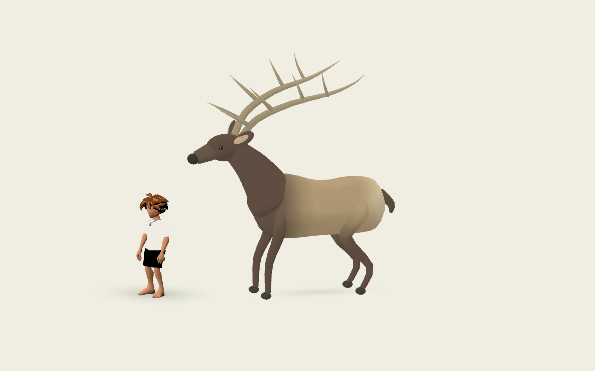
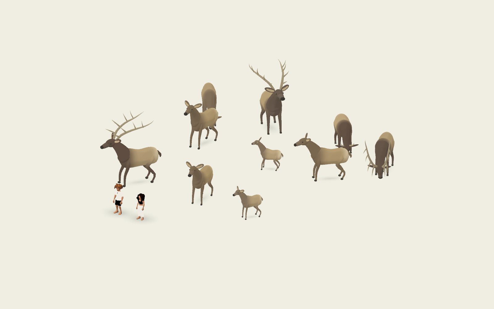
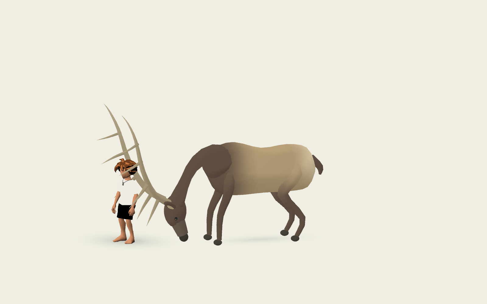

# Painterly elk

Use [`painterly_elk.tscn`](painterly_elk.tscn) for an individually placed animal, or
[`painterly_elk_herd.tscn`](painterly_elk_herd.tscn) for a seeded meadow group. The
root sits at the hooves; local **+Z is forward**. Both generate in the editor.

The forms use a continuous rounded torso, tapered curved limbs, dark neck/head,
pale rump and swept-back branched antlers. Smooth normals, soft toon bands and
broad pigment washes match the existing painted scenery. Coat/antler reference:
[Rocky Mountain National Park elk](https://www.nps.gov/romo/learn/nature/elk.htm).

## Single elk controls

| Control | Effect |
| --- | --- |
| Elk Type | Mature bull, cow, calf or young bull. Cows/calves have no antlers; young bulls have short spikes. |
| Prop Seed | Changes body proportions, coat tone, stance and antler asymmetry. |
| Elk Size | Scales anatomy, collision, contact shadow and placement anchors together. |
| Antler Size / Spread | Adjusts the mature or young bull's rack. |
| Body / Accent / Trim Color | Tan coat, darker mane/legs and pale rump. Antler Color is separate. |
| Idle Pose | Relaxed, slightly raised/turned alert head, or lowered grazing head. |
| Idle Motion / Speed | Breathing, slow head movement, independent ear flicks and occasional tail flicks. Zero motion holds the chosen pose. |
| Collision / Contact Shadow / Visibility Distance | The same rendering and authoring controls as other scenic props. |
| Recall Enabled / Anchor | Optional shared component recall; collision remains solid throughout. |

The feet remain planted. Neck, head, ears, eyes and antlers deform together in the
shader. There is no CPU animation callback or per-frame mesh upload. `seek_time(t)`
provides deterministic previews; pass a negative value to resume shader time.
`Approach`, `Shoulder` and `Head` markers describe the **rest pose**, not animated
attachment points.

The painted coat and idle shader live in the shared
`animals/shared/quadruped_paint.gdshaderinc`, also used by the
[mountain goat](../mountain_goat/README.md). Species-specific anatomy uniforms keep
the original elk pivots, poses and instanced-herd behavior intact.

## Herd controls

Count, Footprint and Minimum Spacing control seeded placement within an ellipse.
Bull Fraction and Calf Fraction set the population mix; remaining animals are cows.
Male groups include different mature racks and, from the third male, young bulls.
Heading/Heading Variation and Grazing Fraction vary orientation and posture.
Coat colors, size, animation, collision and recall remain editable on the herd root.

Spacing scales with Elk Size. If the requested population cannot fit, the herd
generates fewer animals and shows an Inspector warning. Expand the footprint or
reduce count; it never forces animals to overlap. Spacing measures body centers,
so leave extra space for very broad antlers and grazing heads when composing a scene.

Six shared variant meshes use at most **six opaque MultiMesh batches**, plus one
batched contact shadow. Each animal has its own pose, animation phase, tint and
motion strength. A coarse torso box per animal blocks explorers; antlers, heads
and individual legs have no separate collision. This is a stationary scenic herd:
there is no walking, fleeing, navigation or terrain/hoof IK. Place on reasonably
level ground; individually authored elk are convenient on uneven terrain. Grass
can surround the legs without adding the elk as a ground exclusion.

One elk uses one opaque mesh (about **8.2–9.6k triangles**, depending on type) and
one optional contact-shadow draw. Motion-aware bounds include grazing and the
largest supported antlers. Generated meshes, shapes and markers remain internal
and do not serialize into authored scenes. The herd resolves as one component
when recall is enabled; individual elk can be used for separate recall timing.

## Study and verification

Open [`tests/scenes/elk_test.tscn`](../../../tests/scenes/elk_test.tscn) and press
**F6**: bull/cow/calf in front, mixed grazing/alert herd behind, Soren and Vivian
for scale. This study does not register a timeline memory.

- `tests/elk_components.gd`: all four forms, deterministic seed/placement,
  geometry budgets, culling bounds, batching, collision with the real explorer,
  recall across rebuilds, crowded-footprint limits and scene packing.
- `tests/elk_render.gd`: Mobile renderer previews and image comparisons proving
  both single and instanced idles move, grazing lowers the head, and zero motion
  freezes each selected pose.

