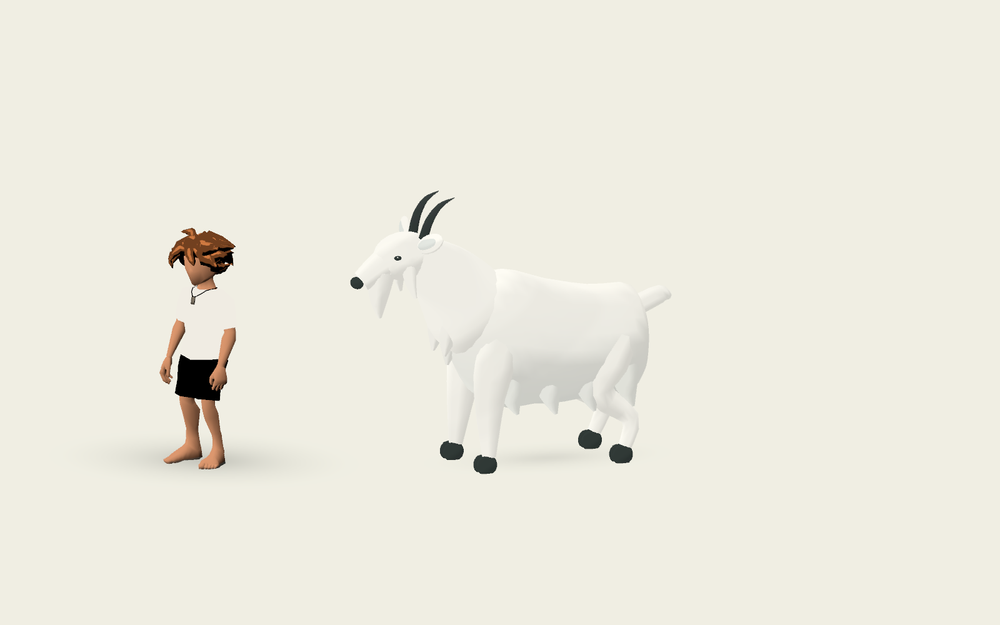
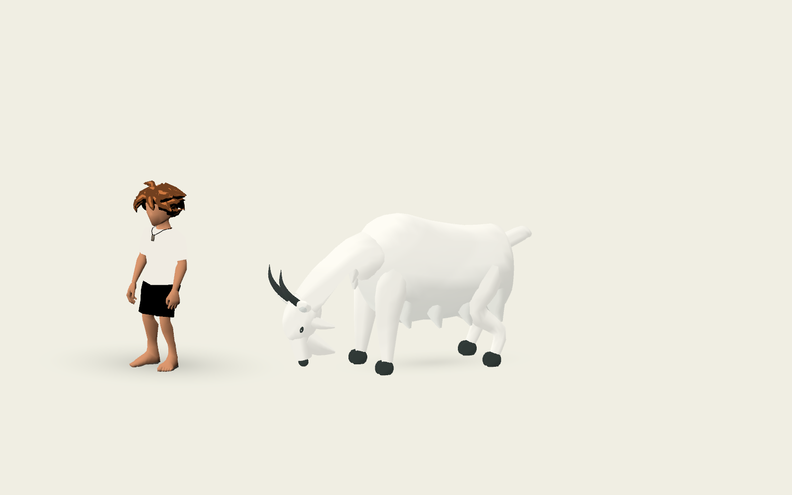

# Painterly mountain goat

Instance [`painterly_mountain_goat.tscn`](painterly_mountain_goat.tscn) for a fluffy
white mountain goat with dark backward-curving horns, a shaggy chest/beard and
split black hooves. The root is at ground level; **+Z is forward**. It generates in
the editor and uses the same smooth tapered geometry, broad pigment washes and
soft toon shading as the elk.

## Main controls

| Control | Effect |
| --- | --- |
| Goat Size | Scales the entire goat, collision, shadow and markers. Default adult is roughly 1 m at the shoulder. |
| Fluffiness | Broad coat contours, overlapping chest/underbody locks and beard length. Zero removes the optional coat locks. |
| Horn Length | Adjusts the two slim black horns; there are no separate sex/age variants. |
| Prop Seed | Small changes to proportions, stance, coat tone, horn asymmetry and idle phase. |
| Body / Accent / Trim Color | White coat, cool underside/inner-ear tint, and dark horns/nose/eyes/hooves. |
| Idle Pose | Relaxed, alert or grazing. |
| Idle Motion / Speed | Gentle breathing, slow head turns/nods, independent ear flicks and occasional tail movement. Zero motion holds the selected pose. |

Duplicate the component with a few different seeds/sizes/poses for a small group.
There is deliberately a single recognizable coat and horn style. For larger
background populations the elk's instanced-herd approach can be extended later.

The fluffy silhouette comes from a continuous shoulder-humped torso and a small
number of broad fur shapes; there are no fur textures, alpha cards or individual
hair strands. Shape reference: [Colorado Parks and Wildlife mountain goat](https://cpw.state.co.us/species/mountain-goat).

## Animation and integration

The goat reuses the elk builder's smooth curves, sweeps, ellipsoids, vertex paint
and articulated part encoding. Both animals share
`animals/shared/quadruped_paint.gdshaderinc`, with species-specific neck/ear/tail
pivots and grazing angles. Elk defaults retain their existing behavior.

The feet stay planted. Neck/head, horns, eyes, ears and beard move together in the
shader, with no per-frame CPU animation or mesh uploads. `seek_time(seconds)`
supports deterministic previews; a negative value resumes live shader time.

One opaque mesh (about **10.6k triangles** at default fluff), plus an optional soft
contact shadow. Motion-aware bounds include the grazing pose and maximum horns.
Collision is one coarse torso box; horns and individual legs have no collision.
Collision, shadow, visibility distance, pigment and optional assembled recall use
the existing scenic-component controls. Rebuilding preserves recall progress.
Generated visuals/physics stay internal and do not serialize into authored scenes.

This is a stationary scenic animal, with no walking, fleeing or terrain/hoof IK.
Place on level ground or a reasonably flat rock ledge. Grass can surround the legs
without adding the goat as an exclusion. `Approach`, `Shoulder` and `Head` markers
refer to the rest pose and do not track animated shader positions.

## Preview and verification

Open [`tests/scenes/mountain_goat_test.tscn`](../../../tests/scenes/mountain_goat_test.tscn)
and press **F6**. It shows relaxed, grazing and alert goats with a bull elk and
both explorers for scale. This component study does not add a timeline memory.

- `tests/mountain_goat_components.gd`: deterministic smooth geometry, triangle
  budget, scale/fluff/horn controls, motion bounds, real explorer collision,
  recall across rebuilds and scene packing.
- `tests/mountain_goat_render.gd`: Mobile previews, visible idle/grazing changes,
  and zero-motion freeze checks.
- Existing elk component and Mobile render checks cover the shared shader.

