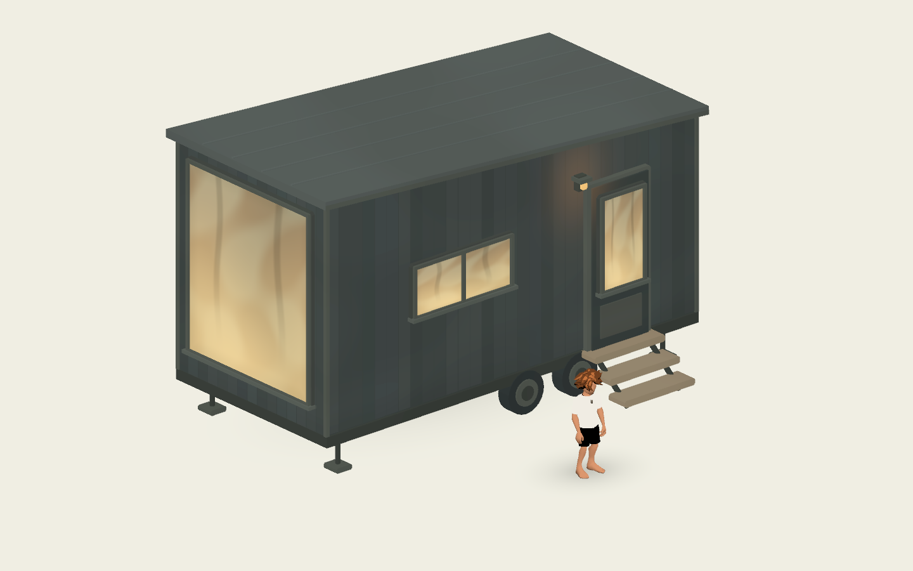

# Painterly postcard cabin

Instance `painterly_postcard_cabin.tscn` for a small trailer cabin exterior inspired
by the supplied references: charcoal vertical siding, a shallow shed roof, a large
end picture window, a low two-pane side window, glazed closed door, amber porch
lamp, tandem wheels, jack feet, and three small timber steps.

The origin is the footprint center at ground level. **Entry faces local +Z; the
large picture window faces -X.** The default footprint is 5.8 × 2.7 m, raised
0.58 m above the ground. The roof is highest over the picture window. It previews
and rebuilds in the editor; generated children remain internal and do not serialize.

| Inspector group | Controls |
| --- | --- |
| Cabin Shape | Footprint, Wall Height, Floor Height, Roof Rise/Overhang, Board Width |
| Exterior Details | Door Offset along the front, Side Window, Wheels, Steps, Porch Lamp |
| Painterly Colors | Siding, trim, roof, steps, hardware, glass; pigment, window warmth/glow, seed |
| Collision and Recall | Solid collision, soft contact shadow, optional assembled recall |

Use dimension exports instead of nonuniform scaling. Seed changes quiet plank
pigment; structural proportions stay consistent. Optional details are removed
from the mesh when disabled. Jack feet remain when wheels are hidden.

## Surface and performance

Reuses the arcade geometry primitives and the bungalow's broad pigment/soft toon
shading recipe. Siding has shallow geometric seams with restrained color variation;
the roof uses a few standing seams. Windows are **opaque painted glazing** with
soft forest reflections and warm amber pigment. Window Warmth blends those two
looks; Window Glow controls fixed emission. The lamp includes a faint painted
wash on the siding. No interior, opening door, real glass/reflection pass, dynamic
light, texture assets, or shadow-map pass is generated.

All exterior parts are batched into **one opaque mesh/surface, 2,142 triangles at
default settings**, plus one optional two-triangle soft contact shadow. There are
no per-board/window/wheel nodes, animation callbacks, or per-frame mesh updates.
Window and pigment controls update uniforms without rebuilding geometry. Both
mesh and shadow stop rendering past 80 m. Profile on target mobile hardware.

## Collision and placement

Solid convex exterior collision prevents entering the cabin, including through
the decorative closed door. The optional steps use a continuous sloped collider
to keep explorers from snagging on individual treads. The shell extends to the
ground for safe exterior movement. Disabling collision makes a scenery-only prop.

`get_anchor(&"FrontDoor")`, `get_anchor(&"Approach")`, and
`get_anchor(&"PictureWindow")` expose local placement markers. Approach is on
ground beyond the steps; FrontDoor is elevated at the threshold; PictureWindow is
an elevated detail marker, not a player spawn. With steps disabled the elevated
door remains decorative.

`excludes_ground_point(world_point)` and `ground_exclusion_changed` integrate with
groundcover exclusion lists, including when the cabin moves or rotates. Optional
recall uses the existing assembled adapter, preserves solid collision/progress on
rebuild, and fades the soft contact shadow with the shell.

This component contains the building only. Trees, groundcover, chairs and firepits
remain separate components for composing a memory.

## Preview and checks

Open **`res://tests/scenes/postcard_cabin_test.tscn` and press F6**. It inherits the
generic component test stage with a warm-white floor, three-quarter camera and
the shared explorer. WASD/arrows/joystick move; R reloads. The existing recall
selector tests optional manifestation. This study is not added to the timeline.

```sh
godot --headless --path . --script tests/postcard_cabin.gd
godot --path . --script tests/postcard_cabin_render.gd --windowed --resolution 1440x900 --rendering-method mobile
```

Checks cover seeded geometry, live window tuning, removable details, saved scene
settings, groundcover exclusion, recall, actual explorer travel up/down the steps,
and blocked entry. Real Mobile renders check warm/cool glazing and recall. Captures
are stored in `docs/previews/postcard-cabin-{overview,reflections,close}.png`.


