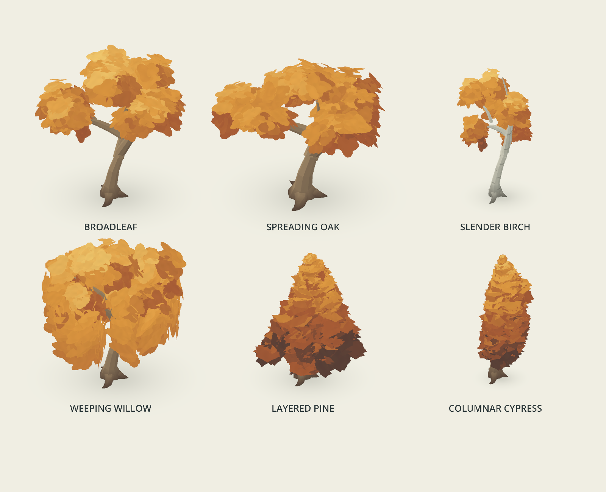

# Painterly procedural tree

Instance `components/foliage/painterly_tree.tscn` under a memory's `Environment`. Place its origin at ground level. The tree previews in the editor, rebuilds when authoring parameters change, and saves parameters rather than generated geometry nodes. It is present immediately, with no recollection or entrance animation.

## Tree variants

Choose **Tree Shape → Tree Type** on any instance of `painterly_tree.tscn`. All six types share seeds, palettes, wind, curved trunks, ground shadows, and optional trunk collision.

| Type | Silhouette |
| --- | --- |
| Broadleaf | Original rounded, irregular crown; existing scenes retain their appearance. |
| Spreading Oak | Wider, flatter crown with a heavier trunk. |
| Slender Birch | Airy, vertically staggered foliage and a narrow pale trunk with broken dark markings. |
| Weeping Willow | Arched limbs with dense, broad, overlapping curtains of hanging foliage. |
| Layered Pine | Tapered crown built from whorled evergreen boughs. |
| Columnar Cypress | Dense, narrow evergreen column with closely stacked growth levels. |

Types apply proportion multipliers to your authored dimensions, rather than replacing them. Combine the type with **Tree Seed**, height, width, bend, density, and a seasonal palette for variations within a forest. **Bark → Use Type Bark** enables birch's pale marked bark; disable it to use your own Bark Shadow / Light colors. Other types use those authored colors directly.



## Authoring controls

| Inspector field | Effect |
| --- | --- |
| Palette Preset / Palette | Shared seasonal and dreamlike foliage palette choices, or a custom `GrassPalette`. |
| Tree Type | Selects one of the six growth forms above. |
| Tree Seed | Repeatable trunk lean, branches, leaf clumps, sprays, and painted colors. |
| Tree Height / Crown Width | Overall proportions, in meters. |
| Trunk Radius | Stem thickness and root-flare size. |
| Trunk Bend | Seeded curve strength as a fraction of tree height; default 0.075. Roots stay fixed. |
| Branch Count | 4–10 deciduous canopy groups or pine levels. Deciduous groups share three unequal main limbs and a few thicker forks. Cypress uses twice as many levels, dividing the same foliage budget between them. |
| Leaf Sprays per Cluster | 0–240; default 120. Total sprays are `(Branch Count + 1) × density`, distributed by growth form. Zero removes foliage completely. |
| Bark Shadow / Bark Light | Warm wood palette, separate from foliage colors. |
| Wind Strength / Speed | World-space canopy sway plus phase-varied leaf flutter; default strength 0.09 m. Zero strength produces a still tree. |
| Trunk Collision | Four aligned capsules follow the bent lower stem and prevent walking through it; disable for decorative trees. |
| Visibility Distance | Culls the tree as a unit; bounds include a generous wind margin. |
| Regenerate Tree | Explicitly rebuilds the editor preview. |

Rotate around Y and translate freely. Use the height and width fields to author dimensions; scaling the node also scales the wind and collision. Tree roots assume a flat ground surface. Only the trunk has collision; canopy and branches remain walkable underneath.

## Painted foliage construction

The canopy is made entirely from curved leaf sprays distributed throughout branch-tip volumes. There is no underlying sphere mesh and no separate layer of leaf decorations. Each spray has three bent oval leaves with raised centers. Ten smaller growth clumps organize each branch-tip mass, giving neighboring leaves connected regions of light and shadow. Small shared world-space pigment variations break up the color without revealing triangle boundaries.

Staggered crown heights and three unequal curved leaders produce a readable tree structure and small gaps. Several canopy groups share each leader rather than sprouting separate thin twigs from the trunk. Main limbs and forks use six-point curved paths, gradual taper, and uneven oval cross-sections. Evergreens retain a stronger central stem with fewer visible, thicker boughs. Leaf forms break the silhouette into uneven brush-like edges. Ground pigment at the root flare and a feathered ground shadow connect the tree to the meadow. The palette and wind retain the grass's visual language. The existing grass component is unchanged. The trunk follows a seeded curve, with branch starts evaluated along that curve. A separate random stream keeps trunk curvature edits from reshuffling canopy foliage. Wind displacement is converted from world space into each scaled leaf instance, so small sprays retain visible movement. Gentle gusts move the canopy together while individual leaves flutter at varied phases. The trunk remains steady.

The previous **Leaf Dabs per Cluster** surface-detail control has been replaced by **Leaf Sprays per Cluster**, which controls the density of the entire canopy. Custom scenes that used the old property should use the new field.

Evergreens reuse the same volume placement and shader with a cached 24-triangle bough mesh made from two broad, overlapping scalloped brush masses. Pine and cypress use branching tiers with overlapping cores and a continuous tapered tip. Evergreen brush masses overlap and follow coherent clump orientations so the crown reads as painted boughs rather than individual needles. Willow reuses the broadleaf spray with wider hanging placement: two-thirds of each branch’s foliage budget forms six full cascading curtains. All types keep a single foliage MultiMesh rather than adding per-leaf objects.

## Rendering budget

The default deciduous tree has **25,914 triangles**, plus a two-triangle shadow plane, and **three geometry surfaces**: merged wood, one foliage MultiMesh, and shadow. A shared 30-triangle leaf-spray mesh is instanced 840 times at the default settings. At the same default density, pine has **20,874 triangles** and cypress has **20,874**, using the shared evergreen spray. All variants retain the same three geometry surfaces. The only transparent surface is the ground shadow; foliage is opaque, double-sided geometry with depth writes. There are no alpha cards, per-leaf nodes, shadow-map passes, or per-frame script updates or mesh uploads.

This uses more geometry than the earlier sphere canopy to make leaves form the silhouette and volume. It also removes a separate canopy draw surface. The demo measured **13 total draw calls and about 63,900 primitives**, including grass, player, and world, on Godot 4.4.1's Metal Mobile renderer. These are rendering counts, not an iOS frame-rate guarantee. For many trees, start with 50–80 sprays per cluster and profile on the target phone. Each tree is culled as one component; forest-wide batching and distance LOD are not implemented.

The cheap shadow lies at ground level; it does not dynamically shade grass leaves. Painted shadow colors establish the canopy's volume without dynamic lighting passes.

`scenes/memories/foliage_demo.tscn` contains a 3.7 m tree with a 3.1 m crown. `docs/tree-demo.png` shows the playable composition and `docs/tree-detail.png` shows the component more closely.

## Validation

```sh
godot --path . --script tests/tree_smoke.gd
godot --path . --script tests/tree_variants.gd
godot --path . --script tests/tree_wind_render.gd
```

The tree check needs a real rendering device because Godot's headless dummy renderer does not retain MultiMesh transform-buffer readback. It validates full seeded placement/color buffers, finite positions, volumetric leaf geometry, culling bounds, triangle budget, shared leaf meshes, independent palette materials, zero-density foliage, and optional collision. The tree has also been visually checked from two camera angles.

The wind rendering check isolates the tree and compares frames with strength zero and with wind enabled. The still tree must remain unchanged while the animated canopy visibly changes. The tree check also verifies that changing trunk bend alters bark geometry without altering the foliage distribution.

## Palette selector

Each component exposes **Foliage Colors → Palette Preset** in the Inspector. Choose seasonal or dreamlike colors, or edit a custom four-color mix. Palette changes preserve geometry and the painterly color distribution. See [the palette guide](PALETTES.md).

The variant check covers all six growth forms, deterministic rebuilding, shared meshes, geometry bounds, palette independence, type/palette scene persistence, birch markings, wind parameters, odd cypress density, and zero-density evergreen foliage. `docs/tree-variants.png` compares the types in an actual Godot render.

Wood generation has an independent seed stream. Trunk and limb refinements preserve the approved canopy transform/color buffers for every type. Lower-stem collision capsules follow the revised trunk curve.

Three thick, curved buttress roots replace the five small root spikes. Their taper sinks below the ground surface, and their proportions follow each tree type’s trunk thickness. They use the same painted bark and uneven cross-sections as the limbs, with an independent random stream to preserve canopy placement.

## Falling leaves

**Falling Leaves → Falling Leaf Count** sets the maximum leaf pool (0–128); zero removes the effect and its draw call. **Falling Leaf Rate** sets target emissions per second; zero hides the effect. Higher rates are limited by Count and the time needed for a leaf to fall. Increase Count if the desired rate cannot be reached. The demo enables a quiet 0.65 leaves/second on three trees; other trees remain unchanged.

Leaves start at seeded positions from the actual generated canopy, inherit its four-color palette, tumble and flutter with gentle wind, then fade near the tree's local ground plane. Their approximate downward speed is 0.55 m/s. They are decorative: no collision, accumulating leaf litter, or terrain-height sampling. Over water or uneven ground, the fade still uses the tree's local Y=0 plane.

Each enabled tree adds one MultiMesh batch, using a shared curved 10-triangle leaf mesh. Count changes rebuild only this batch, while Rate, palette, and wind edits update its material. Animation runs entirely on the GPU, with no per-frame script callbacks. Bounds cover the full descent and drift. Count and Rate are saved with the tree; all six variants support the effect, and trees without canopy geometry emit no leaves.

```sh
godot --headless --path . --script tests/falling_leaves.gd
godot --path . --script tests/falling_leaves_render.gd
```

Checks cover controls, palette updates, persistence, all tree types, bare trees, and preservation of canopy nodes. Captured-frame checks confirm falling motion with canopy wind disabled, and no motion when Rate is zero. `docs/falling-leaves.png` shows a denser single-tree preview (32 leaves, rate 4) than the demo uses.

## Proximity recall

Enable **Recall → Recall Enabled** on a tree instance's root. It defaults to off,
with complete editor previews. All 11 demo trees enable it and discover explorers
independently, using the type-adjusted crown footprint plus a 1.4 m margin. Either
player can trigger it; airborne arrivals and distant foliage do not.

The 4.5 second sequence first manifests trunk/branches upward, from pale pigment
into the existing bark colors. Wood is complete by 42% of the sequence. Canopy
sprays start unfurling at 24%, overlapping the finishing branches without a pause, and rise a short distance from their supporting branches and unfurl, using
the same leaf growth/color shader as bushes. Wind resolves into the normal motion.
The existing ground shadow develops with the tree. Trunk collision is enabled when
wood finishes; falling leaves stay hidden until the canopy is complete. Live falling
leaf count/rate edits respect that state.

The component owns its internal `TreeRecall` controller; no extra nodes are needed
in a memory scene. Toggle off to restore regular materials, shadow and collision.
Rebuilds preserve progress. Completed recall lasts for the visit. No extra geometry,
particles, or per-leaf CPU animation are added; all six tree types use this sequence.

Open `res://scenes/effects/tree_recall_test.tscn` and press F6 to replay, pause, scrub,
or change playback speed. Run `tests/tree_recall.gd` for state/variant checks, adding
`-- --capture` with a real renderer for empty, wood-only, canopy and completed images
in `/tmp/tree-recall-*.png`.
