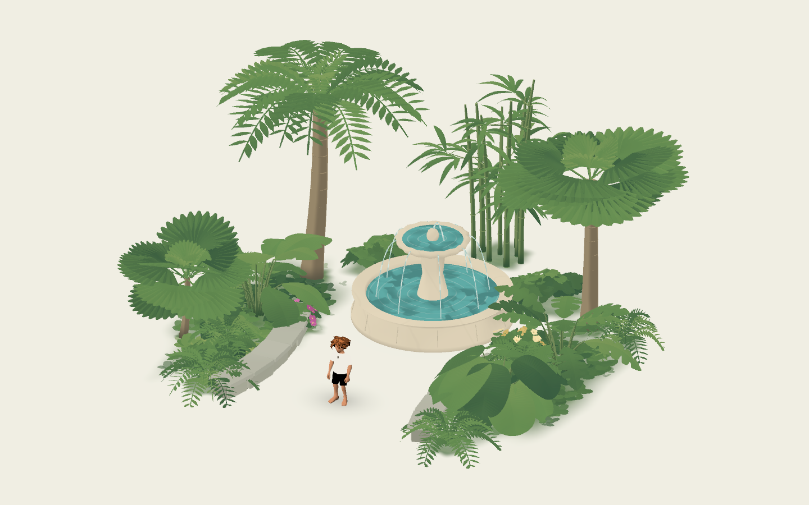

# Painterly jungle foliage

Four component scenes provide seven forms for layered tropical planting. Built
after reviewing the existing foliage library, memory design guide and supplied
conservatory photos. Existing bushes, grass and flowers supply the lower masses;
this adds the missing frond, fan, broad blade and cane silhouettes.

| Entry scene | Plant Form choices | Use |
| --- | --- | --- |
| `painterly_palm.tscn` | Feather Palm, Fan Palm | Tall canopy and lower fan palms |
| `painterly_tropical_broadleaf.tscn` | Banana-like Blades, Elephant Ears, Split Leaves | Overlapping understory leaves |
| `painterly_fern.tscn` | Fern | Low arching groundcover and path edges |
| `painterly_bamboo.tscn` | Bamboo | Clustered vertical screens |

All use `PainterlyJunglePlant`; the scenes save suitable starting dimensions and
any Plant Form remains selectable. Roots sit at ground level. Generated children
are internal; memory scenes store authoring settings instead of individual leaves.

## Controls

- **Form / Seed:** silhouette and repeatable individual growth.
- **Plant Height / Spread:** nominal meters; individual fronds/culms may extend
  beyond them. Use these instead of nonuniform node scaling.
- **Fullness:** frond/leaf count, or culm count for bamboo. Zero is a sparse plant.
- **Growth Curve:** palm bend or bamboo lean; hidden on other forms.
- **Foliage Colors:** shared seasonal/dream presets and custom four-color mix.
  Defaults share `palettes/conservatory.tres` with the other conservatory foliage.
- **Wind / Player Response:** shared strength/speed and smoothed two-player
  disturbance. Tip weights keep roots attached to stems.
- **Use Type Bark:** tan palm trunks or green stems/canes. Disable for custom bark
  colors. Ferns hide wood controls.
- **Trunk Collision:** simple palm/bamboo stem capsules. Broadleaf and fern foliage
  is decorative and passable. This control is hidden where it has no effect.
- **Recall / Visibility Distance:** existing assembled recall and whole-plant
  culling. Recall defaults off for studies; enable it on authored memory instances.

Regenerate Jungle Plant rebuilds geometry. Palette, wind and disturbance controls
update uniforms. `seek_time(seconds)` supplies a deterministic leaf clock; negative
time restores shader time. Explorer response remains independent of this clock.

## Appearance and performance

Feather palms and ferns have curved ribs and paired rounded leaflets. Fan palms
use broad folded fans with shallow scalloped fingers. Broadleaf forms have cupped
central ridges and controlled edge clefts; split leaves use real silhouette cuts.
Bamboo has bent culms, raised nodes and sprays of narrow leaves. Palms have rounded
leaf-scar bands. Wood reuses the existing tree's smooth tapered tube geometry and
toon bark. New leaves preserve the shared palette distribution with gentle folded
shading and broad pigment washes.

Immutable leaf/frond meshes are cached per form. Each plant uses **one MultiMesh
leaf surface**, one merged stem surface when applicable, and one feathered root
pigment plane. Fern uses only leaves and pigment. No per-leaf nodes, transparent
leaf cards, textures, particles, realtime lights, shadow maps or per-frame mesh
updates. Wind is GPU-only. The existing `canopy_response.gd` uploads smoothed
explorer sources; disabling React to Explorers removes that callback. Height gating
keeps overhead crowns from reacting to people below.

At Fullness 0.65, geometry is roughly: feather palm **8.1k**, fan palm **2.9k**,
banana/elephant ear **3.1k**, split leaf **4.1k**, fern **6.1k**, bamboo **11.5k**
triangles, plus each two-triangle root wash. Fullness increases geometry. Reduce
it on distant/repeated plants and profile the target phone; these counts are not
a mobile frame-rate guarantee. Forest-wide batching and distance LOD are absent.

Culling bounds cover actual instance transforms plus animation margins.
`excludes_ground_point()` clears small stem/culm footprints so existing grass can
blend around them. `ground_exclusion_changed` follows edits/transforms. Keep large
leaves outside the main approach and verify both explorers at camera size 3.5.
Recall shares progress across wood and leaves and preserves solid stem collision.

## Preview and validation

Open **`res://tests/scenes/jungle_test.tscn` and press F6**. It inherits the generic
component stage: palms above, bamboo behind, broad leaves in the middle, existing
bushes/grass below, ferns along the sides and small flower accents around the
conservatory fountain. The central approach stays walkable. This is a component
composition, not a timeline memory or greenhouse building.

Assign an individual scene to `tests/scenes/component_test.tscn` for isolated edits
and recall controls. WASD/arrows/joystick move the explorer; R reloads the subject.

```sh
godot --headless --path . --script tests/jungle_components.gd
godot --path . --script tests/jungle_render.gd --windowed --resolution 1440x900 --rendering-method mobile
```

Checks cover seven forms, valid geometry/root weights, shared caches, seeded
variation, live palettes, serialization, recall/rebuild, collision, actual explorer
travel toward the fountain, visible wind/response and stable paused frames in the
Mobile renderer. Captures live in `docs/previews/jungle-*.png`.



[Seven forms](../../../docs/previews/jungle-plant-forms.png), in row order:
feather palm, fan palm, banana; elephant ear, split leaf, fern; bamboo.
