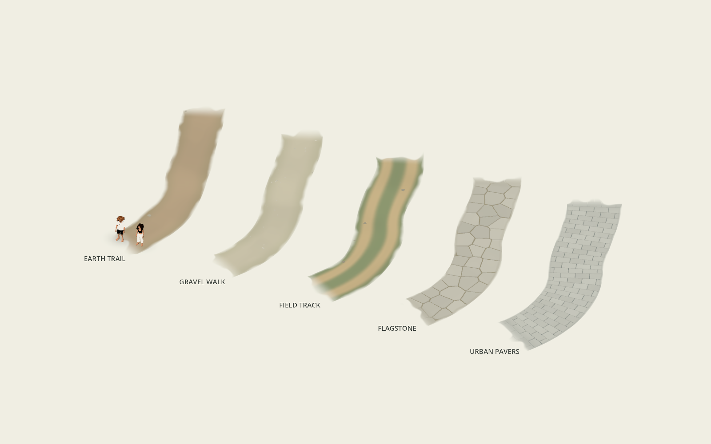
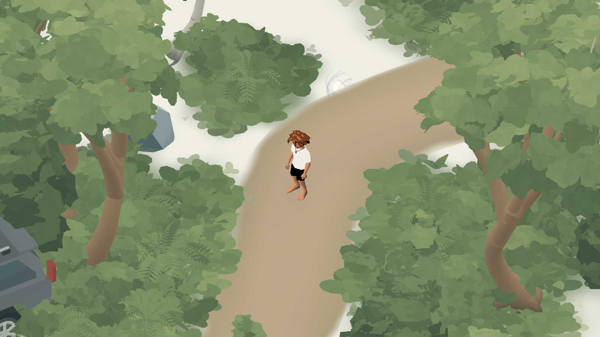
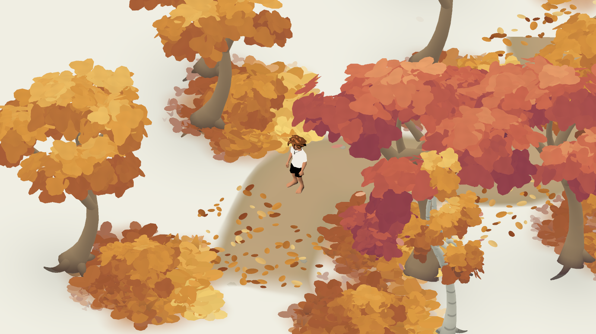

# Painterly paths and trails

Five reusable surface presets give winding routes different identities while
sharing the existing `PainterlyCurvedPath` route API and native **Path3D / Curve3D**
editor. They use matte paint, feathered/broken margins, real shallow surface relief
and one continuous walking collider. The original [sidewalk paving](../paving/README.md)
remains useful for concrete slabs and house approaches.

| Component | Character and use |
| --- | --- |
| [`earth_trail.tscn`](earth_trail.tscn) | Continuous worn soil, unequal shoulders and sparse embedded stones. Woodland hikes and natural slopes. |
| [`gravel_walk.tscn`](gravel_walk.tscn) | Pale compacted ground with small grouped stone accents. Shrine approaches, shore walks and parks. |
| [`field_track.tscn`](field_track.tscn) | Two softly worn lanes with a green median. Vineyard/farm aisles and countryside tracks. |
| [`flagstone_path.tscn`](flagstone_path.tscn) | Irregular Voronoi stone polygons, quiet joints and beveled edges. Gardens and informal stone footpaths. |
| [`urban_paver_path.tscn`](urban_paver_path.tscn) | Staggered rectangular setts following the bend. Courtyards, urban promenades and more formal walks. |

`painterly_surface_path.tscn` is the common configurable component. Select Surface
Style or begin with a preset. These are different materials/layouts on the same
authoring framework, so a route can change character without losing its curve.

## Authoring

Select the **Path3D root** and edit Curve points/Bezier handles in Godot. Points
describe the floor centerline and may change height. There is no automatic terrain
projection or banking from curve tilts. Use a supported memory platform below the
route; adjust curve heights explicitly on climbs, lookouts and deck connections.

| Control | Effect |
| --- | --- |
| Path Width | Nominal width in metres. Allows two passing lanes at the existing memories' widths. |
| Width Variation / Irregularity | Smooth, independently varied shoulders. Variation eases to zero at both endpoints so connections retain their intended width. |
| Crown Height | A gentle raised center; also eases to zero at the ends. The walking collider follows it. |
| Sample Spacing | Curve/ribbon tessellation; smaller values suit tighter bends. |
| Paving Seed | Repeatable shoulder shape, paint values, stones and paving layout. |
| Paving Color / Shoulder Color | Soil/underpainting and the quieter edge or median pigment. |
| Stone Color | Embedded stone or paver tone. All paint edits preserve the existing mesh. |
| Detail Density | Sparse stone accents on earth and gravel; hidden for full stone layouts. |
| Stone Size / Joint Width | Flagstone/paver size and spacing; hidden on earth/gravel. |
| Twin Tracks | Two worn lanes. The median remains walkable and allows existing grass through the exclusion mask; the path itself does not generate grass. |
| End Fade | X fades from the curve's start; Y fades toward its end, in metres. Zero gives a solid connection. |
| Edge Softness / Breakup Size | Feathering and the scale of the torn brush cells at the margins. |
| Collision Enabled | Continuous support on/off, independent of the visual stone joints. |

Keep bends broad enough for the chosen width. Extremely tight hairpins, folded
ribbons and self-intersections still require adjusting handles or narrowing the
path; the generator does not resolve arbitrary overlapping roads. Frames are
smoothed over a short span to avoid small baked-curve jitters.

## Geometry and integration

Earth/gravel are continuous ribbons, without the sidewalk's transverse slab
seams. Flagstones use locally generated Voronoi cells, not randomly scattered
surface decals. Urban setts use running bond. Stone caps and small beveled rims
sit just above the shallow support surface; joints never create physical holes
or a separate collider per stone. All layouts fade through the same brush margins.

The component inherits `get_path_length()`, `point_at(distance)` and
`get_route_points(from_ratio,to_ratio,spacing,height)`. Guidance/fragments continue
to use the authored centerline. Existing width/color/seed/fade properties remain
compatible; the old Slab Length property is hidden and unused by these surfaces.

`excludes_ground_point(world_point)` and `ground_exclusion_changed` integrate with
existing grass/foliage. Exclusions follow the varied tread and stop at the curve
caps, including when end fade is zero. The field track preserves its median.
Geometry, support and exclusions rebuild together when handles change. Generated
children remain internal, and there are no per-frame geometry updates.

One painted mesh/material and one triangle support shape per path. The raised
S-curve component check measured approximately **550–2,400 triangles**, depending
on treatment. Longer/wider routes and smaller stone sizes increase cost; use a
coarser Stone Size for distant paving. Surfaces remain static/visible like existing
paths, keeping walking routes readable during surrounding scenery recall.

## Reviewed memories

The review found the same curved sidewalk slabs recolored for most outdoor
settings. The following memories use the surface family:

| Memory | Applied surfaces |
| --- | --- |
| Bean and Bear Lakes | Earth trail on the forest, overlook climb, descent and camp approach. |
| Duluth / fall-colors hike | Earth on the hike and lookout; gravel along the shore; flagstones around the lighthouse and garden. |
| Tokyo | Gravel on Meiji's forest approach/connections; urban setts on the temple walk and connection to Shibuya. |

The original curves, heights, node paths, fragment placement and guidance sampling
are preserved. Shibuya's hidden crossing route and the actual road markings remain
their existing components. These scenes retain their existing memory platforms.

## Preview and checks

Open [`tests/scenes/path_surface_test.tscn`](../../../tests/scenes/path_surface_test.tscn)
and press **F6** for a labeled comparison beside both explorers. Load any preset in
the generic component stage for an isolated study.

- `tests/path_surfaces.gd`: all presets on a raised, rotated S curve; front-facing
  support across three lanes, finite geometry, bounded exclusions, median handling,
  route compatibility, deterministic seeds, handle edits, paint updates and packing.
- `tests/path_surface_render.gd`: Mobile comparison and five close views.
- `tests/path_memory_render.gd`: focused Mobile views in the four reviewed memories.
- Existing Tokyo, Bean/Bear, Vineyard and Duluth walkthroughs pass in both route
  directions, including fragments, requested guidance, raised floors and cameras.
  The original `tests/curved_path.gd` also passes. Existing Godot shutdown-resource
  warnings from the full-world checks remain.

