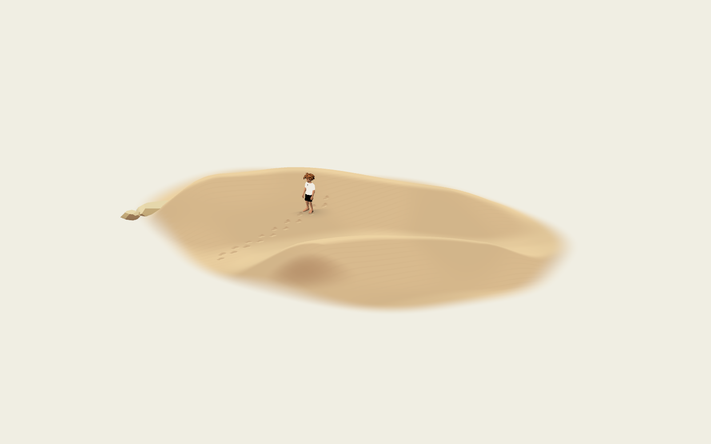

# Painterly sand and dunes

Instance [`painterly_sand_patch.tscn`](painterly_sand_patch.tscn) for sculpted, walkable sand. It inherits the [snow groundcover](../snow/README.md)'s footprint field, player stride tracking, custom outlines and exclusions, and adds seeded dune geometry with matching static terrain collision. Warm pigment, softened toon light and restrained wind ripples keep it consistent with the existing scenery.

## Shape and paint

| Inspector control | Effect |
| --- | --- |
| Surface Shape → Patch Size / Patch Seed | Oval coverage in local X/Z meters and repeatable dune/outline variation. |
| Custom Outline | Optional closed Curve2D in local X/Z meters, including concave or offset shapes. Overrides the oval. |
| Mesh Detail | Grid detail along the longest side, 32–96. Controls both visible terrain and its collision. |
| Ground Exclusions | Relative paths to ponds or other regions to leave uncovered. |
| Terrain Form | Wind-shaped Dunes for warped parallel crests with asymmetric shoulders, or Rolling Hills for rounded intersecting swells. |
| Dune Height | Relief amplitude in meters. Zero gives a shallow sand groundcover. |
| Dune Spacing | Distance between broad swells; larger values give fewer, wider dunes. |
| Dune Direction | Rotation of the generated dunes and fine surface ripples, in degrees. |
| Dune Crests | Optional hand-placed crests. Each entry stores local X, local Z, rise and half-length in meters. |
| Edge Feather | Distance over which terrain lowers toward its supporting ground, including pond edges. |
| Sand Color / Shadow Color | Light and shaded pigment colors. |
| Ripple Strength | Fine, broken wind ripples; zero removes them. |
| Ground Blend → Edge Color | Match the platform/void color at the softened outside edge. |
| Collision Enabled | Matching static triangle collision; disable for decorative scenery. |

The default patch is **16 × 12 m**, with **1.35 m** relief amplitude and **6.5 m** dune spacing. The terrain tapers at the perimeter, so its actual maximum height depends on seed, coverage and feathering. Narrow custom arms and small patches flatten naturally. For bigger hills, enlarge the patch along with Dune Height and Spacing. Very tall dunes with tight spacing can have slopes the explorer cannot climb; the default settings are tested with the real explorer. There is no automatic slope limiter.

With **Dune Crests** set, the authored crests replace the seeded swells. **Dune
Direction** runs across their slopes and **Dune Spacing** controls slope width.
Keep crests far enough apart to leave swales and test both directions of any
route that crosses them.

Keep the root upright; translation and Y rotation are supported. Author dimensions through the controls rather than root scaling. The root Y is the supporting ground level, not the dune crest. This component generates its own relief; it does not drape over a separate terrain mesh. Keep the memory platform beneath it for outer support and safe boundaries.

`get_surface_height(world_point)` returns the generated surface's world Y; `get_surface_normal(world_point)` returns its smooth normal. Use these after the component is ready to place an Entry marker, a fragment or small props on the dunes. The height is sampled from the continuous generating function; the physical mesh approximates it at Mesh Detail, so allow a small placement tolerance. These methods do not include temporary footprint depressions and do not test whether the sample lies inside coverage. Use `excludes_ground_point(world_point)` first when that matters.

## Footsteps

Players in the `explorers` group leave alternating shoe impressions while walking on the terrain. Each actor retains independent stride state. Standing still, teleports and airborne actors do not create connecting trails. Sand validates each stamp against its local dune height before reusing snow's timestamped field.

**Footprint Linger** controls the delay before marks begin to fill; **Footprint Fade Duration** controls restoration time. Defaults are **16 / 6 seconds**. Depth, shoe size, step spacing, tracking and 128²/256²/512² field quality remain editable. The default Detailed field retains readable shoes across the larger patch. Color, ripple and lifetime edits preserve existing trails; shape, seed, terrain, quality and exclusion edits rebuild the surface and clear its history.

`stamp_footprint(world_point, world_forward)` supports explicit animation events or future actors. Pass the actual terrain height, not the root plane. Impressions affect rendering and shading by a few centimeters; they do not rebuild collision. Fading is computed in the shader, and new steps are batched into one field upload per physics tick. No per-print nodes or decal draw calls are added.

## Cutouts and other groundcover

Add the sand instance to nearby grass patches' **Ground Exclusions**. Sand exposes `ground_exclusion_changed`, `excludes_ground_point()` and a world-space `get_ground_outline()` using the existing component conventions.

Ponds and other exclusions with `get_ground_outline()` carve the sand's actual geometry and collision, with a lowered, softened bank around the opening. Predicate-only exclusions are clipped at terrain-cell resolution and also use the inherited coverage mask. Use outlined regions for precise physical holes, and keep cutouts larger than a mesh cell. A fully excluded patch becomes empty without a mesh or collider. Avoid cyclic exclusions between components.

Use one Custom Outline for a connected dune field. Independent patches taper to ground at their boundaries; arbitrary overlapping patches are not a seamless terrain-tile system. Custom outlines must be simple and non-self-intersecting.

## Recall and implementation

**Recall Enabled / Recall Anchor** use the existing assembled reveal, defaulting to off. Collision remains present during recall so the explorer retains support. Shape rebuilds preserve recall progress. Recall affects the sand component independently of nearby scenery.

The default mesh has **7,852 triangles**, one opaque draw surface and matching static concave collision. Smooth normals follow the dune function. There are no texture assets to download, granular simulation, live erosion or per-frame terrain uploads. Fine ripples are analytic and filtered in screen space. The inherited footprint tracker runs during play, updates game-time fading and uploads only on new steps. A 512² two-channel float footprint field uses about **2 MiB** on the GPU, plus its CPU image and a static 128² exclusion mask. Phone performance still requires device profiling.

The snow component's only shared change is an empty-geometry guard for fully carved-away derived surfaces. Its existing shape, shading and footprint behavior are retained.

## Preview and validation

Open [`tests/scenes/sand_test.tscn`](../../../tests/scenes/sand_test.tscn) and press **F6**. It uses the shared component stage, with wind-shaped dunes and a second rolling-hill configuration beside the explorer. Walk from the ivory ground onto the dunes to create a trail. To test recall on one surface, assign `painterly_sand_patch.tscn` directly to the generic component stage.

```sh
godot --headless --path . --script tests/sand_components.gd
godot --path . --script tests/sand_render.gd --rendering-method mobile
godot --headless --path . --script tests/snow_outline.gd
```

Checks cover real explorer traversal and footprints at changing heights, collision/mesh agreement, deterministic relief, transformed concave outlines, physical pond cutouts, empty exclusions, recall, serialization and footprint persistence. Rendered checks verify visible slope impressions, stable linger, complete restoration and fresh marks after long play sessions. The existing snow outline check guards reuse compatibility.


