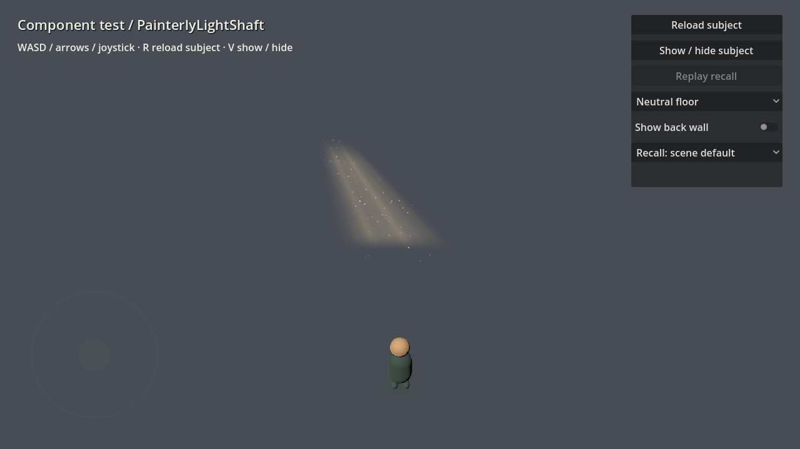

# Painterly light shaft and motes

Instance `res://components/lighting/light_shaft/painterly_light_shaft.tscn` with its
root at the center of the lit patch on the floor. It previews in the editor. The
component combines a warm, soft-edged shaft, slowly suspended dust motes, and an
optional pool from the existing light wash component.

The visual uses straight, slanted brush bands, softly feathered edges and muted
cream/gold colors. Painted variation stays inside the shaft without bending its silhouette. Motes are small oval pigment dabs with quiet individual drift and a subdued
edge tint. They fade before wrapping through the volume. The grounding wash connects
the shaft to the floor with a very slight breath. Neutral/darker interiors give the
shaft more contrast; it stays faint against the white void.

## Shape and placement

- **Beam Height:** source height above the floor.
- **Source Offset:** source position in local X/Z relative to the floor pool. The
  default (-1.5, -1.0) creates a gently slanted shaft; use this to meet a window.
- **Footprint:** lower beam width / mote depth / ground-wash dimensions.
- **Source Width:** width at the upper source; smaller values create more taper.
- **Light Color / Opacity / Paint Variation:** warmth, density and brush variation.
- **Shaft Seed:** repeatable mote phases, positions, sizes and painted variation.

Translate and rotate around Y to place it in a room. Keep the root at floor height
for proximity recall and the grounding wash. The camera-facing shaft follows the
source-to-floor axis as the camera moves. This is transparent painted geometry;
nearby objects retain their original lighting. Place light washes on other receiving
surfaces when composing a room.

## Dust and motion

- **Mote Count:** default 72, maximum 256; zero removes the mote draw surface.
- **Mote Color / Mote Edge Color:** pale center and muted pigment edge.
- **Mote Size:** minimum/maximum width in meters; keep it small for atmospheric dust.
- **Drift Speed:** gentle upward motion in meters/second. Zero freezes all three
  layers, including shaft breathing and the ground wash.
- **Wander:** small lateral meandering, independent of the upward drift.
- **Ground Wash Enabled / Intensity:** remove or tune the footprint's painted pool.
- **Visibility Distance:** cull the component surfaces at distance.

**Recall → Recall Enabled** defaults to off. Enable it to fade all three layers in
together over 1.8 seconds when either grounded explorer approaches. It reads the
shared `recall_settings.tres` distance. Rebuilds preserve progress and disabling
recall restores the full effect. Completed shafts stay present for that visit.

## Generic test stage

Open `res://tests/scenes/component_test.tscn` and press F6. Set **Subject Scene** to
`res://components/lighting/light_shaft/painterly_light_shaft.tscn`. Use Neutral/White/Dark floor presets to judge contrast, Show/Hide
to compare against the stage, and the Recall selector to test its entrance. R reloads
the subject; WASD/arrows/joystick move the explorer. Edit the component scene or a
saved variant to author its parameters, then assign that scene as the test subject.

## Budget and verification

The default component uses one two-triangle shaft ribbon, one MultiMesh of 72
camera-facing two-triangle motes, and one two-triangle grounding wash: three transparent
surfaces and 148 triangles. It uses no textures, per-mote nodes, physics, real-time
shadow passes, volumetric fog, or per-frame CPU particle updates. Normal motion runs
entirely in the vertex/fragment shaders. Only enabled recall needs a process callback.
Generated layers are internal; scenes store parameters. Bounds include the slanted
source, camera-facing width, mote size and wander.

```sh
godot --headless --path . --script tests/light_shaft.gd
godot --path . --script tests/light_shaft.gd -- --capture
```

Checks cover optional layer removal, independent materials,
geometry budget, live appearance, synchronized recall and rebuild state. Seeded
MultiMesh readback is checked with a real renderer. Actual
Metal Mobile captures in `/tmp/light-shaft-{neutral,white,dark,side}.png` verify views;
render comparisons check that zero drift is stationary and GPU motion is visible.
Profile overlapping shafts and large screen coverage on the target phone.


