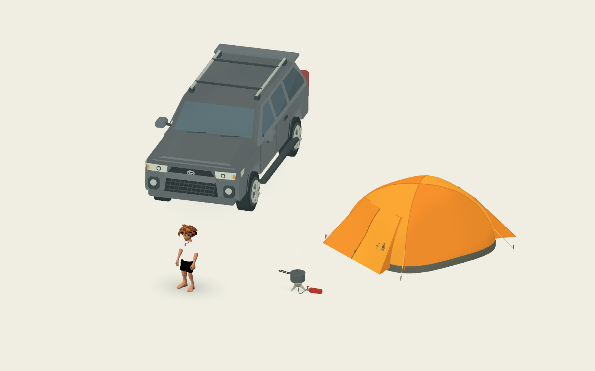
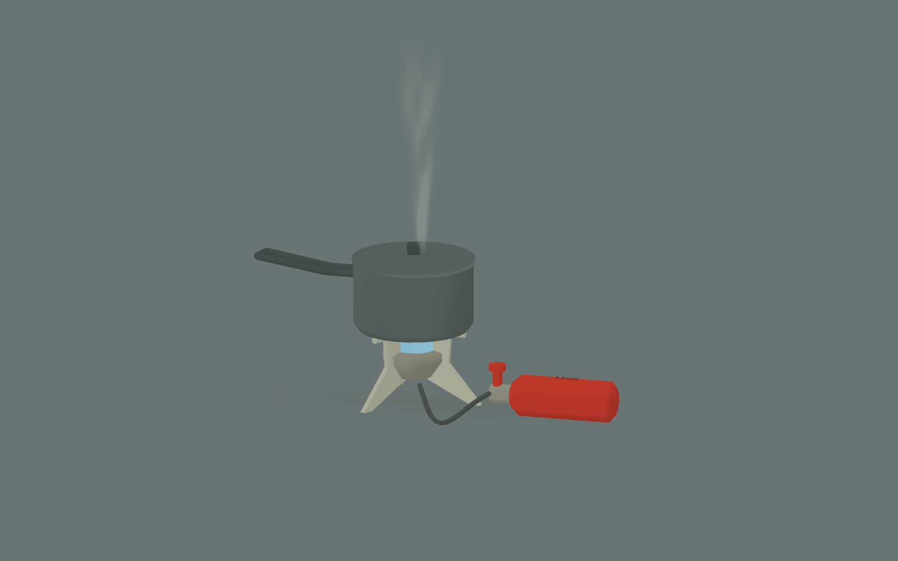

# Backpacking props

Three reusable components form a small camping study: the requested gray **2018 Toyota 4Runner**, an orange **Stormbreak-style tent**, and a **WhisperLite-style stove with pot and red fuel bottle**. All use the existing generated-mesh, collision, ground-exclusion and assembled-recall framework. Their origins are ground level; fronts/approaches face local **+Z**.

| Component | Scene |
| --- | --- |
| Gray 2018 4Runner | [`components/vehicles/four_runner/painterly_four_runner.tscn`](../../vehicles/four_runner/painterly_four_runner.tscn) |
| Orange tent | [`tent/painterly_stormbreak_tent.tscn`](tent/painterly_stormbreak_tent.tscn) |
| Stove, pot and bottle | [`stove/painterly_backpacking_stove.tscn`](stove/painterly_backpacking_stove.tscn) |

These are scenic props, with material and shape controls for memory authoring. The vehicle is parked, the tent fly defaults to closed, and the stove's cooking state is configured in the Inspector. Driving, door/tent entry and tap interactions are not implemented.

## 2018 4Runner

The model uses a long five-door cabin, raked windshield, actual wheel-arch cutouts, rounded tires, six-spoke wheels, side steps and mirrors, roof rails/crossbars, a stepped grille with Toyota oval, and a rear hatch with 4RUNNER lettering. A blank rear plate avoids inventing a personal registration. Body proportions are compressed and simplified for the game's painterly view, rather than a CAD-accurate vehicle replica.

**Body Color** defaults to cool gray as requested; **Accent Color** tints wheel metal, badges and rails, while **Trim Color** controls dark trim. **Roof Rack Enabled** removes the rails and crossbars when off. **Headlights Enabled** adds restrained lens emission; it does not project real-time light onto scenery. Body, windows and metal stay matte, with broad painted color variation rather than metallic reflections.

Approximate overall dimensions are 4.9 m long and 1.9 m high, with a 1.9 m body width and wider mirrors. Uniform root scaling works when a memory needs different scenic scale. The single coarse vehicle collider blocks the exterior, including the wheel area. Disable Collision Enabled for distant placements. Placement markers are `Front`, `Rear`, `DriverDoor`, `PassengerDoor`, and `Roof`; use `get_anchor(&"DriverDoor")` to retrieve one.

## Orange Stormbreak-style tent

**Footprint** controls the rounded rectangular main canopy. The two closed vestibules extend **0.28 m** from each Z end, with tensioned orange/gold fly panels, zipper lines and pulls. Crossed curved roof seams, a dark bathtub hem, stakes and guy lines echo the supplied photograph. The projected quarter-dome mark and stacked NORTH FACE wording can be disabled through **Brand Mark Enabled**.

| Control | Effect |
| --- | --- |
| Footprint | Main canopy width X / length Z; default 2.5 × 2.65 m. |
| Tent Height | Relief above the 0.07 m hem; default 1.2 m, giving a 1.27 m peak. |
| Front Vestibule Open | Roll back half of the front fly to reveal the inner mesh door. |
| Guy Lines Enabled | Toggle the four tie lines and stakes. Lines are decorative and have no trip collision. |
| Brand Mark Enabled | Toggle the small cloth wordmark and quarter-dome motif. |
| Wind Strength | Slight movement of the fly panels, with edges and pole seams pinned. Zero freezes the cloth. |
| Body / Accent / Trim Colors | Orange main fly / gold panel mix / dark hem, stake and zipper details. |

The closed canopy and vestibules have one convex collision shell. Exterior access is available at the `Approach` marker, with `Door` and `Peak` attachment markers. Footprint and Height edit the model directly; use these rather than nonuniform root scale. The outer fly is a stylized interpretation of the supplied orange reference, with editable proportions rather than a claim of exact manufacturer floor dimensions.

## WhisperLite-style cooking setup

The single component includes three splayed metal legs/pot supports, compact burner, small blue flame crown, a separate horizontal red liquid-fuel bottle with pump, flexible dark hose, and a charcoal pot with folding handle. The MSR label is generated geometry. The lid has a small knob and optional rising wisps of steam.

| Control | Effect |
| --- | --- |
| Gear Scale | Uniform model, collider, marker and steam scale; default 1, range 0.75–2. |
| Pot Enabled | Remove the pot, handle, lid and steam for a bare burner setup. |
| Lid Enabled | Show or hide the pot lid. |
| Pot Radius | Tune pot size, 0.11–0.22 m; default 0.145 m. |
| Burner On | Enable the compact blue flame and any configured steam. Off stops both without replacing meshes. |
| Steam Enabled / Strength | Toggle the steam layer / tune its subtle opacity. Steam requires a pot and Burner On. |
| Body / Accent / Trim Colors | Pot / red fuel bottle / legs, supports and burner metal. |

At default scale the setup is intentionally much smaller than an explorer: the pot is roughly 0.29 m wide and its lid is about 0.37 m above ground. Increase Gear Scale slightly when scenic readability matters more than literal scale. Markers are `Approach`, `Burner`, `PotTop` and `FuelBottle`. Place the root on the supporting ground or rock surface; the model does not conform to irregular terrain. Two small box colliders cover the cooking assembly and bottle. There is no heat/damage or cooking gameplay simulation.

## Shared rendering and placement

All three expose Body/Accent/Trim colors, Prop Seed, Pigment Strength, collision/contact-shadow toggles, Visibility Distance and optional Recall Enabled/Recall Anchor. Each main model is one opaque mesh surface. The stove adds one faint, camera-facing steam quad; contact shadows add one small plane per prop. Motion runs in shaders, with no per-prop CPU frame callback or mesh uploads. Tent and steam culling bounds include their motion/orientation.

Default opaque triangle counts are **11,251** for the 4Runner, **9,993** for the tent and **2,926** for the stove/pot/bottle. Optional details and tent/pot settings affect these counts. Small badges and wire details use simpler cross-sections while the tires, pot and canopy retain smooth silhouettes.

`seek_time(seconds)` provides deterministic cloth/cooking previews; pass `-1` to resume the shader clock. Animation controls preserve existing geometry; shape/detail changes rebuild it. Recall includes the steam and preserves progress through rebuilds. Collision remains in place during the reveal. Generated children stay internal and do not serialize as individual parts.

Use each prop in nearby grass **Ground Exclusions**. Their `excludes_ground_point(world_point)` methods and `ground_exclusion_changed` signals follow the shared library convention. Keep a memory platform beneath the composed campsite for supported ground and safe outer boundaries. These props and the study do not add a timeline memory or personal story text.

## Preview and validation

Open [`tests/scenes/backpacking_test.tscn`](../../../tests/scenes/backpacking_test.tscn) and press **F6**. It inherits the shared component stage, with all three props and the explorer for scale; the walking approach stays open between car and tent. Individual source scenes can also be assigned to the generic stage for isolated recall/parameter studies.

```sh
godot --headless --path . --script tests/backpacking_components.gd
godot --path . --script tests/backpacking_render.gd --rendering-method mobile
```

Component checks cover finite geometry/normals, budgets, repeatable generation, collision and real walking clearance, grounding exclusions, parameter/variant behavior, saved settings and recall including the stove's steam. Render checks verify moving/frozen cloth and active/off cooking effects. Captures live in `docs/previews/backpacking-*.png`. Phone performance still requires device profiling.





## References

The supplied orange tent and stove/pot photographs are the primary art references. Manufacturer material was checked for the [Stormbreak's two-door/vestibule layout](https://www.thenorthface.com/en-us/p/bags-and-gear/camp-shop-829877/stormbreak-2-NF0A8BDM), the [WhisperLite's compact liquid-fuel assembly and flexible hose](https://cascadedesigns.com/products/whisperlite-stove), and [Toyota's 2018 4Runner photo album](https://pressroom.toyota.com/album/2018-toyota-4runner/). Gray [front-quarter](https://www.carmax.com/cars/toyota/4runner/sr5/2018) and [rear-quarter](https://www.groovecar.com/inventory/2018-toyota-4runner-sr5-5171526.html) photographs informed the vehicle's color and trim shapes. No reference photographs or downloaded model assets are bundled; all supplied geometry and material effects are procedural.
