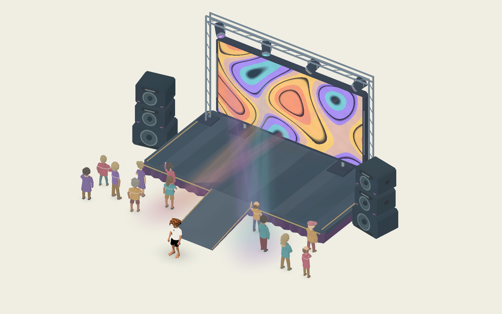

# Painterly concert components

Four reusable components for an open concert/rave memory. All preview in the
editor, store exported parameters rather than generated geometry, face local +Z,
and use meters. Their roots sit on the supporting floor.

| Component | Scene | Main controls |
| --- | --- | --- |
| Stage | `stage/painterly_stage.tscn` | Footprint, Deck Height, Ramp Enabled/Width/Length, colors, seed |
| Speaker stack | `speakers/painterly_speaker_stack.tscn` | Cabinet Count/Width/Depth, Subwoofer Enabled, colors, cone motion, BPM/phase |
| Rave lights | `lights/painterly_rave_lights.tscn` | Light Count, Rig Width/Height, Supports Enabled, palette, intensity, sweep/rhythm |
| Visual screen | `display/painterly_concert_screen.tscn` | Display Size, Bottom Height, Supports Enabled, graphic family, visual tempo, palette, brightness/glow |

## Library review and composition

Built after reviewing `docs/MEMORY_DESIGN_GUIDE.md`, arcade props, light shaft,
light wash, crowd, smoke, and memory platform. The remaining gaps were a walkable
performance deck, independent PA stacks, a moving lighting rig, and a large
animated visual display.

The kit reuses the arcade geometry builder, its broad pigment/toon shading recipe,
soft contact shadows, and optional assembled recall. Colored beams and floor
pools reuse the existing light-shaft and light-wash shaders. Stage boards and
cabinet paint use repeatable seeded variation.

`concert_setup.tscn` arranges a stage, rig, large display, two stacks, and the existing crowd with
a clear center approach. It is a component study, not a timeline memory or an
autobiographical scene. Keep a real venue open to the ivory void; add selected
smoke, foliage, and crowd groups around it. A real memory still needs its authored
platform, zones, fragments, ambience, and walking route.

## Stage and walking space

Broad deck boards, chamfered floor corners, a softly folded plum apron, and inset
trim keep the engineered shape consistent with the painted scenery. The optional
front access ramp has continuous convex collision matching its visible slope.
The default width is 1.6 m, leaving room for both explorers.

Use `get_anchor()` with `DeckCenter`, `Performer`, `LightingRig`, or `Approach`
(the last exists when the ramp is enabled). These are local placement hooks, not
interaction controllers. Stage collision does not replace MemoryPlatform: place
the deck and its approaches on supported memory ground.

## Speakers

A stack combines an optional subwoofer with one to four main cabinets. Cones,
horns, handles, ports, and fittings use painted shapes instead of a noisy grille
texture. Each cabinet has a simple solid collider. A small cone pulse runs in the
vertex shader; zero BPM or zero Cone Motion holds it still. Cabinets stay still.
`Top` and `Front` placement anchors are available.

Music/ambience belongs to the memory/zone's existing Audio routing. BPM here is a
visual tempo, not audio analysis or automatic synchronization to a music track.

## Moving-head lights

The open truss can omit its supporting uprights. Fixtures pan/tilt to meet moving
targets; every painted shaft begins at the moving lens. Targets have optional
softly feathered pools. Crossing Fans, Slow Waves, and Still control composition.
Sweep Speed zero holds the fan arrangement while the independent BPM pulse can
continue. BPM zero holds brightness steady. Pulse Amount gives restrained
continuous breathing rather than hard flashes. An empty palette falls back to violet.

**Receiving Height** is relative to the rig root: the starter rig sits on a 0.45 m
deck, with Receiving Height -0.45 to paint ground-level pools. Set 0 for pools on
the deck. Match this flat receiving plane to the authored surface. These are
translucent painted meshes; they do not project lighting/shadows onto arbitrary
scenery or require real-time lights/volumetric fog. They work with unshaded props.

## Animated visual screen

`display/painterly_concert_screen.tscn` is a 5.4 × 2.6 m canvas in a chamfered
painted case. The optional feet let it stand alone; disable Supports Enabled to
mount it behind a stage or against scenery. Display Size and Bottom Height alter
the canvas, frame, collision and anchors together. Local +Z is the viewing side.
`DisplayCenter`, `RearMount`, and `Front` anchors support placement.

Auto Mix cycles six animated graphic families: Liquid Pigment, Kaleidoscope,
Brush Bars, Paper Prisms, Orbiting Halos and Painted Sunburst. Each family appears
once per six-image round, with alternating order and seeded color variation.
Select a single family to hold its composition while its shapes keep moving.
Broad pigment pools, softened graphic edges, a matte bezel and subtle glow connect
the luminous display to the existing painterly props.

**Beat BPM / Beats per Pattern** set the switching interval: defaults of 120 / 1
give two graphics per second. Playback Speed scales both motion and switching;
zero freezes the full image. BPM zero holds the first family but keeps its shapes
moving. Transition Duration controls a short irregular brush wipe, capped below
half the switching interval so rapid sequences still resolve each graphic.
These controls use visual time, not audio input. Brush Bars is a graphic, not a
live audio spectrum. `seek_time(seconds)` can follow an authored music clock;
`seek_time(-1)` restores normal GPU time.

Aurora, Ember, Electric and Dream Pastel offer four-color mixes; Custom exposes
four editable colors (short/empty arrays use fallbacks). Ink Color controls the
negative space. Brightness, Emission Strength, Paint Amount and Halo Enabled tune
the finish. Emission makes the surface luminous; the optional feathered halo
provides glow without requiring bloom. It does not illuminate nearby props.

## Collision, recall, and groundcover

Each component has Collision Enabled, Contact Shadow Enabled, Visibility Distance,
and Recall Enabled. Add its node path to a grass patch's Ground Exclusions;
`excludes_ground_point()` and `ground_exclusion_changed` follow the library convention.

Recall defaults off. If enabled, hardware resolves through the existing assembled
recall adapter; beams and pools turn on after it completes. Rebuilds preserve
progress, disabling recall restores the complete prop, and collision stays safe.
Generated children are internal. Use dimension exports rather than nonuniform
Node3D scaling. Appearance/tempo edits update materials; shape/color edits rebuild
the appropriate mesh, never per frame.

## Preview and validation

Open `res://tests/scenes/concert_test.tscn` and press F6. It inherits the existing
component test stage, with a warm-white floor and three-quarter overview. WASD,
arrows, and joystick move the explorer. Walk the central ramp to explore the deck.
R reloads the arrangement. The existing panel changes floor color. For an isolated
study with recall controls, assign one component to Subject Scene in
`tests/scenes/component_test.tscn`; adjust Camera Size/Focus for a close view.

```sh
godot --headless --path . --script tests/concert_components.gd
godot --headless --path . --script tests/concert_screen.gd
godot --path . --script tests/concert_render.gd --windowed --resolution 1600x1000
godot --path . --script tests/concert_screen_render.gd --windowed --resolution 960x600
```

Checks cover seeded paint, independent materials, optional layer removal, lens/beam
alignment, culling bounds, recall/rebuild state, actual explorer travel up/down
the ramp, visible light motion, and repeatable paused frames. Screen checks cover
independent instances, live material updates, mounted variants, saved parameters,
recall, six distinct rendered graphics, visible internal motion, switching and
pausing. Captures are saved in `docs/previews/concert-components-{overview,close}.png`
and `concert-screen-{close,patterns}.png`. Add `-- --capture` to the screen render
command to write deterministic animation frames into `/tmp/memories-concert-screen-frames`.

Stage and speakers each use one opaque mesh plus an optional contact shadow.
Cone motion is GPU-only. The default rig uses one truss, four fixtures, four
two-triangle beams, and four two-triangle pools: 13 render surfaces. One callback
updates four fixture transforms, targets and material parameters, without rebuilding
meshes. No real-time lights or cast shadow passes are added. Limit overlapping
full-screen beams and profile on the target phone before increasing rig counts.

The screen adds one opaque case, one two-triangle opaque canvas, an optional
two-triangle halo, and an optional contact shadow. Its graphics use shader math
without texture assets, video decoders, SubViewports or CPU frame callbacks.
Only the short wipe renders two graphic families at once. Pixel cost scales with
visible display area; mobile performance still needs measurement on target hardware.



[Animated screen preview](../../../docs/previews/concert-screen-animated.gif)
· [Six graphic families](../../../docs/previews/concert-screen-patterns.png)
