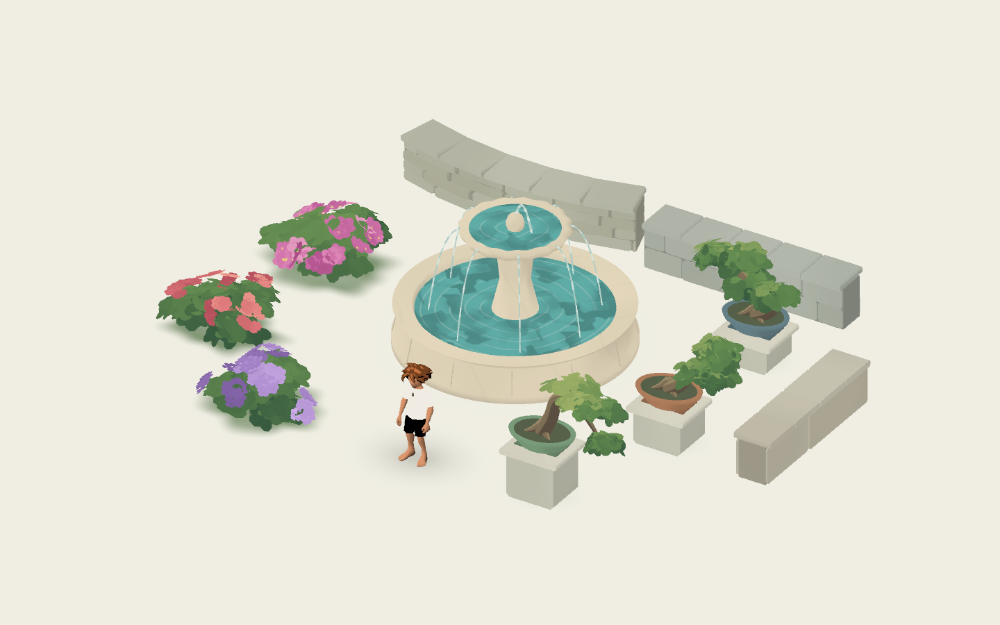

# Painterly conservatory components

The complementary [jungle foliage kit](../../foliage/jungle/README.md) adds seven
tropical forms and a layered fountain garden. Run `tests/scenes/jungle_test.tscn`
with F6 for that planting study.

Five reusable, editor-previewable components for the Como conservatory memory and
future gardens. Built after reviewing `docs/MEMORY_DESIGN_GUIDE.md`, the supplied
photos, existing bushes, flowers, trees, bungalow/arcade/museum stone, and pond water.
They preserve the warm-white void, broad pigment/toon shading, soft silhouettes,
seeded geometry and batched rendering. The greenhouse architecture and the actual
memory composition are separate from this component study. The playable memory is
documented in [the Como guide](../../../scenes/memories/como_conservatory/README.md).

| Component scene | Main controls |
| --- | --- |
| `../../foliage/flower_bush/painterly_flower_bush.tscn` | Flower Style, Count, Size, main/highlight/center colors; inherited bush size, seed, foliage palette and wind |
| `walls/painterly_stone_wall.tscn` | Stacked Stone / Cut Blocks / Large Slabs, Length, Height, Thickness, Curve Degrees, coping, color and seed |
| `fountain/painterly_marble_fountain.tscn` | Basin Radius, Fountain Height, marble/water color, Water Enabled, Flow Speed |
| `../../foliage/bonsai/painterly_bonsai.tscn` | Twisted Upright / Windswept / Half Cascade, Height, Spread, Trunk Curve, Canopy Fullness, pot color, optional pedestal; inherited seed/palette/bark/wind |
| `frame/painterly_greenhouse_frame.tscn` | Footprint, Eave Height, Roof Rise, Rib Count, Open View Side, Frame Color, collision and recall anchor |

## Flower bushes

`PainterlyFlowerBush` extends the existing `PainterlyBush`. The irregular leafy
mounds, shared leaf sprays, foliage palettes and ground pigment remain in place.
Blossoms occupy small growth clusters on the upper/outward surfaces of those
mounds; they do not create a separate ground layer or grow tall stalks.

Open Petals uses rounded five-petal crowns with warm centers. Ruffled Rosettes
overlaps two seven-petal cups. Clustered Florets groups five smaller crowns into
one head. Geometry reuses the existing flower patch's approved petal generator.
Main and Highlight colors preserve the leaf shader's painterly light distribution;
Center Color applies to Open Petals. Flower Count counts **heads**, including five
small flowers per head for Clustered Florets. Size and count affect geometry;
color edits update uniforms without changing placement.

The flower layer uses the same shader, wind phase, anchored motion and smoothed
two-explorer disturbance uniforms as the leaves. The shared canopy shader's new
center-pigment switch defaults off for existing trees/bushes. Zero Flower Count
leaves an ordinary bush; zero Sprays per Mass removes blossoms as well as foliage.
The default is 56 open heads: **8,722 triangles**, three render surfaces including
the existing feathered ground wash. Rosettes and florets cost more per head.
Each style's immutable head mesh is cached across component instances.

## Stone walls

Walls run along local X with a ground-center origin. Length is centerline arc
length. Curve Degrees bends the centerline symmetrically; zero is straight.
Stacked Stone uses shallow irregular polygonal pieces, Cut Blocks uses staggered
chamfered masonry, and Large Slabs uses broad plates. All have restrained seeded
pigment, shallow mortar joints and optional slightly projecting coping stones.

`point_at(t)` and `yaw_at(t)` describe the centerline. `get_anchor(&"Start")` and
`get_anchor(&"End")` expose endpoints/tangents: align one module's Start transform
to another's End to extend a wall. Dimensions, coping and material stay independent
per module. Keep a consistent height/thickness when joining. Extreme tight arcs
with wide/deep blocks can show small overlaps; shorter modules provide more control.

One opaque mesh contains the entire wall. Simple convex blockers follow the arc
rather than using a large enclosing box. Collision Enabled removes all blockers
when disabled. Groundcover exclusion follows the curved footprint and transforms.

## Marble fountain

The fountain interprets the reference's broad molded basin and fluted upper bowl,
using an original hourglass pedestal and simple central finial. Smooth radial
normals avoid sharply faceted round surfaces. Quiet mineral washes suggest marble
without photographic texture. Root is at ground center; height controls the stone
profile, and the small water jet rises slightly above it.

Two opaque water surfaces, a central jet and eight delicate overflow arcs form
one water batch. It reuses the pond's authored pigment/caustic masks, with crossing
wave distortion, broken ripple arcs and moving highlights. No particle simulation,
screen/depth sampling, transparent glass, realtime reflection or extra lights.
Flow Speed zero freezes all water motion; Water Enabled false removes it entirely.
`seek_time(seconds)` supports an authored clock; negative values restore GPU time.

The default fountain uses **4,738 triangles** across three surfaces: sculpted stone,
water, and contact shadow. Motion stays on the GPU. A solid cylindrical basin
collider blocks explorers from entering the water. `Center` is a water-level detail
anchor; `Approach` is a ground-level placement marker outside the rim.

## Bonsai

`PainterlyBonsai` extends the existing tree, reusing its smooth tapered wood,
organic branch curves, shared curved leaf sprays, clump pigments, seasonal palette,
wind and optional player response. A few substantial branches support layered,
flattened leaf pads; these are not scaled-down canopy spheres. Three root flares
stay within the soil tray. Seed changes trunk curvature and leaf organization.

Bonsai Height is plant height above the soil; the 0.24 m tray and optional pedestal
add to it. Spread changes crown reach, Trunk Curve shapes the main scaffold, and
Canopy Fullness changes sprays per pad. The Half Cascade arches over the tray and
descends beside it; a pedestal makes that silhouette easy to see. Pot Color does
not affect leaf palettes. Forest-only settings and falling leaves are hidden in
the Inspector. Use dimension controls instead of nonuniform node scaling.

A typical default bonsai is about **10,000 triangles** across wood, instanced
foliage, ceramic tray/pedestal and one contact shadow. Wind is shader-driven; the
existing optional explorer response updates only smoothed sources. Trunk Collision
controls a simple tray/pedestal blocker; decorative leaves/branches have no separate
colliders. Groundcover exclusion covers the tray footprint.

## Greenhouse frame

A small number of thin barrel-vault ribs and five longitudinal members suggest
the teal glasshouse architecture while keeping the elevated view open. There is
no opaque roof, glass fill or complete enclosing building. **Open View Side**
omits the near/east half by default for the shared three-quarter camera. One painted batch
reuses the existing conservatory scenery material and assembled recall. Optional
post collision stays outside the central walking space. Use **Recall Anchor**
for a reachable room approach. The existing component study still demonstrates
the original four families; the full Como memory composes all five.

## Recall, placement and preview

All five save parameters rather than generated geometry. Recall Enabled defaults
off and uses the existing assembled recall adapter, with shared material progress
for foliage/blossoms/stone/water and safe collision during manifestation. Rebuilds
preserve recall progress. These classes retain shared Memory Audio/LAN behavior;
no personal story text, timeline entries or interactions are added by a prop.

Walls, fountain and bonsai expose `excludes_ground_point()` and
`ground_exclusion_changed` for grass/snow exclusion lists. Flowering bushes remain
decorative groundcover and can blend into grass. Use several small groups with
varied seeds and leave a clear walking route around basins and displays.

Open **`res://tests/scenes/conservatory_test.tscn` and press F6**. This inherits the
generic component stage, adding three flower treatments, three wall treatments,
three bonsai forms, the fountain and an explorer for scale. It is a library study,
not the authored memory. For isolated editing/recall, assign a component's scene to
`tests/scenes/component_test.tscn`.

```sh
godot --headless --path . --script tests/conservatory_components.gd
godot --path . --script tests/conservatory_render.gd --windowed --resolution 1440x900 --rendering-method mobile
godot --path . --script tests/bush_smoke.gd
```

Checks cover variant silhouettes, count/zero-count handling, palette updates,
shared smooth disturbance sources, seed repeatability, curved wall connectors,
groundcover exclusions, saved scenes, recall/rebuild, basin/wall collision with the
actual explorer, visible fountain animation and paused frames. Real Mobile-render
captures are in `docs/previews/conservatory-*.png`. Geometry counts describe these
defaults, not a guarantee of phone frame rate; profile the intended mobile device.


