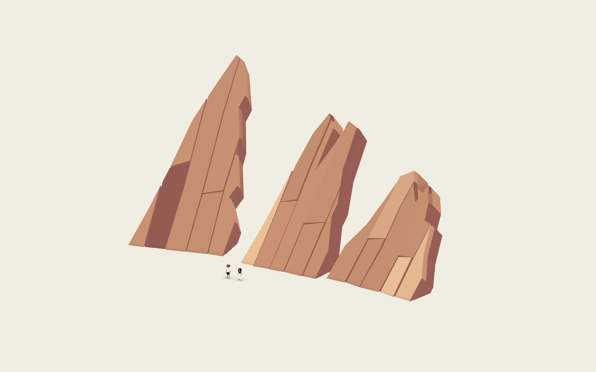
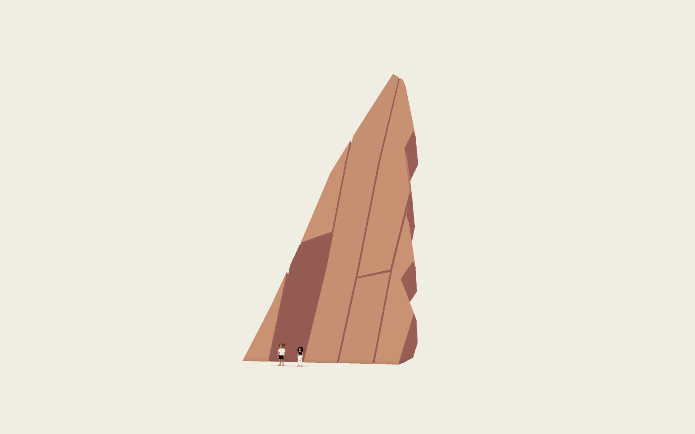

# Painterly Flatirons

Large inclined sandstone faces for the Boulder portion of the trip. Instance
[`painterly_flatiron.tscn`](painterly_flatiron.tscn), or start with the inherited
[`split_flatiron.tscn`](split_flatiron.tscn) and
[`jagged_flatiron.tscn`](jagged_flatiron.tscn) presets. All expose the same controls.

The recognizable features are broad sloping slabs, asymmetric triangular crests,
jagged shoulders and long fractures. Shape reference: the university photograph
and explanation in [CU Boulder's Flatirons article](https://www.colorado.edu/today/2026/08/26/curiosity-how-special-are-boulder-flatirons-really).
These are reusable stylized formations rather than exact replicas of the numbered
First, Second or Third Flatirons.

## Main controls

| Control | Effect |
| --- | --- |
| Formation Type | Classic Slab, Split Crest or Broken Ridge. The family remains recognizable as seeds change. |
| Formation Width / Height | Nominal horizontal width and vertical height; default 9 × 16 m. Height supports 4–60 m for close cliffs or distant landmarks. |
| Thickness | Depth perpendicular to the inclined face, including a solid beveled backing. |
| Slope Angle | Angle above horizontal, 40–80 degrees; default 55. |
| Jaggedness | Seeded chips, shoulder irregularity, fracture width/offsets and sparse diagonal joints. |
| Fracture Count | One to seven dominant lengthwise joints; a few plates also have offset diagonal breaks. |
| Prop Seed | Changes summit offset, unequal shoulders, fracture paths, plate depth/tilt and painted plane tones. |
| Burial | Sinks the front toe below the ground to hide the base seam. |
| Palette Preset / Palette | The existing boulder StonePalette system: Terracotta by default, plus Sandstone, Granite, Slate, Chalk, Dream Violet and Custom. |
| Plane Variation | Strength of the broad painted tones between physical fracture planes. Palette edits update materials without rebuilding geometry. |

**The root is ground level at the front toe. Local +Z faces the viewer/approach;
the crest rises toward -Z.** Rotate the root around Y to orient it in a memory.
Slope changes both the lean and the depth of its footprint. Width/Height are
nominal dimensions; seeded shoulders, burial and face offsets affect exact bounds.
For a grouped ridgeline, place a few differently sized instances with varied seeds,
slightly staggered roots and a common general incline.

## Paint and geometry

The material uses the boulders' shared palette resources and softened three-tone
lighting, with broad per-plane pigment values. There are no photographic textures,
cloudy noise, tiny crack decals or moss layers. Warm face planes, muted cut edges
and lighter fresh breaks keep the rock consistent with the rest of the library.

Recessed cracks are real geometry. A closed backing prevents the white void
showing through, with separate closed face plates merged into one opaque surface.
Joints have unequal spacing, small directional changes and sparse diagonal cuts;
the outside edges are chipped and the backing tapers into broad weathered planes.

A default formation is roughly **200–350 triangles**, depending on seed/form,
plus one optional two-triangle contact shadow. No CPU frame callbacks, texture
sampling or per-frame mesh updates are needed. Shader distance haze is tuned for
larger landmarks; Visibility Distance controls whole-component culling.

## Collision, recall and placement

Collision Enabled builds a small set of convex hulls following the backing and
face plates. These approximate small chips and crest notches; they are intended
to block ground-level explorers, not to provide a climbing surface or detailed
handholds. Disable collision for background landmarks. Groundcover exclusions use
the projected hull bounds, which include the backward lean.

Optional Recall Enabled/Recall Anchor use the shared assembled scan. The solid
collision stays present during recall, and rebuilding preserves progress. Use a
reachable anchor when the formation is beyond the walking area. Generated meshes,
physics, shadows and markers remain internal and do not serialize separately.

`get_anchor(&"Approach")`, `Base` and `Crest` provide placement hooks. Set the root
on supported ground and dress the toe with the existing boulders, rock clusters,
grass or pines when composing the actual memory. The inclined sheet extends back
from its toe; use terrain/foliage or another formation behind it as needed. It does
not generate a complete mountain, forest, walking trail or memory platform.

## Preview and verification

Open [`tests/scenes/flatiron_test.tscn`](../../../tests/scenes/flatiron_test.tscn)
and press **F6**. The study shows all three forms and both explorers for scale.
Load an individual Flatiron into the generic stage to use its recall replay controls.
The generic stage's camera-size range now accommodates large landmark studies.

- `tests/flatiron_components.gd`: three forms across multiple seeds, finite and
  outward geometry, closed plate topology, thin/wide and tall/steep extremes,
  deterministic generation, palettes, real explorer collision, recall and packing.
- `tests/flatiron_render.gd`: Mobile overview/detail/side previews and hidden/full
  recall comparisons.

