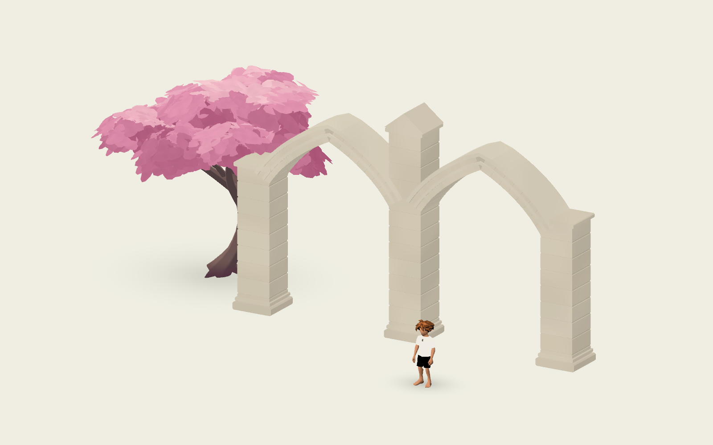

# Campus landmarks

Two freestanding architectural pieces based on the supplied photos, plus a cherry
blossom preset built from the existing tree generator. They use the same matte
painterly stone, broad pigment variation, warm-white surroundings and optional
assembled recall as the conservatory/museum library.

Open **`tests/scenes/campus_landmarks_test.tscn`** and press **F6**. The study places
the arches and cherry on the left and the stair/portico piece on the right, with an
explorer for scale. `campus_landmarks_setup.tscn` is the reusable composition.
This is a component study for the graduation memory, not a new timeline entry.

| Scene | Controls |
| --- | --- |
| `landmarks/painterly_campus_arches.tscn` | Opening Width, Spring Height, Arch Rise, Depth, Stone Color and Paint Seed. |
| `landmarks/painterly_classical_portico.tscn` | Width, Column Count/Height, Stone Color, optional Frieze Text; stair count, rise, tread depth, landing depth and railing toggle. |
| `../../foliage/presets/cherry_blossom_tree.tscn` | All existing tree controls: seed, height, crown width, branches/density, palette, bark, wind and falling-leaf count/rate. |

## St. Thomas arches

The twin broad pointed openings, layered stone moldings, coursed piers and small
central pointed coping preserve the reference's main silhouette. The surrounding
building and statue are omitted. The component faces local **+Z**, is centered on
the middle pier, and starts at floor level.

There is one merged opaque stone mesh. Curved intrados normals keep the inside of
each arch smooth, while quiet block seams and seeded cream stone colors maintain
the painted style. The recessed masonry core avoids overlapping surface artifacts.
Three small contact shadows ground the piers.

Collision follows the three piers and curved vault segments; it does not span the
openings. `LeftPassage` and `RightPassage` are floor-level anchors, with `Approach`
in front. `passage_center(index)` returns a local center for either opening.
Groundcover exclusions cover the pier footprints and preserve the passages.

## Classical portico and stairs

The museum component already supplies Ionic shafts, fluting and spiral capitals.
Its extracted `build_ionic_column()` helper is shared here; the existing museum
mesh was verified unchanged. This component adds eight columns by default, a broad
flat architrave/frieze/cornice, small wreath/dentil accents, a landing, shallow
stairs and slender railings. There are no building walls or enclosed interior.

Local **+Z** is the front. The origin is at ground level below the column row.
`landing_height()` is `Step Count × Step Rise`; `stair_front()` gives the front Z
extent. The stair flight and landing occupy the component's full width.
`Approach`, `Landing` and `RearLanding` anchors support later paths/fragments.

Visible treads and collision use the same profile. Small beveled risers let the
existing explorer climb using its normal floor movement; there is no invisible
full-flight ramp covering different tread heights. The columns and railing posts
are solid. The landing's rear ends as an open edge; place it on supported memory
ground and arrange the eventual route/boundaries around it.

**Column Height** includes base and capital. Width and Column Count control the
gaps; keep enough space for the explorer when authoring narrow/dense variants.
An even count leaves the centerline open; an odd count puts a column there, so
route players through the adjacent gaps. The default eight-column arrangement
has a tested clear center passage. Frieze Text defaults empty for later authoring;
it is baked into the static mesh when provided.

## Cherry blossom preset

The existing Broadleaf growth form already provides the spreading crown, organic
forks and painted foliage masses needed for this reference. The new inherited
scene selects that form, a wider crown, darker bark and the custom
`palettes/cherry_blossom.tres` pink-to-cream palette. It introduces no separate tree
engine or new foliage shader. The existing falling-leaf pool becomes a restrained
pink petal fall; **Falling Leaf Count / Rate** remain the controls.

The blossom look comes from the existing rounded paint-stroke canopy geometry and
pink gradient, rather than individual botanical flower models. Other tree settings
remain editable. Use the preset as a starting point, change Tree Seed for another
tree, or use its palette on other foliage. It retains wind, smooth player response,
trunk collision and the existing tree recall behavior.

## Reuse, cost and checks

Both stone pieces inherit **PainterlyConservatoryPiece**, including collision
toggle, generated internal children, groundcover notifications and recall support.
They need no CPU frame callbacks, real-time lights or shadow maps. Use dimension
exports for shape changes and rotate/translate their roots for placement.
The cherry retains the base tree's shared spray mesh and single canopy MultiMesh.

```sh
godot --headless --path . --script tests/campus_landmarks.gd
godot --path . --script tests/campus_landmarks_render.gd --windowed --resolution 1600x1000 --rendering-method mobile
```

Checks exercise actual explorer traversal through both arches and up/down the
stairs, ray-test each visible tread/bevel, solid piers, seeded geometry, optional
collision, recall/rebuild/serialization, and the inherited cherry preset. The stills
were visually reviewed with Godot 4.4.1's Mobile renderer.



[Both set pieces](../../../docs/previews/campus-landmarks-overview.png) ·
[Portico](../../../docs/previews/classical-portico.png) ·
[Stair detail](../../../docs/previews/classical-portico-detail.png)
