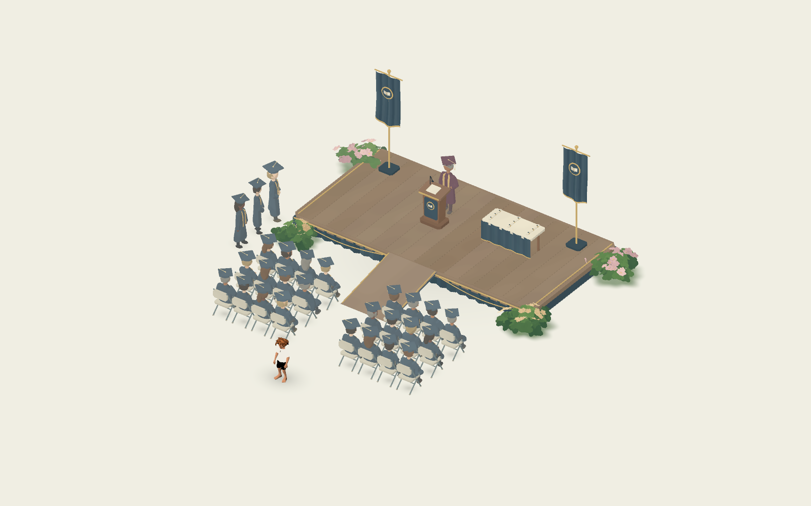

# Painterly commencement kit

A configurable college graduation ceremony in the existing warm-white memory
style: a wood deck, navy cloth, restrained gold trim, softly moving banners, and
graduates with varied faces, hair and quiet poses. Colors are editable; the open-book
medallion is a generic decorative mark, without invented school names or dates.

Open **`tests/scenes/graduation_test.tscn`** and press **F6** to explore the study.
Walk the central aisle and ramp to reach the stage. `graduation_setup.tscn` is the
reusable example composition; the components below can be instanced individually.
This builds the library for the next memory, without registering a timeline entry.

The [campus landmarks](LANDMARKS.md) add the St. Thomas twin stone arches, a cherry
blossom tree preset and a classical columned portico with broad stairs. Run
`tests/scenes/campus_landmarks_test.tscn` with F6 for that separate study.

| Component scene | Main controls / purpose |
| --- | --- |
| `stage/painterly_commencement_stage.tscn` | Stage footprint and height, central access ramp, banner toggle and wind, painted palette. |
| `lectern/painterly_lectern.tscn` | Width and height; a sloped reading surface, notes, book medallion and gooseneck microphone. |
| `diplomas/painterly_diploma_table.tscn` | Table width and diploma count; tied rolls on a softly pleated presentation table. |
| `seating/painterly_ceremony_seating.tscn` | Rows, seats per row, chair spacing, row spacing, clear aisle width, colors, collision and seat shadows. |
| `graduates/painterly_graduate_crowd.tscn` | Count, seed, robe/stole/tassel colors, inherited appearance and idle controls, optional Seating reference. |

## Reuse and placement

The commencement deck inherits **PainterlyStage**, preserving its continuous convex
ramp and tested walkable collision. Ceremony trim and independently animated cloth
add identity without a roof or solid back wall. The lectern, diploma table and
chairs reuse **PainterlyConcertComponent** and the shared painted geometry/material
helpers. The study reuses existing flowering bushes for the floral arrangements.

The props face local **+Z**. The stage root sits at ground level. Put a lectern and
table on the deck at `Deck Height + 0.015`; placement markers `Lectern` and
`DiplomaTable` provide convenient local defaults. Inherited anchors include
`DeckCenter`, `Performer` and `Approach`. Query them with `get_anchor()` after a
rebuild. Lectern anchors are `Speaker` (behind it) and `Microphone`; table anchors
are `Presentation` and `Approach`.

The chair block faces **-Z**, toward a stage in front of it. Its origin is the
center of the rows at floor level. **Aisle Width** is the clear opening between
the two inner chair edges. An odd Seats Per Row puts one extra chair on the right.
`AisleFront` and `AisleRear` anchors support later route/fragment placement.

Keep the ramp centered on the aisle, with supported memory ground underneath.
The study uses a 1.8 m aisle around a 1.6 m ramp, preserving room for both explorers.
The lectern is slightly left of center so the stage landing stays open.

## Graduates and seats

The graduate component inherits the existing **PainterlyCrowd**. Cached gown
bodies and mortarboard heads replace its casual garments; placement, deterministic
identity variation, shared toon shading, skin/hair palettes, GPU arm poses, idle
motion, chunked batches and individual capsule hitboxes are reused.

For a standing procession or group, leave **Seating** empty and use the normal
Gathering/Standing Rows, Footprint, Spacing, Facing, Empty Areas and Pose Mix controls.
The eight gown builds and independent hair/head styles retain variation underneath
a coordinated gown color. Skin/hair palettes remain independently editable.

For a seated audience, assign a **PainterlyCeremonySeating** node to **Seating**.
It fills actual seat transforms in row order, up to Count; excess requests cap at
available chairs and show an Inspector warning. Chair edits, movement and rotation
regenerate the occupants to match. Clearing the reference restores standing layout.
The seated mode uses four quiet arm poses and fixed leg/torso proportions for chair
fit, retaining varied build widths, cached body/head shapes, complexion, hair and
idle phases. Height Variation, standing layout/facing and Pose Mix apply in standing
mode. **Person Scale 1.3** matches the supplied chair dimensions well; extreme sizes
will need matching chairs. The shader folds the robe across the lap, and seated
capsules shorten to fit the lowered head height.

## Rendering, collision and recall

All generated parts stay internal; author parameters on the scene rather than
editing generated children. The static props use opaque merged meshes and simple
collision. All chairs share one MultiMesh plus one optional batch of contact
shadows, with one stationary box collider per chair. Graduates use the existing
crowd's body/head batches and capsule-per-person scheme; there are no per-person
skeletons, animation players or CPU update callbacks. Banners animate in their
opaque shader, with expanded culling bounds and no real-time lights/shadows.

Each component supports **Recall Enabled**, with safe collision retained during
the shared assembled effect. Rebuilds preserve recall progress. Use the generic
component stage with one scene for isolated recall checks. Props also expose
`excludes_ground_point()` for groundcover placement; chair exclusions follow the
individual chair boxes, leaving the aisle clear. Graduate hitboxes are approximate,
as in the base crowd. This kit is scenic, with no ceremony/diploma interaction yet.

The default study contains 24 seated graduates, four waiting graduates and one
presenter. Bigger classes can use additional chair blocks and graduate components.
The controls are authoring limits, not a measured phone performance budget; profile
the final memory on its target device. The study's neutral school identity and
layout are examples for the eventual authored place.

## Checks and previews

```sh
godot --headless --path . --script tests/graduation_components.gd
godot --headless --path . --script tests/crowd.gd
godot --headless --path . --script tests/crowd_collision.gd
godot --path . --script tests/graduation_render.gd --windowed --resolution 1600x1000 --rendering-method mobile
```

Checks cover exact chair occupancy, moved/rotated layouts, optional collision,
seeded variation, compact caps/tassels, recall/rebuild/serialization, actual explorer
travel through the occupied aisle and up/down the ramp, visible banner/idle motion,
and stable paused shader frames. Captured with Godot 4.4.1's Mobile renderer.



[Stage](../../../docs/previews/graduation-stage.png) ·
[Graduates](../../../docs/previews/graduation-graduates.png) ·
[Lectern and diplomas](../../../docs/previews/graduation-details.png)
