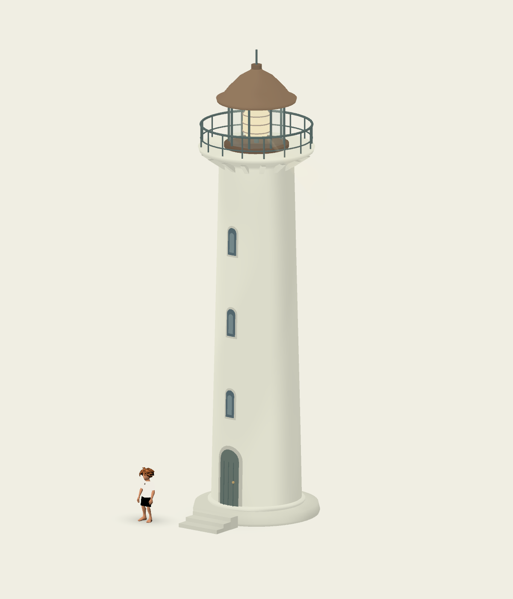
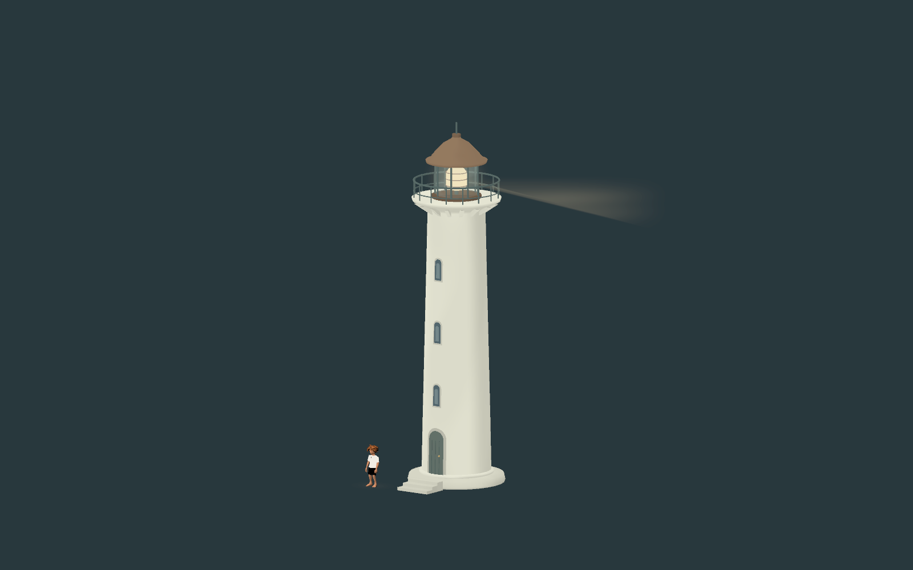

# Painterly lighthouse

Instance [`painterly_lighthouse.tscn`](painterly_lighthouse.tscn) for a slender white lighthouse based on the supplied reference: gently tapered plaster, narrow arched windows, a wraparound lantern gallery and compact copper-colored bell roof. The rounded shaft uses smooth normals and broad matte pigment rather than visibly angular cylinder faces or photographic texture.

The component reuses the existing turned-profile mesh builder, painted-prop lifecycle, collision and assembled recall. Its root is ground level and its entrance faces local **+Z**. Generated meshes, physics and placement markers are internal; only authoring parameters save to the scene.

## Controls

| Inspector field | Effect |
| --- | --- |
| Tower Height | Ground to gallery height, 5–18 m. Roof and finial add 2.54 m; the default total height is 11.54 m. |
| Base Radius | Radius of the main shaft, 0.8–2 m. The plinth and balcony extend beyond it. |
| Window Count | Number of front arched windows; staggered rear windows follow the same rhythm. |
| Gallery Enabled | Toggle the gallery railing and its plaster corbels. The structural ledge remains. |
| Body Color | Plaster and entry steps. |
| Accent Color | Copper-colored roof, lamp base and lens bands. |
| Trim Color | Gallery railing, lantern framing and finial. |
| Prop Seed / Pigment Strength | Repeatable broad paint wash and its strength. |
| Beacon Enabled | Toggle the rotating beam and soft lamp halo; also disables the lens emission. |
| Beacon Color / Strength | Warm light color and intensity. |
| Rotation Speed | Revolutions per second. Default 0.035 is approximately one turn every 29 seconds. Zero holds Beam Heading. |
| Beam Heading | Initial direction in degrees around local Y; zero points toward +Z. |
| Beam Length | Reach of the soft painted shaft, 3–16 m. |

The lantern has eight framed glass panels and a small banded warm core. The glass is a faint painted tint, with no screen reads or refraction. The beam is deliberately restrained against a light background and reads more clearly in dusk/dark scenes. It is a camera-facing painted ribbon rotating in world space, not a spotlight that illuminates other scenery. The core, halo and beam run in shaders without CPU animation callbacks, shadow maps or per-frame mesh uploads. Culling bounds cover every beam direction and update when its length changes.

`seek_time(seconds)` sets a deterministic visual time for captures; use `-1` to resume the shader clock. Changing strength, speed, heading or length updates materials without rebuilding the tower. Beacon Enabled removes its beam/halo geometry when turned off. Shape and paint-color changes regenerate the relevant component geometry.

## Placement and collision

This is a closed exterior. Its three approach steps use a continuous convex ramp and lead to a supported base plinth; the shaft has tapered convex collision. There is no enterable interior or climbable route to the gallery. Gallery and roof markers are attachment hooks for future content, not accessible floors. Disable **Collision Enabled** for distant scenery.

`get_anchor(&"Approach")`, `Door`, `Lantern`, `Gallery`, and `Roof` return generated placement markers. Translate and rotate around Y freely; use Tower Height and Base Radius for proportions rather than nonuniform root scaling. Keep a memory platform beneath the placement for its outer floor and safe boundaries.

Grass can reference the lighthouse in **Ground Exclusions**. It exposes `ground_exclusion_changed`, `excludes_ground_point(world_point)` and `get_ground_outline()`. The exclusion follows the circular plinth and entry stairs, so the upper gallery does not carve an oversized rectangular gap in surrounding foliage or sand.

**Recall Enabled / Recall Anchor** use the existing assembled reveal and preserve progress across rebuilds. Collision remains in place during recall. Without a custom Recall Anchor, proximity is measured at the component's root; the rotating beam does not enlarge the discovery area. Contact Shadow and Visibility Distance use the shared painted-prop controls.

## Preview and checks

Open [`tests/scenes/lighthouse_test.tscn`](../../../tests/scenes/lighthouse_test.tscn) and press **F6**. The scene inherits the generic component stage, with a warm ivory ground and explorer for scale. Walk around the tower and approach its closed door. The stage's background selector also shows the beacon against a darker setting.

```sh
godot --headless --path . --script tests/lighthouse_components.gd
godot --path . --script tests/lighthouse_render.gd --rendering-method mobile
```

Component checks cover finite geometry, smooth normals, seed repeatability, actual explorer traversal up/down the steps, closed-tower collision, ground exclusions, beam bounds, settings serialization and recall across all material layers. Mobile-render checks verify visible rotation, a stationary mode and beacon-off behavior.

The default model uses **13,220 opaque triangles in one mesh surface**, plus 16 glass-panel triangles, one halo quad, one beam quad and the optional contact-shadow plane. The window/door patches are subdivided to follow the curved wall. There are no external image assets. These are desktop Mobile-render checks; target-phone performance still requires device profiling.




