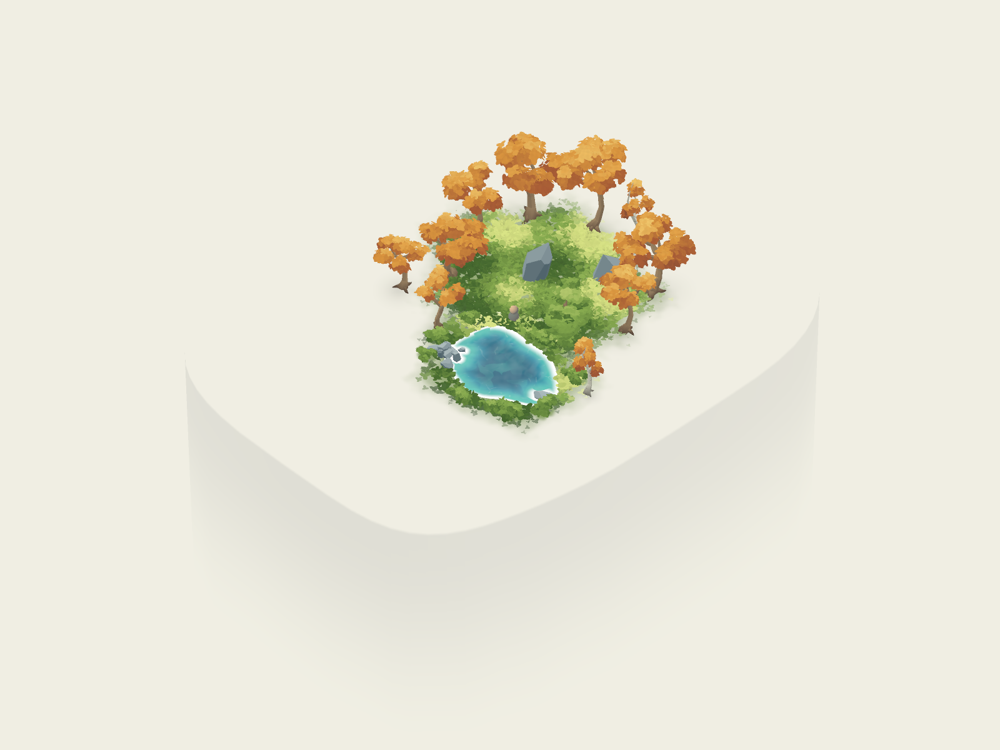

# Memory platforms

Instance `memory_platform.tscn` under a memory's Environment to give it a finite, walkable surface. The top is local Y=0. Place Entry, Exit, foliage, water, and scenery on that level. The platform descends as a pale pillar, gradually matching the void color before its geometry ends. It has no visible fence; collision along the rim stops the explorer a short distance before the lip.

The demo uses a 24×30 m rounded platform centered at `(0,0,1)`. It contains the forest, pond, entry/exit markers, and the recall landing area. The wisps remain hidden.

| Inspector field | Effect |
| --- | --- |
| Shape | Soft Oval or Rounded Rectangle. |
| Footprint | Top width X and length Y in local meters. Use this instead of scaling the node. |
| Platform Seed / Irregularity | Repeatable broad variation around the edge. |
| Outline Detail | Boundary samples, 24–96; default 64. |
| Custom Outline | Optional simple closed Curve2D in local X/Z meters; overrides generated shape. Concave outlines are supported. Invalid outlines fall back to the generated shape. |
| Pillar Depth | How far the platform descends below the top. |
| Taper | Gradual narrowing toward the bottom. |
| Fade Start / Fade Depth | Depths below the top where the pillar starts blending into the void / disappears. Fade Depth is capped before the mesh ends. |
| Top Color / Side Color | Closely related pale colors; a little side contrast makes the form readable. |
| Void Color | Color the lower pillar blends into. The world synchronizes it with the background when entering a memory. Match background and fog colors for a seamless fade. |
| Pigment Strength | Restrained, broad surface color variation. |
| Edge Inset | Invisible collision's distance inside the visible edge. The explorer's capsule adds further clearance. |
| Boundary Height | Height of the invisible rim above the top. |

Shape edits rebuild the static mesh and collision. Color and fade edits only update material uniforms. Generated nodes remain internal; scenes save authoring controls. Translate and rotate around Y; sloped, stacked, or differently elevated platforms require matching scenery and spawn authoring.

## World integration

Platforms register in the `memory_platforms` group. `memory_world.gd` finds those beneath its Memory, hides DreamSurface, and disables the world-boundary ground collider. The finite top and rim become the physical play space. Memories without a platform retain the original blank-void ground.

The existing recall offset is used only when it lands safely within a platform; otherwise recall uses Entry. Always author Entry inside the platform with at least a meter of clearance, on its top plane. Exit should also remain inside the rim. `contains_ground_point(world_point, margin)` is available for other placement systems; it checks the outline in X/Z, not vertical clearance.

The boundary is physical rather than a teleport or camera clamp. It blocks ordinary walking and sliding, including along corners. Explicit script teleports and future jumping/flying systems must respect the platform themselves. Multiple separated platforms can be authored, but bridges and traversal between them are separate components.

## Rendering and validation

A default platform uses **830 triangles**, one opaque surface, a static floor triangle mesh, and 64 simple rim colliders. Its fade blends surface color into the background, so it needs no transparent fog skirt, particles, real-time shadows, or per-frame scripts. The world's normal distance fog still applies. Physical phone performance has not been profiled.

```sh
godot --headless --path . --script tests/memory_platform.gd
godot --headless --path . --script tests/scene_smoke.gd
```

Checks cover finite seeded geometry, spawn/exit clearance, floor collision, attempts to walk off all four sides, custom concave outlines, saved controls, unsupported recall positions, and the blank-void fallback.


