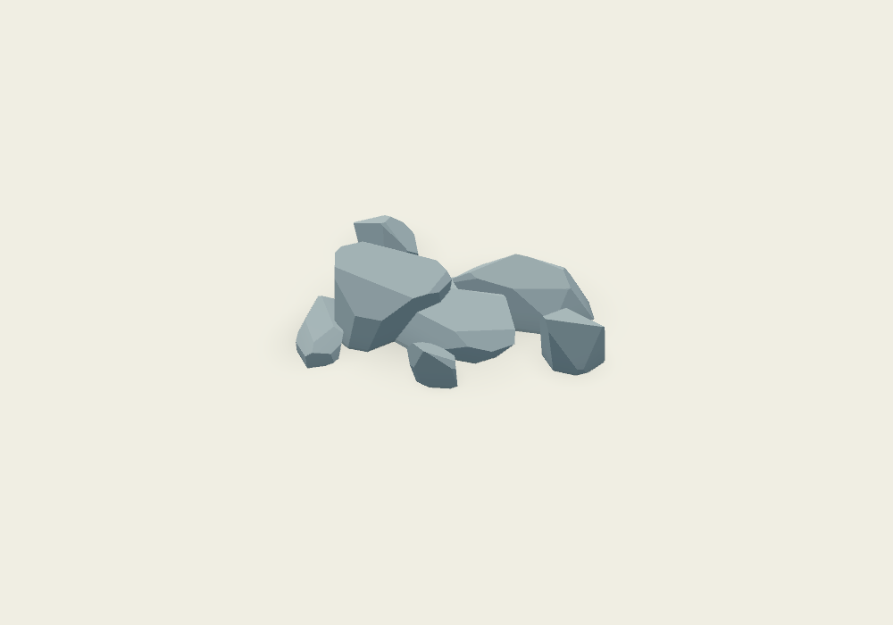

# Painterly rock cluster

Instance `painterly_rock_cluster.tscn` at ground level. Both the script and scene inherit the existing boulder component, reusing its geometry generator, shape profiles, stone palettes, paint shader, burial, and collision controls. The cluster previews live in the editor and saves only parameters.

## Cluster controls

| Field | Effect |
| --- | --- |
| Rock Count | Exact number of stones, 0–40; default 7. Zero removes geometry, shadows, and collision. |
| Cluster Footprint | Width and depth of the stone centers, in meters. Stone edges extend beyond these dimensions. |
| Rock Scale | Multiplier on inherited boulder Dimensions, before individual size variation; default 0.35. |
| Size Variation | Mix between uniform nominal size and a larger anchor stone with smaller companions and satellites. Default 0.8. |
| Regenerate Cluster | Rebuilds the preview explicitly. |

Under the inherited **Shape** controls, **Boulder Seed** controls repeatable placement, rotations, individual shapes, and sizes. Automatic Shape Profile produces mixed rock families; choosing a profile applies that family to all stones while retaining seed variation. Dimensions set the reference proportions; Rock Scale scales those proportions down for the group. Size Variation controls nominal sizes, while Variability still controls each boulder's intrinsic shape and proportions. Changing the count redistributes the cluster within its footprint.

Palette Preset, Custom Palette, Plane Variation, Solid, and Visibility Distance behave as on the single boulder. Palette changes update the shared material without regenerating stones. With Solid enabled, one static body contains an individual convex collision shape for each rock. Disable it for decorative pebble patches.

## Rendering

All stones are merged into one opaque mesh using the same painted material. Their individual contact-shadow quads are merged into a second surface. There are **two draw surfaces per nonempty cluster**, independent of rock count, with no per-frame script work. The default seven-stone cluster has **388 stone triangles + 14 shadow triangles**. Rocks are culled as one group; keep a cluster local rather than spreading it over a large memory.

`foliage_demo.tscn` includes an eight-stone cluster along the pond's western shore. Rotate around Y and place freely on flat ground; authored footprint and scale controls are preferable to scaling the entire node.

## Validation

```sh
godot --headless --path . --script tests/rock_cluster_smoke.gd
godot --headless --path . --script tests/scene_smoke.gd
```

Checks cover inheritance, exact count, varied smaller sizes, deterministic geometry, merged surfaces, per-rock collision, palette updates and scene persistence, seed variation, and counts 0, 1, and 40.


