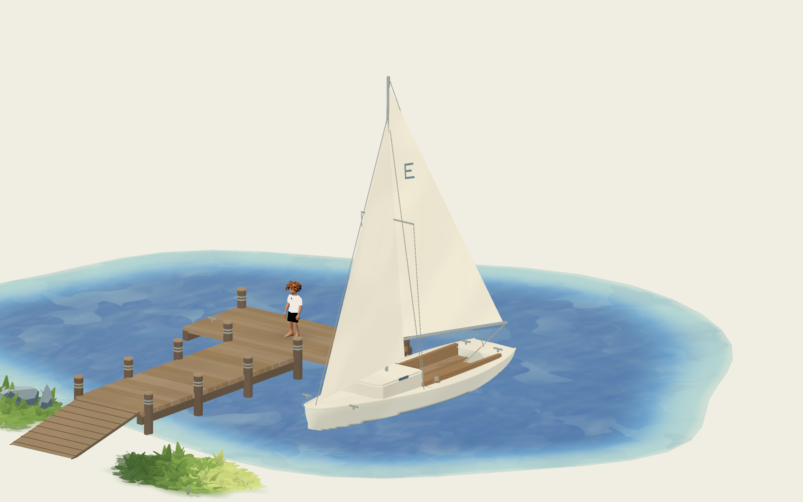

# Sailing day components

A walkable wooden dock and scenic Pearson Ensign sailboat, built with the existing vertex-painted prop, collision and assembled-recall framework. The separate components preview in the editor and expose dimensions, colors and optional details. Their generated children remain internal, so scenes save only authoring parameters.

## Wooden dock

Instance [`dock/painterly_wooden_dock.tscn`](dock/painterly_wooden_dock.tscn). The root is the **water/shore datum**, with the shore-facing end at local **+Z** and the landing toward **−Z**.

| Control | Purpose |
| --- | --- |
| Layout | Straight pier, T landing, or L landing extending to local +X. |
| Dock Length / Width | Main pier dimensions in meters. |
| Head Width | Total crosswise landing width for T/L layouts. |
| Deck Height | Walking surface above the root; default 0.55 m. |
| Pile Depth | Visible support depth below the root. |
| Rail Sides | None, left, right, or both main-pier edges, viewed from shore. |
| Ramp Enabled / Length | Continuous sloped shore access, ending close to the root's Y level. |
| Body / Accent / Trim Colors | Planks, supports and metal/rope-colored fittings. |
| Prop Seed / Pigment Strength | Seeded broad plank weathering and painterly wash. |

Rounded pilings, cap rings, inset plank seams, cleats and sparse worn streaks are batched into one opaque mesh. The deck has continuous collision across board gaps and section joins; the ramp has a real sloped convex collider. Optional rails have supporting stanchions and collision. The open landing edges have no invisible perimeter wall; use the memory's supported floor/boundary design when composing a playable waterfront.

`get_anchor(&"Approach")`, `ShoreJoin`, `DeckEnd`, `PortBerth`, and `StarboardBerth` provide generated placement markers. ShoreJoin is at the elevated deck; Approach is on the low side of the optional ramp. Berth markers identify the dock edge, not an automatic boat placement or mooring solver. Place consecutive straight pieces with ramps disabled at internal joins and matching Deck Height.

The component supports `excludes_ground_point(world_point)` and emits `ground_exclusion_changed` after transforms or rebuilds. Add it to grass **Ground Exclusions** to keep the deck and shore ramp clear.

## Pearson Ensign

Instance [`ensign/painterly_ensign.tscn`](ensign/painterly_ensign.tscn). Its root is the **waterline** and its bow faces local **+Z**. Match its Y position to the water surface; author hull length and beam rather than applying nonuniform root scaling.

The default 6.86 m hull and 2.13 m beam follow the Ensign's overall proportions. Recognizable details are the fine bow and tucked transom, small forward cuddy with two ports, long recessed cockpit with teak seats/coamings, tiller, full keel and rudder, fractional sloop rig, mainsail and jib. It has **no motor, motor bracket, or propeller**. The mainsail includes a small painted E mark; no invented personal sail number is added.

| Control | Purpose |
| --- | --- |
| Hull Length / Beam / Mast Height | Main proportions, in meters. Mast Height is above the root waterline. |
| Hull / Deck / Keel / Sail / Wood Colors | Broad matte color treatment; Trim Color sets fittings. |
| Sails Enabled | Show the two sails or leave the bare mast/boom/stays. |
| Sail Angle | Signed boom/sail opening; −35° to +35°. |
| Sail Fullness | Curvature of the filled cloth. |
| Fenders Enabled | Two rounded fenders hanging on the port side. Rotate the boat for the intended berth. |
| Wind Strength | Small cloth flutter, pinned at sewn edges. |
| Bob Amount | Gentle whole-boat heave and roll. |
| Motion Speed | Overall animation rate; zero freezes motion. |

Hull, rigging and sails share one opaque painterly shader in three mesh batches. Broad pigment, softened toon lighting and smooth hull/cloth normals avoid a glossy fiberglass or sharply faceted appearance. Shader motion needs no per-frame script callback, mesh upload or physics simulation. `seek_time(seconds)` sets a deterministic preview time; `-1` resumes the shader clock. Zero Wind Strength and Bob Amount restores a fully stationary boat. Culling bounds include the maximum configured movement.

The hull's convex exterior collision is static and intentionally does not move with the few centimeters of visual rocking. This is a scenic moored/sailing prop, not a controllable boat, buoyancy system or boardable vehicle. Set Bob Amount to zero for exact still placement. The Cockpit marker is a future attachment point, not a walkable cabin. Other markers are `Bow`, `Stern`, `PortMooring` and `StarboardMooring`; they remain at authored positions during visual motion.

Both components expose optional **Recall Enabled / Recall Anchor**, visibility distance, collision and contact-shadow toggles. Recall includes the hull, rig and cloth and preserves progress across rebuilds. Contact shadows default off because these props sit over water. Keep ordinary shoreline blocking off where the dock crosses a water edge; the water component does not automatically carve a dock corridor in its shore barriers. No water, grass or shared recall code was changed for this kit.

## Study and validation

Open [`tests/scenes/sailing_test.tscn`](../../../tests/scenes/sailing_test.tscn) and press **F6**. It inherits the generic component stage and places the Ensign beside a T dock, using existing water, shore grass, a bush, stones and a tree. Walk from the dry approach up the ramp and out to the landing. The study is not a timeline memory.

`tests/sailing_components.gd` checks seeded geometry, valid normals, mesh budgets, internal-child serialization, collision toggles, recall and real explorer traversal up/down the ramp and across all three dock layouts. `tests/sailing_render.gd` captures the scene in the Mobile renderer and checks moving/frozen boat frames.

Default triangle counts: dock **4,510**, hull/cockpit **6,271**, rig/fenders **1,296**, sails/mark **816**. Optional rails and changed dimensions affect these counts. There are no texture downloads or runtime dependencies. Phone performance still needs device profiling.

## References

The supplied sailing photograph guided the white hull and two-sail silhouette. The [Ensign Class Association](https://www.ensignclass.com/content.aspx?club_id=323935&module_id=250553&page_id=22) describes the deep cockpit, small cabin, full keel and day-sailing character. The [Pearson Yachts Portal's Ensign archive](https://www.pearsonyachts.org/models/pearson-ensign.html) provides original brochure specifications and restoration photographs, including cockpit seating, rigging and proportions. Reference photographs were used only for inspection; all component geometry and shading are procedural.
