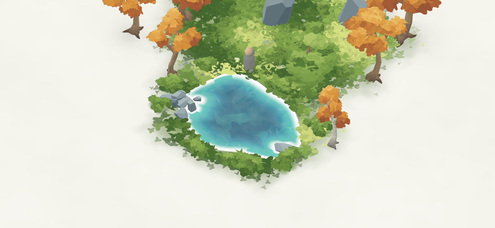
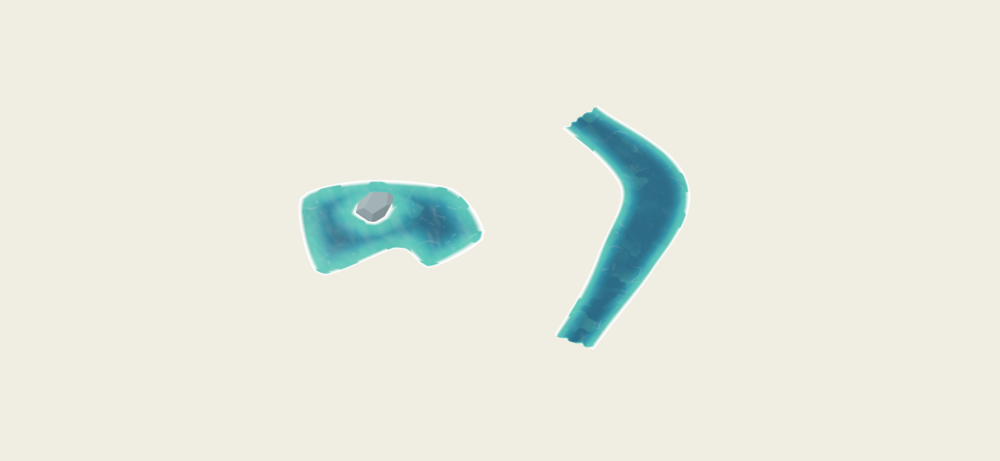

# Painterly modular water

Instance `painterly_water.tscn` at ground level in a memory. The component previews in the editor and appears fully at startup. It uses layered wave normals, broad painted pigment, separate shallow caustics, and a view-dependent sky-light cue. One white shoreline band fades inward and breaks into animated cells; there is no colored bank or secondary foam ribbon.

The demo pond uses Calm Pond settings, with foliage framing the shore and registered rocks contributing foam. Run `scenes/memories/water_study.tscn` with F6 for an uncluttered custom-outline pond and a curved, variable-width stream.

## Appearance and motion

Choose **Shared Appearance → Behavior Preset**: Calm Pond, Flowing Stream, or Open Lake. Expand **Settings** to tune the result. Editing a preset switches it to Custom and saves the edited resource. Each preset starts with its own settings copy; save/load a `.tres` resource to intentionally share settings across bodies.

| Settings field | Effect |
| --- | --- |
| Palette | Optional shared WaterPalette override. Leave empty to use each body's Water Colors selection. |
| Flow Speed | Overall animation speed. Zero freezes waves, caustics, and foam. |
| Ripple Scale | Spatial pattern density; larger values make smaller features. |
| Wave Activity / Height | Crossing-wave and normal intensity / physical displacement in meters. |
| Paint Contrast | Variation between broad brush masses, with quieter regions retained. |
| Depth Distance | Distance inward from shore at which the painted basin reaches its deeper colors. |
| Caustic Strength | Restrained curved light patterns, strongest in the shallows. |
| Normal Strength | Surface slope used by the painted lighting and deformation. |
| Reflection Strength / Sky Color | View-dependent analytic sky cue. |
| Highlight Amount / Light Direction | Strength and direction of the broad painted highlight. |

These edits update materials without rebuilding meshes. Bodies without a Settings resource retain their original motion controls for compatibility. New lighting/depth controls are available by creating a WaterSettings resource or choosing a Behavior Preset. The old directional Depth Gradient value remains serialized for compatibility but is hidden; shore-based Depth Distance replaces it.

**Water Colors → Palette Preset** retains Turquoise, Storybook Blue, Autumn Jade, Winter Glass, Dream Lavender, Moonlit, and Custom. Colors are Deep, Body, Shallow, and Foam. A palette inside shared Settings overrides these per-body colors.

## Shape authoring

| Body field | Effect |
| --- | --- |
| Shape | Closed Pond or Stream Section. |
| Footprint | Width X and length Y in meters for generated shapes. For a custom stream, X sets base width; the path sets length. |
| Water Seed / Irregularity | Seeded pond boundary and painting phase / amount of boundary variation. |
| Stream Bend | Seeded meander when no custom path is assigned. |
| Outline Detail | Boundary samples, 16–96; default 48. |
| Pond Outline | Optional Curve2D in local X/Z meters. Overrides generated footprint and irregularity. |
| Stream Path | Optional Curve3D centerline, projected onto the local X/Z plane. |
| Stream Width Profile | Curve sampled from 0 to 1 along the path; width multiplier clamped to 0.25–2. |
| Stream Flow Offset | Along-path phase offset in meters for connecting custom segments. |
| Cap Stream Ends | Adds barriers and shoreline foam at the mouths. Leave off for joins. |
| Block Water Entry | Static shoreline barriers. Disable when implementing traversal or decorative water. |
| Flow Direction | Local X/Z current for ponds; streams derive their direction from the centerline. |
| Visibility Distance | Distance culling for the water surface. |

For a custom pond, assign a Curve2D with at least three boundary points, ordered around a simple nonintersecting outline. The generator closes it automatically, samples its Bezier curves at meter-scale precision, and triangulates concave shapes. Invalid polygons fall back to the generated pond.

For a custom stream, add a **Path3D** child and assign the same Curve3D resource to its Curve and the water's Stream Path. Keep the Path3D's local transform at identity; edit its handles in the 3D viewport. The study scene demonstrates this setup. Use gentle bends relative to width: very tight curves or self-crossing paths can fold the ribbon. The component is planar; Curve3D height is ignored.

### Stream joins

Seeded sections have straight matching mouths along local Z. Match width and Y rotation, then place centers one section length apart. Custom segments must have matching endpoint positions, tangents, and width-profile endpoints. Set the next segment's Stream Flow Offset to the previous offset plus its path length. Use shared Settings, matching foam controls, and open mouths.

Ripples use along-stream coordinates, so their orientation follows bends. A baked flow field slows motion near banks and deflects flow around registered stones. World-space pigment and swells keep neighboring sections visually related. This is a component framework, not a junction solver: automatic intersections, branching rivers, waterfalls, and seamless overlaps between unrelated bodies are not implemented.

## Shore, rocks, and foam

**Shore Obstacles** contains paths relative to the water node, such as `../PondShoreStone`. Register boulders and rock clusters that intersect the water plane. The component slices their convex collision shapes at water height; decorative stones without collision use their visual meshes instead. Separate cluster stones remain separate obstacles, preserving water between them.

The same baked signed-distance field drives shallow/deep color, shoreline foam, rock cutouts, bank anchoring, and flow speed. Registered procedural stones notify water when moved or regenerated, refreshing the field automatically. Registration is explicit; unrelated scenery does not trigger expensive depth reads.

| Foam field | Effect |
| --- | --- |
| Foam Amount | Overall opacity; zero disables foam. |
| Foam Width | Approximate inward width in meters. |
| Foam Cell Size | Opening size multiplier; larger values create larger evolving cells. |

The foam stays strongest at the shore and fades inward. Large openings and a lapping motion break the single band. Flow Speed zero freezes it. Open stream mouths do not create artificial foam caps. Dress the outer edge with foliage, stones, and terrain.

## Grass integration

Add the water path to a grass patch's **Ground Exclusions**, relative to that patch. Its scatter uses the same sampled polygon as the water mesh, with a small margin. Shape and transform changes refresh linked grass patches while preserving seeded placements elsewhere. Future scatter systems can call `excludes_ground_point(world_point)`.

## Mobile rendering budget

At detail 48, a generated pond uses **528 triangles**, a stream **768**, and the supplied custom pond fewer than **736** with adaptive subdivision. Every body uses **one opaque surface**. Foam, caustics, lighting, and paint are composited in that pass. There are no screen/depth reads, extra reflection passes, or per-frame script updates and mesh uploads.

Four shared 512×512 data masks separate pigment, packed normals, caustics, and foam. Mipmaps reduce distant shimmer. Their import settings preserve data channels: no source-color conversion or alpha-border fixing. `textures/generate_paint.py` recreates them using Python/numpy; runtime does not require either.

**Shore Field Quality** selects a per-body RGBA half-float field: Mobile 64² (~32 KiB), Balanced 96² (~72 KiB), or Detailed 128² (~128 KiB), excluding engine overhead. Baking occurs when authoring geometry or registered obstacles change. Use smaller water modules or higher quality when a large body needs narrow shore details. These fields are intended for static scenery, not moving obstacles every frame.

Depth is an artistic profile derived from distance to shore, not measured terrain depth. Sky reflection is analytic and does not reflect surrounding trees. There is no underwater refraction, swimming, or buoyancy. Translate and rotate around Y; author size with Footprint and curves rather than node scaling. Target-phone performance still needs device profiling, especially for large screen-filling water surfaces.

## Validation and previews

```sh
godot --headless --path . --script tests/water_framework.gd
godot --path . --script tests/water_component.gd
godot --path . --script tests/water_motion_render.gd
godot --headless --path . --script tests/scene_smoke.gd
```

Framework checks cover custom triangulation, curved width/flow, shared-resource updates and persistence, signed shore distance, moving stones, decorative rock clusters, open mouths, and shape/exclusion agreement. Component checks cover seeded generation, palettes, budgets, collision, and grass updates; grass MultiMesh readback requires a real renderer. Captured-frame checks verify stationary modes and independent wave/foam animation.

`docs/water-upgrade-motion.gif` is a six-second actual-engine animation preview.




