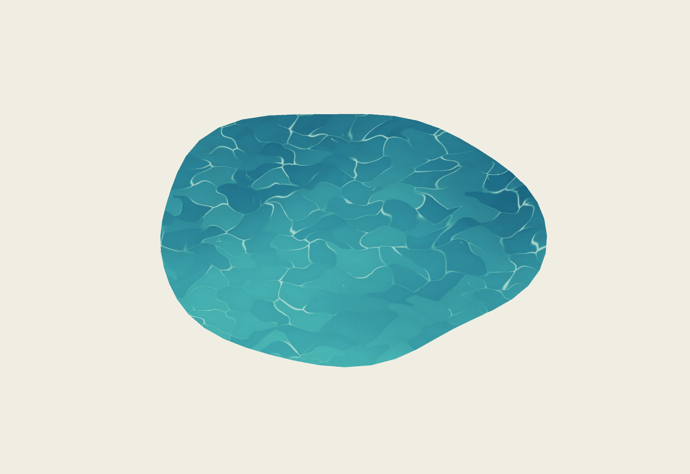

# Painterly modular water

Instance `painterly_water.tscn` under a memory's `Environment`, with its origin at ground level. **Water Shape → Shape** selects a seeded Pond or a Stream Section. It previews in the editor and is fully present at startup; there are no reveal or transition effects.

The component uses overlapping brush-shaped pigment masses, a directional blue-to-turquoise depth gradient, gentle surface motion, and curved, broken light seams. It renders one water surface with an animated white shoreline-foam layer; there is no colored bank or separate border mesh. It shares the scenery's unshaded painterly language. The demo contains a turquoise pond at the clearing entrance, with two existing boulder components framing its shore.

## Authoring

| Inspector field | Use |
| --- | --- |
| Shape | Irregular closed pond or open-ended stream ribbon. |
| Footprint | Ground width (X) and length (Y), in meters. Use these instead of scaling the node. |
| Water Seed | Changes the pond outline or the interior stream bend. |
| Irregularity | Pond shoreline variation. |
| Stream Bend | Meander strength for stream sections. Both endpoint positions and tangents stay aligned. |
| Cap Stream Ends | Closes collision at stream ends and anchors their wave displacement. Leave off when joining modules. |
| Outline Detail | Shape detail, 16–96; default 48. |
| Block Water Entry | Adds static shoreline barriers. Disable for purely decorative water or when implementing another traversal system. |
| Palette Preset | Turquoise, Storybook Blue, Autumn Jade, Winter Glass, Dream Lavender, Moonlit, or Custom. |
| Palette | Four editable pigment colors. Editing a preset switches to Custom; custom resources can be shared intentionally. |
| Flow Direction / Speed | World X/Z flow direction and motion speed. Zero speed freezes all animation. |
| Ripple Scale | Density of painted water features in world meters. |
| Depth Gradient | Directional shallow-to-deep pigment contrast for ponds. Streams keep a shared world-space field for seamless joins. |
| Caustic Strength / Highlight Amount | Strength of curved light seams and smaller luminous accents across the surface. |
| Wave Activity | Strength of crossing waves, paint deformation, and crest lighting. Independent of directional flow. |
| Wave Height | Physical GPU displacement from the same three swells, anchored at the edges. |
| Shore Foam → Foam Cell Size | Size multiplier for the evolving openings. 1 keeps the current look; larger values create larger cells. Updates live without rebuilding geometry. |
| Shore Foam → Foam Amount / Foam Width | Animated white froth, with width in approximate meters inward from the edge. Zero amount disables it. Uses the palette’s Foam Color. |
| Visibility Distance | Culls the two surfaces beyond the chosen distance. |

Palette and motion edits update materials without rebuilding geometry. Shape and collision edits regenerate the editor preview. Generated meshes and collision nodes are internal; scenes save authoring parameters.

## Joining stream sections

Streams run along local Z. Give neighboring sections equal widths and matching Y rotation, then place their centers one section length apart along that axis. Different lengths and seeds are supported; each mouth has the same straight cross-section. Leave **Cap Stream Ends** disabled. Use matching palette, flow, ripple scale, and wave height on joined pieces.

The shader uses world-space painting and one common stream phase, so colors, moving highlights, and displacement agree at aligned joins. This first version provides straight-ended sections with seeded internal meanders; it does not provide arbitrary spline junctions, waterfalls, elevation changes, or automatic intersections between water components. Closed pond outlines are separate silhouettes rather than overlap tiles.

## Grass integration

On a grass patch, add a path to the water instance in **Ground Exclusions**, relative to the grass node—for example `../ClearingPond`. Scatter checks the same analytic water shape used by the mesh and clears the water footprint with a small margin. Water shape and transform changes signal linked grass patches to rebuild automatically. The grass's other seeded placements are preserved when exclusions are toggled.

The water's public `excludes_ground_point(world_point)` method is also available to future scatter components. Existing manually placed bushes, trees, and stones remain under the scene author's control.

## Rendering and gameplay limits

At detail 48, a pond uses **528 triangles**, and a stream uses **768**. Each component has **one opaque draw surface** and optional static collision. Shoreline foam is composited in the same opaque pass, with no extra draw surface. No border geometry or transparent bank is generated. The water's edges are intended to be dressed with separate foliage, stone, and terrain components.

A shared seamless 512×512 RGBA data texture stores procedural brush regions and light seams. The water body samples it six times, with one additional froth sample inside the narrow shoreline band: two counter-moving noise fields deform the overlapping brush layers, while three swells with different directions, wavelengths, and phase speeds reinforce and cancel. Their slopes bend the painted shapes and their crests gather and release light. Broad depth pigment stays anchored; this avoids running a cellular-noise search per pixel on mobile. Mipmaps soften fine patterns at a distance. The texture is data, not source-color imagery; alpha-border fixing is disabled to preserve its fourth channel. `textures/generate_paint.py` recreates the deterministic mask using Python and numpy; neither is needed at runtime.

There are no screen/depth reads, reflection probes, real-time reflection passes, or per-frame script updates/mesh uploads. Painted shallow colors suggest depth; the surface does not actually refract underwater objects or reflect surrounding trees. Static shoreline collision keeps the current explorer outside ponds; swimming and buoyancy are future mechanics. Open stream mouths have no blocking end walls. Keep player spawns outside the water footprint.

Translate and rotate around Y freely. Use Footprint rather than node scaling. The surface sits just above the project's flat ground. Profile fragment coverage on the target phone before filling a memory with large water bodies.

## Validation and preview

```sh
godot --path . --script tests/water_component.gd
godot --path . --script tests/water_motion_render.gd
godot --headless --path . --script tests/scene_smoke.gd
godot --path . --script tests/render_water_preview.gd
```

The component checks cover finite nondegenerate geometry, animated bounds, budgets, deterministic generation, palettes and custom palette persistence, optional collision and absence of border geometry, matching stream mouths, and grass exclusion updates. A real renderer is needed for grass MultiMesh readback. The motion check compares captured frames: zero speed stays still; disabling directional flow and wave activity also stays still; enabling wave activity with directional flow still zero produces visible motion. This checks actual deformation/interference rather than simple texture scrolling. The scene check verifies player movement and camera behavior with the demo pond in place.



`docs/water-motion.gif` is an actual-engine motion preview at the default wave settings. Setting Flow Direction to `(0, 0)` removes current advection while preserving swells. Setting Wave Activity to zero removes the interference; Flow Speed zero freezes every animated part. Wave settings update materials without rebuilding meshes.

Shore foam uses a single thick band with large evolving cell openings and a slow lapping wave. It is opaque at the shoreline and fades inward into the water; no secondary ribbon is generated. It follows the same shoreline distance used by the geometry, including open stream sides without foaming across their joins. Flow Speed zero freezes foam together with the rest of the surface. The render check isolates foam with wave activity and directional scrolling disabled to verify that the foam itself animates.

The demo pond is 6.4 × 4.7 m, roughly twice its original surface area, with 0.44 m shoreline foam. Its planting and shore stones have been moved outward, and the grass exclusion follows the enlarged footprint. The turquoise preset uses pure white Foam Color for solid cartoon foam.
