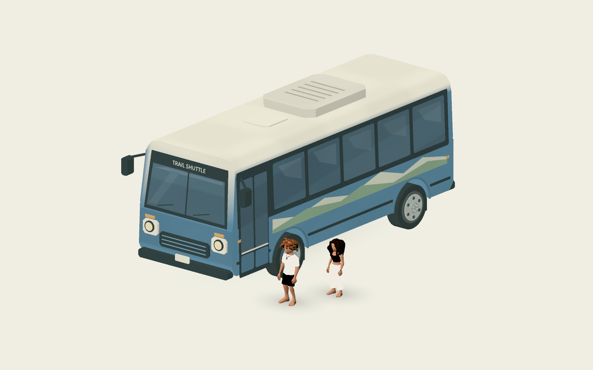
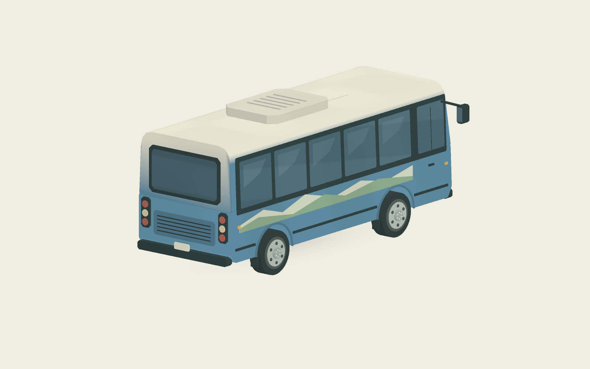

# Painterly trail shuttle

Instance [`painterly_shuttle_bus.tscn`](painterly_shuttle_bus.tscn) for a parked
shuttle exterior. The root is at the tires' contact plane; **local +Z is forward**,
with the passenger entry on **+X**. It generates in the editor and shares the
4Runner's smooth vehicle geometry tools, matte pigment/toon paint, opaque glass,
contact shadows, collision, ground exclusions and assembled recall.

The broad windshield, rounded roof shoulders, window band, folding entry door,
truck wheels, mirrors and roof pod give it a readable park-shuttle silhouette.
Blue bodywork, cream roof and a restrained green mountain graphic evoke the park
transport from the memory. The design loosely references the shuttle photograph
on page 11 of the [NPS Rocky Mountain access guide](https://home.nps.gov/romo/planyourvisit/upload/Access-Guide-508-updated-July-7-2026.pdf#page=11).
It is a stylized vehicle, with generic editable signage and no invented fleet ID,
registration, park logo or specific destination.

## Main controls

| Control | Effect |
| --- | --- |
| Passenger Bays | Four to seven passenger window bays; changes body length, windows, wheelbase, collision and anchors together. |
| Vehicle Scale | Uniform size, including wheels, mirrors, roof equipment, shadow, collision and placement markers. |
| Destination Text | Front display, default `TRAIL SHUTTLE`. Up to 24 characters, sized to fit the display; blank removes lettering. |
| Body / Accent / Trim Color | Body paint, near mountain layer, and dark frames/bumpers/rub rails. |
| Roof / Glass Color | Cream roof/far mountain layer/lamp surrounds, and painted window tint. |
| Mountain Graphic Enabled | Remove the two broad mountain layers for a plain bus. |
| Roof Pod Enabled | Toggle the raised ventilation/AC unit. |
| Headlights Enabled | A visible warm lens-color lift and restrained emission. No projected scene lighting. |
| Prop Seed / Pigment Strength | Small window-paint variation and broad body pigment washes. |

The default five-bay body is **6.75 m long**, **2.34 m wide** before mirrors, and
about **3 m high** with roof equipment. Body length ranges from 5.90 to 8.45 m;
bumpers add a small overhang. Size and length edits rebuild; headlight edits retain
the existing mesh.

## Placement and scope

This is a static exterior prop with a closed entry door and opaque painted glass.
There is no boarding, driving, door animation, interior or transit logic yet. The
passenger bays suggest seating rows without generating hidden seats. Use it as a
recognizable arrival detail with a clear approach beside the door.

Retrieve placement markers with `get_anchor(&"Boarding")`. Available markers are
`Front`, `Rear`, `Boarding`, `Door`, `Driver`, and `Roof`. The Boarding marker sits
outside the closed body collider; leave walking room around it when composing
the parking-lot or trailhead area.

One coarse exterior box prevents explorers passing through the bus. Mirrors and
the separate wheel notches have no detailed collision. Collision Enabled can be
disabled for distant buses. Add the bus to nearby grass Ground Exclusions through
its shared `excludes_ground_point()` method and `ground_exclusion_changed` signal.

One opaque mesh (**about 9k triangles**) plus one optional soft contact-shadow
plane, with no CPU frame callback. Windows use large painted reflections rather
than transparency or reflection captures. Recall Enabled/Recall Anchor use the
shared scenic-prop reveal, retaining collision and progress across rebuilds.
Generated geometry, markers and physics remain internal when packing a scene.

## Study and verification

Open [`tests/scenes/shuttle_bus_test.tscn`](../../../tests/scenes/shuttle_bus_test.tscn)
and press **F6** to inspect the bus beside both explorers. This study does not add
a timeline memory.

- `tests/shuttle_bus_components.gd`: all four body lengths, geometry budgets,
  repeatability, scaling of roof/wheels/physics/markers, real explorer collision,
  optional details, sign limits, recall and scene packing.
- `tests/shuttle_bus_render.gd`: Mobile front/rear/side previews, a plain compact
  configuration, visible headlight switching and a stable parked pose.

