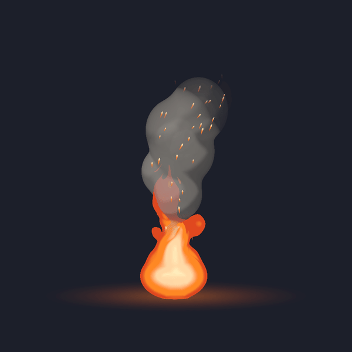
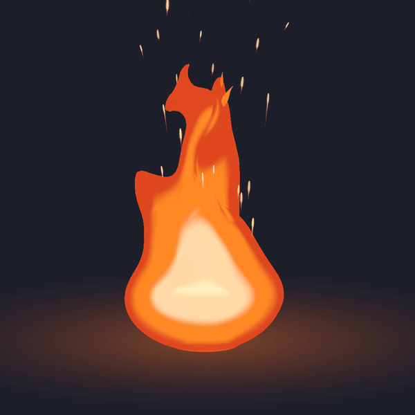

# Sculpted painterly fire

`painterly_sculpted_fire.tscn` is a separate 3D fire component. The original
`components/vfx/fire/painterly_fire.tscn` and existing memory instances are retained.
Place the root on the fire's base and use **Fire Size** for width and height.

The effect combines a full lower flame, irregular red-orange tongues, a luminous
heart, small detached flame pieces, billowing smoke, pointed sparks and a warm
ground wash. The flame is a true 3D volume. A rising curl/density field bends,
splits and necks its upper mass instead of moving fixed oval loops. The dense
root stays connected while the upper silhouette changes. Smoke moves more slowly.

Heat colors follow the volume's thickness: red/orange at thin edges, gold inside,
and cream at the deepest part of the heart. The component uses one original,
offline-generated Texture3D, with no flipbooks or downloaded assets. The ground
wash reuses the original fire's shader.

## Controls

| Inspector group | Main controls |
| --- | --- |
| Fire | **Fire Size** (width/height scale in meters), **Body Fullness**, **Intensity**, **Animation Speed**, **Curl Amount** (strength of the rolling upper flow), **Wind** (local X/Z), **Fire Seed** |
| Paint and Glow | **Core Color**, **Flame Color**, **Edge Color**, **Glow Strength** |
| Smoke | **Smoke Amount** (density), **Smoke Height** (plume rise), **Smoke Spread**, **Smoke Turbulence**, **Smoke Definition**, **Smoke Color** |
| Sparks | **Spark Amount**, **Spark Height** in flame-height multiples, **Spark Size** in meters, **Spark Variation**, **Spark Burstiness** |
| Recall | **Recall Enabled**, using the shared proximity distance and fade lifecycle |

**Body Fullness** defaults to **0.72**. It fills the lower flame without raising
a sphere into the upper silhouette. A flow-distorted tapered plume forms the
upper mass. Lower values narrow the base. **Spark Variation** (default **0.65**)
blends from consistent strokes toward varied short flecks and longer bent streaks.

Set **Animation Speed** to zero to freeze every layer. Set **Intensity** to zero
to hide the effect. Smoke Amount, Spark Amount and Glow Strength each support
zero to disable their batches. Spark Amount adjusts the active pool; Smoke Amount
changes the density of both smoke layers without rebuilding geometry. Smoke uses
one fused 3D billow volume with broad toon shading and faint upper wisps.
**Smoke Definition** (default **0.8**) adjusts the edge clarity and shading bands.
Its base develops above the hottest flame; expanding billows fade before their
birth clock wraps. Smoke Color defaults to a neutral warm gray.
Flame and smoke colors remain readable on the
game's warm-white background; emission supplies an accent without requiring bloom.
Glow Strength controls painted glow/emission, with no dynamic light added.

All appearance controls update uniforms and bounds; only Fire Seed regenerates
the seeded instance data. Each component owns private materials while sharing
cached geometry. Generated children stay internal, so the saved scene contains
only its authoring parameters. Recall preserves progress through rebuilds.

Open `res://tests/scenes/sculpted_fire_test.tscn` and press **F6**. This inherits the
generic component stage, including an explorer for scale, three backdrop options,
visibility/reload controls, and optional recall replay. Existing memories continue
using the original fire until an instance is deliberately swapped.

## Construction and cost

Six batches: main flame volume, detached flamelets, smoke volume, smoke fray,
sparks, and ground wash. The main flame traces a low rounded root smoothly fused
with a tapered plume inside an invisible bounds box, with at most 128 bounded
steps per pixel and five refinement steps when a trace crosses the surface.
An upward-scrolling 64³ field supplies curl displacement and density. Displacement
grows with height; density pinches the plume into irregular tongues and temporary
openings. An actual-height taper limits the size of detached upper pieces.
Three interior field samples estimate heat thickness without normal-lit spots
or a permanent painted highlight. The shader writes the depth of the
actual fire surface, so opaque scenery correctly occludes the volume.
Orthographic cameras use parallel tracing rays; perspective cameras use rays
through the proxy pixels. A camera-dolly check guards against projection distortion.

Draw-constant motion is prepared on the proxy vertices. The shared RGBA half-float
field occupies 2 MiB on the GPU; the compressed resource is about 1.6 MiB. RGB
encodes curl of smooth periodic vector potentials; alpha contains broad density.
Each fire seed changes its field offset. There is no runtime noise generation.

Three small detached accents use closed, curved 12-sided × 16-ring meshes
(384 triangles each). Their births and bends sample the same moving field,
appearing briefly where the upper flow is hot rather than tracing fixed loops.
Smoke traces seven smoothly fused, expanding billows inside a tightly fitted
box proxy, with at most 64 steps per pixel. Their centers, radii and lifecycle
weights are cached at the proxy vertices. Four distance samples estimate the
surface normal; a short analytic chord calculation supplies a connected opacity
through overlapping billows. The result has a scalloped 3D silhouette and broad
painted shadow, middle and light tones. Sixteen faint billboard dabs add upper
wisps. Both smoke layers test scene depth without writing it. The volume writes
its actual surface depth for that test, preventing proxy-box occlusion artifacts.

Sparks have a pool of 64 closed loft meshes (192 triangles each); the default
amount shows 42. Velocity-aligned strokes have pointed gold heads, a thin cross
section and narrowing orange/red tails. Their broad faces turn toward the camera
so they stay readable as 3D flecks rather than spheres. Variation controls width,
length and bend while preserving one drawn shape language. Embers follow the
plume, slow as they climb and fade from their tails. Restrained flicker adds heat;
Burstiness defaults to 0.35. Smoke renders before the sparks so their
bright marks remain readable, with opaque scene occlusion preserved.

Animation runs on the GPU, including the fused fire shape, moving heat layers,
smoke rolling/expansion/drift, and spark rise. The component has no animation frame
callback, physics particles, runtime simulation textures, screen/depth sampling, collision,
or sound. Bounds include the plume, lifted fragments, wind and spark travel.
The implicit flame costs more per covered pixel than the original simple fire.
Tight ray bounds and early exits limit empty work; physical-device performance
still needs profiling before using many large instances.

Local profiling of the flow revision on the M1 Mac (Godot 4.4.1 Mobile/Metal,
1280×720, VSync disabled, median of 120 frames after 30 warm-up frames) measured
about 6.9 ms/frame for one complete fire and 6.9 ms/frame for four; the empty
viewport was 2.97 ms/frame. These are whole-frame timings at a fixed gameplay-scale camera,
not a per-effect GPU budget or a measurement on a phone.

To regenerate the shared field (NumPy is needed only for this offline step):

```sh
python3 tools/generate_fire_flow.py
godot --path . --script tools/bake_fire_flow.gd
```

The second command saves `flame_flow.res`. Use the native renderer when baking;
the headless dummy renderer cannot reliably save Texture3D pixel data.

## References

The user's references informed the bright core, negative-space curls, detached
flame pieces and separate smoke/spark layers. Implementation research:

- [Alex Starovoyt — Stylized Fire Spell VFX](https://discofish.artstation.com/projects/eRDOkP): simple volume meshes, animated vertices and scrolling masks.
- [Cyanilux — Fire/Flame Shader Breakdown](https://www.cyanilux.com/tutorials/fire-shader-breakdown/): upward distortion, clear teardrop shapes and restrained overdraw.
- [Marina VFX — Stylized Fire Texture](https://realtimevfx.com/t/marina-vfx-50-weeks-of-stylized-vfx-between-art-emotion-code/29826): separate vertical fire flow and slower breathing shape.

These informed the design; all geometry and shaders here are original project
code, with no downloaded reference assets.

## Verification

```sh
godot --headless --path . --script tests/sculpted_fire.gd
godot --path . --script tests/sculpted_fire_render.gd
godot --path . --script tests/sculpted_fire_render.gd -- --animation
godot --path . --script tests/sculpted_fire_render.gd -- --animation --detail
godot --path . --script tests/sculpted_fire_render.gd -- --animation --detail --smoke --sparks
```

Checks cover parameter persistence, geometry/material sharing, independent
materials, bounds, layer disabling, amount changes, recall/rebuild continuity,
frozen animation, visible motion, and visibility from four angles. The render check
also isolates the main fire across seven times, checks its core at both Curl Amount
extremes, verifies foreground/background occlusion and perspective projection,
and checks smoke density, Definition, scene occlusion and animation in isolation.
Ember visibility, motion and Spark Variation are checked independently too.
The solid flame is also tested through partial recall and maximum wind at low
intensity. It writes
light/dark previews to `docs/previews/sculpted-fire-{light,dark}.png`. The optional
animation frames go to `/tmp/sculpted-fire-frame-*.png`. `--detail` also captures
the flame/wisps close up with smoke disabled to `/tmp/sculpted-fire-detail-*.png`.
`--smoke` captures the isolated plume to `/tmp/sculpted-fire-smoke-*.png`. `--sparks` additionally captures isolated embers to `/tmp/sculpted-fire-sparks-*.png`. Animation
captures are four seconds at 24 frames/second. See [the art-direction guide](../../../docs/SCULPTED_FIRE_ART_DIRECTION.md) and
[the smoke critique](SMOKE_REVIEW.md)
for the rationale behind the layered plume.




