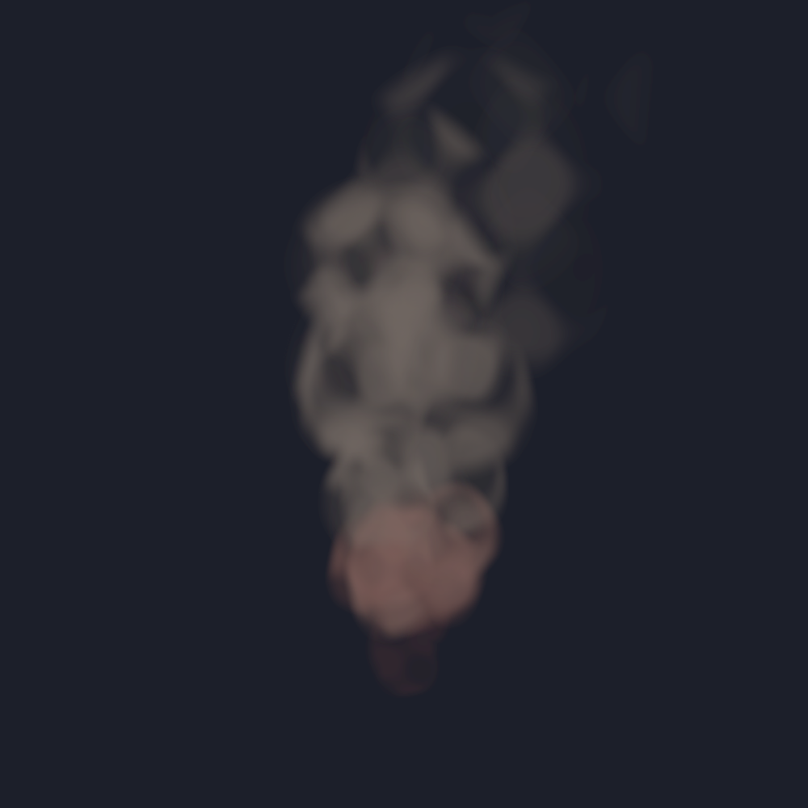
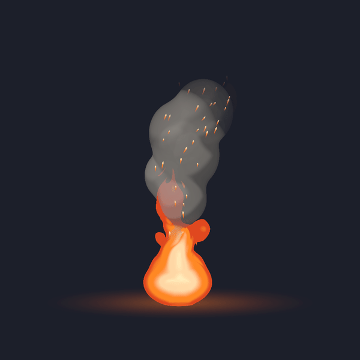

# Smoke critique and redesign

The supplied campfire reference reads as a connected plume: small, hot forms
close to the flame roll into larger gray masses above it, while embers remain
visible through the smoke. Its silhouette is uneven, its internal motion is
slower than the fire, and its boundaries soften as it disperses.

The previous close-up missed those qualities:

- **Countable solid puffs.** Eight opaque, shaded spheres exposed their joins.
  Stacked silhouettes and three-tone lighting made them resemble rocks.
- **Shrinking instead of dissipating.** Each puff changed scale at the end of
  its life, but retained a solid surface and a recognizably separate identity.
- **Uniform material and rhythm.** Purple-gray paint, similarly sized cells and
  regular upward movement made the column feel arranged rather than turbulent.
- **Weak connection to the fire.** The smoke appeared above the flame rather
  than developing from its hot upper region. Warmth was a small tint on isolated
  puffs; embers did not feel embedded in one shared flow.

## Implemented replacement

The current pass retains a continuous loft as a faint connecting density. Its
surface no longer carries strong normal lighting: that exposed folded tubing in
the first replacement. Smaller geometric deformation and broken interior opacity
keep the connection without defining a smooth outer skin.

Sixteen soft brush dabs now carry the visible billows. Unequal lobes roll within
each dab, expand through shared 3D flow, and erode internally before fading away.
The lower column stays connected while upper lobes separate into thinning wisps.
The palette remains neutral brown-gray with restrained warmth at the fire. A
feathered UV boundary prevents the procedural lobes from exposing quad edges.
Both smoke layers depth-test without writing depth, so embers remain visible
through their translucent density. Embers inherit the plume's drift.

**Smoke Amount** controls optical density; **Smoke Turbulence** controls rolling
billows and meander. Height, Spread, Color and Wind remain direct art controls.
The smoke intentionally moves more slowly than the new rapid flame bursts.

The surrounding fire now has sharper, more strongly tapered hooks, staggered
roughly one-second bursts, a localized bright heart, and red/orange outer paint.
Rising heat parcels thin before detaching to avoid large floating blobs. Sparks
mix small ember heads with velocity-aligned trails, grouped emissions, changing
launch directions, flicker, and delayed red cooling.

## Review and verification

Open `res://tests/scenes/sculpted_fire_test.tscn` and press F6. Use both dark and
warm-white floors. Inspect the smoke with the flame hidden as well as in context;
a bright fire can otherwise conceal an empty or weak plume.

The render check tests smoke density and movement independently, freezes all
layers, checks the main flame across time and curl settings, verifies four views
and perspective, and places scenery in front of and behind the fire. Component
checks cover saved controls, shared geometry/private materials, layer disabling,
bounds and recall/rebuild continuity.

```sh
godot --headless --path . --script tests/sculpted_fire.gd
godot --path . --script tests/sculpted_fire_render.gd -- --animation --detail --smoke
```



The [isolated smoke animation](../../../docs/previews/sculpted-fire-smoke-motion.gif)
shows its independent billowing and dissipation without the flame obscuring it.


