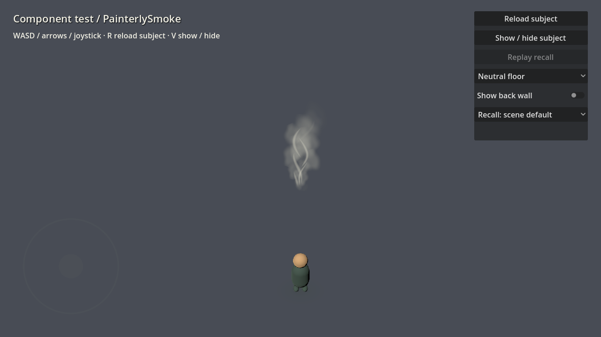

# Painterly smoke / steam

Instance `res://components/vfx/smoke/painterly_smoke.tscn` and place its root at
the emission source: a cup, stove, chimney, fire, or patch of magical mist.
Soft scalloped puffs mingle with tapered curling brush strokes, using layered
pigment colors instead of realistic volumetric smoke. The plume previews and
animates in the editor.

## Starting looks

- **Steam:** cream-colored, airy curls with soft translucent puffs. The default.
- **Soft Smoke:** fuller lavender-gray billows with subdued pale wisps.
- **Candle Smoke:** a thin, delicate trail with tighter curls.
- **Dream Mist:** a wider, gently drifting lilac plume.

Choose **Preset** on the component root, then tune its parameters. Changes switch
the selection to **Custom**; save the component variant to keep that look.

## Shape and motion

- **Plume Height / Emitter Width / Spread:** height, source footprint, and widening.
- **Curl Radius / Curl Turns:** amplitude and number of curls along the rise.
- **Wind:** final drift in local X/Z meters. Rotate the component to orient it.
- **Lifetime / Animation Speed:** travel time and motion multiplier. Speed zero
  freezes both layers.
- **Puff Size:** starting and ending puff size. Puffs expand as they rise.
- **Wisp Width / Wisp Length:** brush stroke thickness and fraction of plume height.
- **Base / Shade / Highlight Color / Paint Variation:** the pigment palette and
  broad painted bands.
- **Density / Puff Opacity / Wisp Opacity:** transparency and balance between layers.
- **Puff Count / Wisp Count / Emitter Seed:** population and reproducible variation.
  Either count can be zero to use only one layer; density zero hides both.

The source emits continuously with staggered phases; puffs and wisps fade before
looping. This is a decorative plume with no smoke simulation or collision.

## Recall

The single **Recall Enabled** checkbox opts into proximity recall. The plume fades
in over 1.8 seconds when an explorer approaches its source footprint. It uses the
shared `components/effects/recall/recall_settings.tres` distance and stays visible
after discovery. Disabling recall restores full visibility.

## Test and rendering cost

Open `res://tests/scenes/component_test.tscn` and press **F6**. Set **Subject Scene** to
`res://components/vfx/smoke/painterly_smoke.tscn`. Use the floor presets to judge contrast and the recall
controls to replay its appearance.

Two internal MultiMesh batches animate entirely in shaders. Default steam uses
288 triangles across two transparent surfaces, without textures, shadow passes,
or per-frame CPU animation. Appearance edits update uniforms; population/seed
edits rebuild geometry. Transparent overdraw still grows with screen coverage
and overlapping emitters; profile those situations on the target phone.

Checks:

```sh
godot --headless --path . --script tests/smoke_emitter.gd
godot --path . --script tests/smoke_emitter.gd -- --capture
godot --headless --path . --script tests/recall_settings.gd
```

The render check verifies motion, a frozen frame, and captures all four presets
to `/tmp/painterly-smoke-{steam,smoke,candle,mist}.png`.


