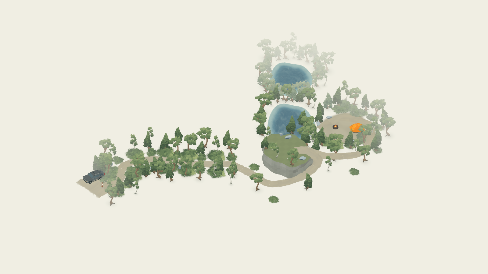

# Bean and Bear Lakes · July 25, 2026

A summer backpacking memory in northern Minnesota: **parked 4Runner → forest
trail → two-lake cliff overlook → lakeside camp**. Recall it between Southern
Vietnam and Vineyard, or run `res://scenes/world/bean_bear_world.tscn` with F6.

The date, trail, vehicle, overlook relationship and camping equipment are confirmed
by the brief. Time of day and personal wording are unspecified. The scene uses the
shared soft daylight and explicitly marked placeholder notes. Layout distances are compressed for exploration.

## Three zones

- **Trailhead:** `trailhead_zone.tscn` starts beside the existing gray 4Runner.
  **ForestTrail** winds between native-looking pine, birch and broadleaf trees,
  layered shrubs, reused ferns, grass and granite boulders. Staggered planting
  leaves a clear route for two explorers. The first fragment sits within the forest.
- **Overlook:** `overlook_zone.tscn` reuses the coastal headland with gray rock and
  a summer-green cap. **OverlookClimb** curves around its flank onto a supported
  landing. Two existing water bodies lie on the same camera sightline: the nearer
  lake, then the farther lake, separated by wooded shore. Softer, simpler distant
  crowns suggest depth. The second fragment occupies the open ledge.
- **Campsite:** `campsite_zone.tscn` is reached along **ToCamp**, descending around
  the other side of the rock. It reuses the orange Stormbreak-style tent, active
  WhisperLite-style stove with pot/steam, and steel fire ring with its existing
  animated fire VFX. Forest encloses a small irregular earth-colored sand clearing,
  leaving the lake-facing bank open. **CampWalk** leads around the gear to the
  third fragment. The tent stays a closed scenic exterior.

The routes use the [earth-trail preset](../../../components/groundcover/paths/README.md),
with unequal soft shoulders and sparse embedded stones rather than sidewalk joints.
Their original curves/heights and guidance links are preserved. The
[backpacking kit](../../../components/scenery/camp/BACKPACKING.md),
[water](../../../components/scenery/water/README.md), headland and sand reuse the
existing component library.

## Editing

Edit **Fragment → Note Title / Notes** inside each zone:

| Zone | Placeholder title |
| --- | --- |
| Trailhead | Into the north woods |
| Overlook | One lake, then another |
| Campsite | Camp beside the lake |

Each zone owns an ambient bed: quiet woodland, exposed wind, then sheltered camp.
These reuse placeholder recordings (`vineyard_rows`, `vineyard_field`, and
`cabin_clearing`). Replace the zone root's **Ambience Stream** with your recordings.
Music remains available on **Memory/Audio**; fragment cues use the shared SFX bus.

`../../../scripts/bean_bear_camera.gd` starts at **3.5**, follows the woods at **4.6**,
opens to **29** at the elevated overlook, then settles around the camp at **8**.
The reveal depends on actual height and distance; walking underneath the cliff
cannot trigger it. Movement reverses all transitions without changing camera yaw.
**Overlook Focus** and **Overlook Size** tune the view. Preserve the lakes' center
delta of `(-11, 0, -11)` to keep them aligned with the inherited camera.

All recallable scenery, including the nested fire, has recall enabled. **ArrivalRecall**
reveals the parked car, **OverlookRecall** reveals the cliff/lakes/distant forest,
and **CampRecall** reveals the camp trees, clearing and gear from the same accessible
overlook, so its distant path never appears as an empty loop. Water
now supports an optional **Recall Anchor**, so distant lakes can appear from the
cliff instead of requiring the player to stand at water level. Empty anchors retain
ordinary shoreline discovery. Foliage responds to both explorers. Distant trees use
28 leaf sprays per cluster; nearby trees use 52, with shader wind and no falling leaves.

One hidden **Environment/ForestFloor** supplies finite support and outer safety
boundaries. Curved paths supply their own continuous elevated collision. Their
clockwise collision faces also support downward guidance rays. Keep summit paths
at the cliff's **3.2** top height; their visible surface is already lifted slightly.
The camera, hints and real explorer should all be checked after changing heights.

`../../../scripts/bean_bear_memory.gd` derives hints directly from the same curves.
If extending the routes, regenerate the finite outline:

```sh
godot --headless --path . --script tools/rebuild_bean_bear_floor.gd
```

Keep the **Entry** and its guest fallback **+1.2 m X** clear of vehicle, trunks and
shore barriers. LAN shares avatar choice and player movement; notes, recall,
foliage disturbance rendering, audio and scenic fire remain local to each device.

## Verification

```sh
godot --headless --path . --fixed-fps 60 --script tests/bean_bear_memory.gd
godot --path . --fixed-fps 60 --script tests/bean_bear_memory.gd -- --capture
godot --headless --path . --script tests/water_recall.gd
godot --headless --path . --script tests/curved_path.gd
godot --headless --path . --script tests/memory_effects.gd
```

The memory check uses the real explorer in both directions, visits/taps all three
fragments, requests each hint, climbs and descends the rock, verifies both lake
centers' screen alignment and framing, checks recall/ambience, finite support,
paired arrival space and timeline avatar choice. Separate `-- host` / `-- guest`
processes use isolated UDP **24765**; production IP-entry LAN stays on 24680.
Rendered Mobile previews live in `docs/previews/bean_bear-memory-*.png`.
The rendered walkthrough, headless route/fragment/camera check, two-process LAN,
water/path component checks, full timeline recall audit and existing First Meeting,
Southern Vietnam and Vineyard regressions pass.
Physical phone/Wi-Fi performance remains unmeasured. Existing macOS shader-cache
and Godot shutdown-resource warnings may appear.


