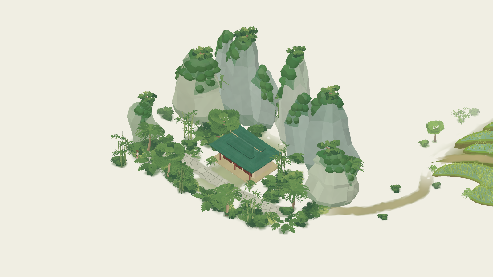

# Central Vietnam · June 15, 2026

**Da Nang · Marble Mountains → terraced rice fields → Hue Imperial City**, in three
zones. Recall **Central Vietnam** after Northern Vietnam, or open
`res://scenes/world/central_vietnam_world.tscn` with F6.

## Brief and reuse

The Da Nang beat is a lush limestone grove with a green-tiled temple nestled in
its clearing. Six faceted limestone formations, elevated broadleaf crowns,
palms, bamboo, broad tropical leaves, ferns and low bushes carry that identity.
A winding flagstone approach opens into the small temple court, then turns out
towards the fields. The front remains open to the ivory void.

The composition draws on the pagodas among the limestone peaks described by
[Vietnam Tourism](https://vietnam.travel/things-to-do/around-marble-mountains/).
It is a compressed, stylized recollection, not a surveyed reproduction of a
particular pagoda. Green roof tiles are the author's requested color. Personal
wording, the rice field's precise location and time of day remain unspecified;
notes are explicitly placeholders and the world uses shared soft daylight.

Existing limestone karsts and the Vietnamese pavilion supply the architecture;
the pavilion now supports optional broad tile relief. Jungle planting, trees,
bushes, grass, the new surface paths, rice terraces, the open Meridian Gate and
Thai Hoa-inspired hall are reused. No new mountain or jungle renderer is needed.

## Layout

- **Marble Mountains:** `marble_mountains_zone.tscn` replaces the beach. Six solid
  ridges, spires and shelved bluffs frame the **NestledTemple**. **MountainRoute**
  follows a walkable flagstone curve from the jungle arrival, past the fragment
  in front of the temple, and onto **ToFields**. **TempleCourt** adds broad stone
  paving. Exit planting guides the route where the flagstone and earth fade
  apart. The temple and cliffs recall from **MountainView**.
- **Rice:** `rice_zone.tscn` has eleven individually shaped, flooded paddies
  at staggered levels. **BundWalk** winds between planted plots and climbs to
  the fragment and overlook. **ToHue** descends along the same earthen bank
  before its tread fades. Paddies, raised banks and crop rows share one
  painted mesh. The rice shader animates the water and responds to both explorers.
- **Hue:** `hue_zone.tscn` approaches the **MeridianGate** through its open central
  arch, then reaches a partial ceremonial court and **ThaiHoaHall**. Muted gold
  roofs, green gate wings, red timber, ochre masonry, two leafy ponds and partial
  walls carry the identity. The garden shrubs and early gate recall guide the
  approach where the field path fades. The fragment is in front of the hall.

**Environment/VietnamFloor** is one hidden finite platform using
`walk_outline.tres`, formed from the solid mountain clearing, buffered
connections and the two other land clusters. It supplies outer support without
internal platform rims. The host and the guest's 1.2 m X spawn offset fit on the
arrival path. The guidance curves and finite floor carry walks across the
visible breaks. The rice bund and its banks share the same authored curves,
with a single static collider for the banks and paddy ground.

## Authoring

Edit **Fragment → Note Title / Notes** in the relevant zone:

| Zone | Placeholder title |
| --- | --- |
| Marble Mountains | A temple among the limestone |
| Rice | Along the rice terraces |
| Hue | Within the imperial walls |

`../../../scripts/central_vietnam_memory.gd` derives requested brushstroke routes
from the authored curves. The first route ends at the temple fragment; the next
continues along **MountainRoute**, **ToFields** and **BundWalk**. Update the
supported floor when extending a path; run `godot --headless --path . --script
tools/rebuild_central_vietnam_floor.gd` to regenerate its connected outline.
On **RiceTerraces**, edit **Paddy Contours** as closed, level local curves.
**Bund Paths** references **BundWalk** and **ToHue**, which should meet on
the same grade and share a width. The bank rebuilds from those curves when
they change. Keep the paddy shoulders clear of the footpath and align the
fragment when moving the crest.

The camera holds **4.7** for walking, including between the paddies. It widens
to **17.6** at the temple, **14.0** on the rice crest, **11.6** at the gate
and **8.8** in the palace court. The reveal areas and focus points live in
`../../../scripts/central_vietnam_camera.gd`.

Each zone has a quiet ambient bed. The mountain grove and fields reuse jungle
ambience as a placeholder, not a location recording. The previous beach surf and
sea palette remain available assets but are no longer used by this memory.
Music remains available on Memory/Audio and fragment chimes use SFX. LAN shares
avatar identity and movement; notes, recall, audio and scenic breeze remain local.

## Validation and views

```sh
godot --headless --path . --script tests/vietnam_components.gd
godot --headless --path . --fixed-fps 60 --script tests/central_vietnam_memory.gd
godot --path . --fixed-fps 60 --script tests/central_vietnam_memory.gd -- --capture
```

The real-explorer walkthrough covers both directions, supported arrival,
finite path containment, the temple fragment, the rising/descending field
routes, the central gate, all note tap targets, requested guidance, ambience,
camera changes and timeline avatar choice. Separate `-- host` / `-- guest`
processes use isolated UDP **24745** for partner presence and movement;
production IP entry stays on 24680. Native Mobile renders are saved in
`docs/previews/central_vietnam-memory-*.png`. Phone/Wi-Fi performance has not been
measured. Existing headless material and macOS shader-cache/exit resource warnings
may appear.

[Before and after](../../../docs/previews/central-vietnam-polish-comparison.jpg) ·
[Walking among the rice paddies](../../../docs/previews/central_vietnam-memory-rice-bund.png)


