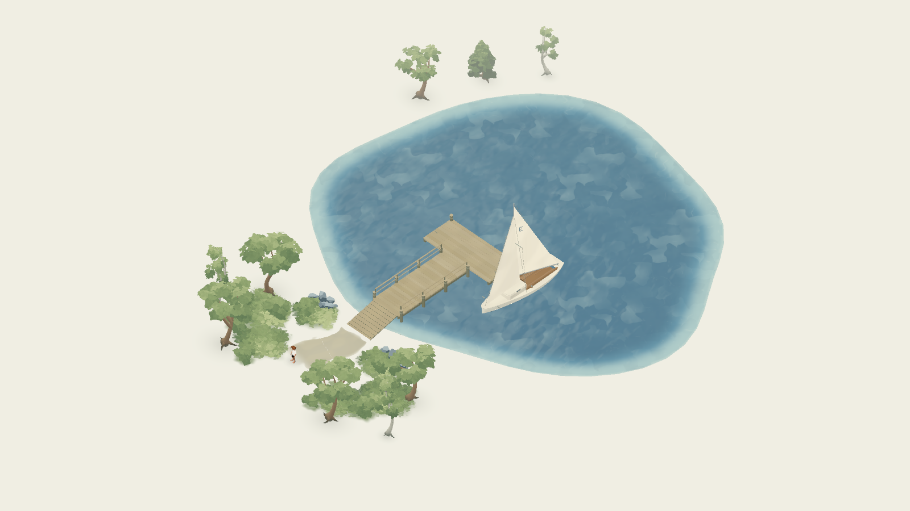

# First Sail · August 22, 2026

One lake-focused zone: **planted summer bank → wooden dock → Pearson Ensign**.
Recall it after Vineyard, or run `res://scenes/world/first_sail_world.tscn` with F6.
The date and sailing theme are confirmed; the lake's name, time of day and personal
wording are unspecified. The scene keeps the shared soft daylight and warm-white void.

## Composition and reused pieces

`lake_zone.tscn` inherits the standard MemoryZone. It instances the existing
**PainterlyWoodenDock** as a T landing, **PainterlyEnsign**, **PainterlyWater**, curved
shore path, trees, bushes, grass and rock clusters. No new model components were
needed. Six summer trees and uneven low planting frame the dock base; three softer
distant trees lightly suggest the opposite shore. Planting excludes the water,
access ramp, path and shore stones.

The 9 m dock has a 2.4 m main pier, 6 m landing, side rails and its existing sloped
shore ramp. The Ensign sits beside the landing at the waterline, with clearance for
its hull/fenders. Existing shader animation gives the boat gentle rocking and the
sails a little wind. It retains the sailing component's scenic exterior behavior.
See the [sailing kit](../../../components/scenery/sailing/README.md) for controls.

One hidden **Environment/ShoreAndDockFloor** supplies finite support and outer
safety boundaries along the bank, ramp, pier and landing. The dock supplies its
actual elevated collision. Keep the floor's **Custom Outline** aligned with the
pier and landing when changing dimensions. **Lake → Block Water Entry** stays off
so shoreline barriers do not cut across the access ramp. The finite floor stops
explorers before the open landing edges. Entry and the guest's **+1.2 m X** fallback
both fit on the shore approach.

## Authoring

Edit **Lakeside → Fragment → Note Title / Notes** in `lake_zone.tscn`. The placeholder
is titled **Our first sail** and asks for your own words about the Ensign. It stands
on the landing, with room for both explorers. Requested guidance follows the same
shore curve, then the real ramp and pier; it is derived by
`../../../scripts/first_sail_memory.gd` and updates when the path or dock changes.
If changing dock length/height, reposition the fragment, floor and Entry as needed.

`../../../scripts/first_sail_camera.gd` starts at **3.5**, gradually opens through
**6** on the ramp/pier, and reaches **17** at the landing. The fixed-yaw reveal
frames bow, stern and masthead together. **Sailing Focus** and **Sailing Size** tune
the view. Walking back to shore smoothly restores close framing.

Recall is enabled on all 28 recallable pieces. **ShoreReveal** reveals the water and
dock from the bank. **DockReveal** reveals the Ensign and distant trees as the player
walks onto the pier. All 23 foliage components respond to both explorers. Boat and
sail motion run in the existing shader without per-frame geometry updates.

The zone root's **Ambience Stream** reuses the quiet `central_vietnam_surf` recording
at −29 dB as placeholder water ambience. Replace it with your lake recording there.
**Memory/Audio** retains the standard music slot and fragment SFX cue. LAN shares
avatar choice and player movement; recall, notes, audio and scenic motion remain
local to each device.

## Validation and previews

```sh
godot --headless --path . --fixed-fps 60 --script tests/first_sail_memory.gd
godot --path . --fixed-fps 60 --script tests/first_sail_memory.gd -- --capture
godot --headless --path . --script tests/sailing_components.gd
godot --headless --path . --script tests/memory_effects.gd
```

The real-explorer check walks the approach, ramp, both landing arms and return;
checks the finite edge stop, fragment tap/read, requested hint, ambience, recall,
boat clearance, camera framing, paired spawn space and timeline avatar selection.
The rendered Mobile walkthrough, component checks, timeline smoke test and complete
17-world recall/foliage audit pass. Two separate `-- host` / `-- guest` processes
also pass on isolated UDP **24775**; production IP-entry LAN remains on 24680.

The separate whole-story UI test currently stops at its `StoryTitle` lookup: the
existing UI creates that label but has its `add_child` call commented out. First
Sail's timeline selection and recall checks pass. Phone/Wi-Fi performance is
unmeasured; existing Godot shader-cache and shutdown-resource warnings may appear.

Previews are in `docs/previews/first_sail-memory-*.png`.


