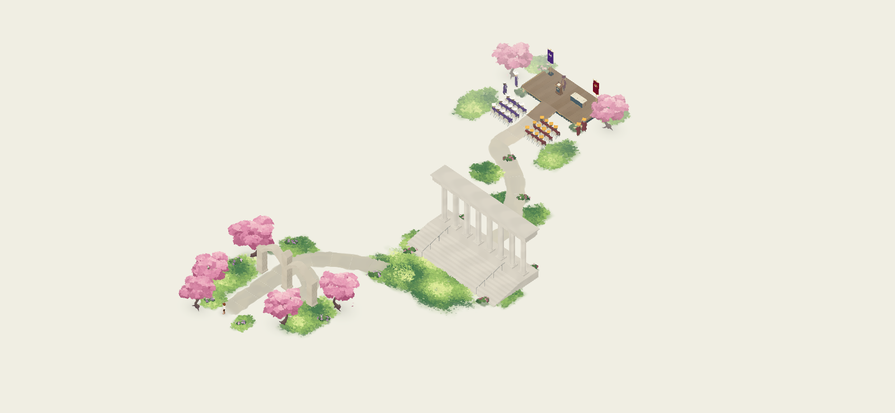

# Graduation · May 14, 2026

Three open spring vignettes connect St. Thomas's twin stone arches, the University
of Minnesota's columned portico, and an intimate commencement ceremony. Five cherry
trees frame the arrival and arches; two more flank the ceremony. Curved stone paths, small planting islands
and white negative space suggest the journey between campuses; this is an authored
memory composition, not a continuous reconstruction of their real geography.

Recall **Graduation — MAY 14, 2026** between Mifflin and Vineyard in Memory Lane,
or run `res://scenes/world/graduation_world.tscn`. The inherited world provides
Soren/Vivian selection, LAN presence, fragments, audio mixing and requested guidance.

## Scene and route

- `../graduation.tscn` owns Entry/Exit, one hidden finite **CampusFloor**, ordered
  zones and three requested brushstroke routes. Both arrivals fit the first path;
  the guest's 1.2 m offset stays supported. The concave floor joins all three
  places without internal platform boundary walls.
- `arches_zone.tscn` reuses **PainterlyCampusArches** and the cherry blossom tree
  preset. **CampusWalk** passes through the left arch to the first fragment;
  **OtherPassage** provides a second way through. The last four meters of
  CampusWalk dissolve, ending before the portico. Three additional cherry trees
  line the route before the arches. Low planting leaves both openings clear,
  with scattered petals and soft canopy shade on the stone.
- `portico_zone.tscn` reuses **PainterlyClassicalPortico** from the campus landmarks
  study. A broad, walkable grass courtyard replaces the continuous paved approach.
  **CourtyardLawn / CourtyardLawnEdge** overlap naturally, excluding the portico
  and the visible part of CampusWalk. Its actual shallow treads lead to the second
  fragment on the landing. Trees and spring planting frame the outer stairs
  and the first garden bend. The center of the colonnade stays open.
  The center column gap opens onto **GardenWalk**, a continuous curved path
  descending from landing height to the ceremony. Keep its first point aligned
  with the rear landing and its last point/tangent aligned with the ceremony aisle.
- `ceremony_zone.tscn` instances the existing **GraduationSetup**: ramped deck,
  lectern and presenter, diploma table, 24 seated graduates, four waiting
  graduates, cloth banners and flowers. A 2.2 m chair aisle meets the 2 m stage
  ramp. The last fragment is on the deck, within reach from its open center.
  St. Thomas occupies the left chair bank: purple gowns, white caps and stoles.
  Minnesota occupies the right bank: maroon gowns, gold caps and stoles. Two
  waiting graduates on each side and the two stage banners use the same palettes.
  Graduate idle motion and cloth movement reuse the kit's batched shaders.
  Low flower groups mark the aisle entrance and frame the stage. Canopy Shade
  drifts across the timber, and the stage framing lifts slightly toward the banners.

All authored recallable scenery has **Recall Enabled**, including the nested
ceremony props and flowers; all foliage responds to both explorers. Collision
stays supported throughout recall. The portico and stage framing plants recall
from reachable approach markers.

## Editing

In `ceremony_zone.tscn`, **Setup/SeatedGraduates** and **Setup/WaitingGraduates**
use the St. Thomas palette; **MinnesotaGraduates / MinnesotaWaiting** use Minnesota.
Set **Gown Color**, turn off **Cap Matches Gown**, then set **Cap Color / Stole Color**.
The seated groups reference the same Chairs block and use **Seating Side → Left /
Right**, keeping 12 non-overlapping occupants on each side. **CommencementStage →
Individual Banner Colors** exposes **Left/Right Banner Color / Trim** for their flags.


Edit each zone's **Fragment → Interaction → Note Title / Notes** for personal text.
The three one-page notes — “Under the arches,” “At the university,” and “A new
beginning” — are explicitly placeholders.

`../../../scripts/graduation_memory.gd` samples the editable path curves and portico
tread profile for requested hints. The first fragment follows CampusWalk's third
control point. The portico note follows the component's landing height. When
changing stairs, also align GardenWalk's elevated start. Guidance recognizes
**PorticoStairs** as supported walking geometry, while columns and other solids
remain obstacles.

`../../../scripts/graduation_camera.gd` exposes **Walking Size** 3.5, **Arches Size**
7, **Portico Size** 13.5, **Landing Size** 5.5 and **Ceremony Size** 6.5. Arrival
and connecting paths stay close. The wide colonnade briefly fills the approach
view, then the camera closes again while climbing toward the landing note.
Transitions reverse smoothly without rotating movement directions.

The zone roots reuse quiet breeze/bird-like beds for the two campus spaces and
a subdued crowd murmur for commencement. Tune **Ambience Volume / Size / Blend
Distance** on each root. Shared fragment chimes use SFX; **Memory/Audio** retains
a music slot for a chosen soundtrack. These are placeholder sound identities.

## Checks and previews

```sh
godot --headless --path . --fixed-fps 60 --script tests/graduation_memory.gd
godot --path . --fixed-fps 60 --script tests/graduation_memory.gd -- --capture
godot --headless --path . --script tests/memory_effects.gd
```

The real-explorer check walks both arch openings, stairs, raised curved path,
occupied aisle and stage ramp in both directions. It checks both school groups'
seat occupancy and cap colors, courtyard access, and every note's tap
visibility/reach, requested guidance, audio, camera transitions, paired spawn
support and timeline avatar choice. Separate `-- host` / `-- guest` runs verify
partner appearance, different avatars and replicated movement on isolated UDP
24715. Production IP entry remains on 24680. Physical devices and Wi-Fi performance
have not been measured.

Native Mobile-renderer views: [arches](../../../docs/previews/graduation-memory-arches.png),
[portico](../../../docs/previews/graduation-memory-portico.png),
[courtyard](../../../docs/previews/graduation-memory-courtyard.png),
[ceremony](../../../docs/previews/graduation-memory-ceremony.png), and
[stage](../../../docs/previews/graduation-memory-stage.png).


