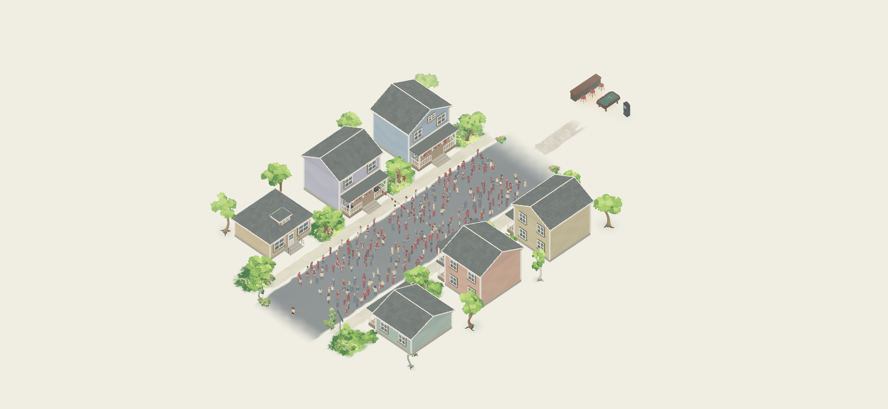

# Mifflin Block Party · April 25, 2026

Two connected zones recall a spring block party at UW–Madison and a quieter bar
interior. Six pastel houses, porch speakers and pennants frame the outdoor street;
spring trees, bushes, blossoms, flowers and grass dissolve into the ivory void.
Flowering curb pockets frame the arrival and interrupt the stretch of asphalt.
Guests sway and bounce lightly across the street, including the center. The bar
contains only the pool table, electronic jukebox and a freestanding counter with
three stools, composed directly in the memory void.
The block is an evocative composition rather than a reconstruction of addresses.
Both fragments contain explicitly marked placeholder personal notes.

Run `res://scenes/world/mifflin_world.tscn`, or recall **Mifflin Block Party —
APR 25, 2026** in Memory Lane. The shared world supplies avatars, LAN, tap
interaction, guidance, audio mixing and return controls. House walls and roofs
remain opaque.

## Scene and editing

- `../mifflin.tscn` owns one finite custom-outline floor connecting street, approach
  and bar. Its **Environment/Street** is the reusable
  [PainterlyStreet](../../../components/groundcover/street/README.md): edit Length,
  Width, asphalt color, seed and edge/end fades. The road is one continuous painted
  surface. The two sidewalks use the original paving. The bar approach uses
  curved urban setts with feathered ends to lead from the asphalt into the void.
- `block_party_zone.tscn` owns the outdoor scenery, fragment and crowd/air bed.
  The house family, spring planting and porch props remain independently editable.
  Both speakers sit inside the west porch deck, clear of front/side rails and the
  doorway. That porch's guest group was removed to leave the equipment clear.
- **Environment/StreetWeave** and **PorchWeave** are hidden, non-colliding
  PainterlyCurvedPath scenes. Edit their Curve3D handles to change the narrow
  meandering gaps between guests. The broad **StreetGathering** references them
  through **Ground Exclusions**. Existing seeded crowd scatter fills the rest of
  the road; its stationary capsules make walking feel like weaving through people.
  Sidewalks provide a less crowded alternative.
- `scripts/mifflin_memory.gd` samples those curves and BarApproach for requested guidance:
  arrival → street/porch fragment, then back through the gathering → bar fragment.
  Editing handles updates both guidance and crowd clearance. Keep the branch's
  first point joined to the main curve and its endpoint at the street fragment.
- `bar_zone.tscn` contains **PoolTable**, **Jukebox** and **BarCounter** under
  Scenery. The standalone counter reuses the bar kit's painted geometry and
  collision/recall framework, with adjustable dimensions and stool count. There
  are three faint pools of color painted onto the ivory void under Presentation.
  The shared hidden ground supports an open walk around the pool and stools.
- Edit each zone's **Fragment → Interaction → Note Title / Notes** for the story.
  Each Notes entry is one page. Fragments retain the standard tap/read lifecycle.
- `scripts/mifflin_camera.gd` exposes **Walking Size** (4.7), **Party Size** (8.2)
  and **Bar Size** (6.1). The fixed-angle camera opens up briefly at the porch
  branch to reveal the busy block, and frames all three bar props near its fragment.

Keep the single MemoryPlatform outline around every new route; separate touching
platforms would introduce blocking perimeter rims. Ground exclusions on the
planting reference houses, porches and paving. New house variants remain in the
[neighborhood kit](../../../components/buildings/neighborhood/README.md).

## Audio and activities

Original instrumental music continues through Music. Outdoor synthesized crowd/air
blends into a quieter indoor room bed on Ambience as the local explorer approaches
the bar. Fragment cues and pool sounds use SFX. Edit standard Audio and zone
controls to change the mix; the clips are placeholders generated in the project.

The existing pool table supports its tap-to-rack-and-break toy, animated balls and
short sound effects. The electronic jukebox has an animated display; it remains
visual scenery while the memory Audio node supplies music. Pool shots, fragments,
recall, ambience and scenic animation are local; shared avatar choice and movement
use the existing LAN framework. See [bar props](../../../components/activities/bar/README.md).

Visual references: [The Daily Cardinal's porch photographs](https://www.dailycardinal.com/gallery/m4kbykcs97nyxa1)
and the [Wisconsin Historical Society's Mifflin photograph](https://www.wisconsinhistory.org/Records/Image/IM84176).
All scene geometry is generated in the project; these photographs are references.

## Checks and previews

```sh
godot --headless --path . --fixed-fps 60 --script tests/mifflin.gd
godot --path . --fixed-fps 60 --script tests/mifflin.gd -- --capture
godot --headless --path . --script tests/street.gd
godot --headless --path . --script tests/memory_effects.gd
```

The actual-explorer walkthrough checks the populated center, winding passages,
speaker bounds against the porch, both fragments, guidance, bar entry/return, clearance and collision around the stools,
ambience blending, camera sizes, pool playback and timeline character choice.
Existing crowd layout/collision and bar component checks cover the reused systems.
Run the memory test with `-- host` and `-- guest` in two terminals, host first, for
an isolated loopback check on UDP 24695. Production IP entry remains on 24680.
Physical-phone performance and Wi-Fi still need target-device review.

Native captures are `docs/previews/mifflin-{arrival,street,porch,bar,pool,overview}.png`;
the overview shows the complete recalled composition.

[Before and after at arrival, the street and the bar](../../../docs/previews/mifflin-polish-comparison.jpg)


