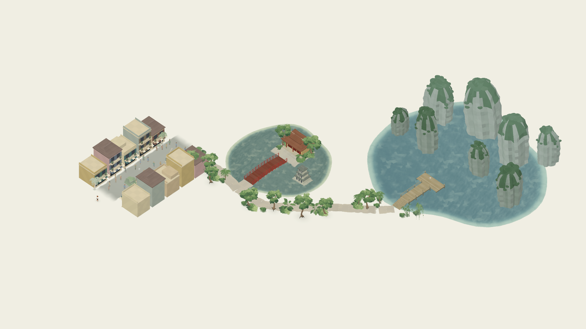

# Northern Vietnam · June 6, 2026

Three connected memory clusters: **Hanoi Old Quarter → Hoan Kiem Lake → Ha Long Bay**.
Open `res://scenes/world/northern_vietnam_world.tscn` with F6, or recall Northern
Vietnam between Tokyo and Vineyard on the timeline. This is a compressed memory
composition, not a geographic walking route between Hanoi and the bay.

## Brief and layout

The confirmed context is northern Vietnam on June 6. The composition moves from
an intimate, inhabited street to a leafy island temple and then an open limestone
seascape. Personal stories and time of day were not supplied; notes remain explicit
placeholders and lighting uses the shared soft daylight.

- **Old Quarter:** ten narrow shophouses mix ochre, faded pink, pale plaster and
  green shutters. Two or three floors, roof profiles, balcony rails, planters and
  striped awnings vary the street silhouette. Existing shader-animated crowds leave
  a clear shared lane. The near row sits back far enough to keep the fragment and
  explorers visible, without a building cutaway.
- **Hoan Kiem:** a short wooded promenade leads across a real arched red footbridge
  to a small Ngoc Son-inspired pavilion. A separate Turtle Tower sits offshore.
  The island is a small playable branch: return across the bridge, then follow the
  curved bank toward the bay. The temple is a scenic exterior, not an enterable room.
- **Ha Long:** an existing timber dock opens into a T-shaped overlook over muted
  jade-blue water. Eight differently seeded limestone formations layer fluted cliffs,
  irregular crowns and merged vegetation. Reused jungle foliage dresses the shore
  and selected rocky shelves. The dock is walkable; islands and water are scenery.

The scene reuses **PainterlyWater, PainterlyCurvedPath, PainterlyPaving, PainterlyStreet,
PainterlyCrowd, PainterlyWoodenDock**, broadleaf trees, bushes, grass, and the existing
palm/bamboo/broadleaf/fern kit. New silhouettes are the [Vietnam scenery kit](../../../components/scenery/vietnam/README.md).
One hidden concave **Environment/VietnamFloor** supports the lane, bank, bridge,
island and dock, with safe outer boundaries and no internal platform rims. Water
entry blocking is off where bridge/dock cross the shore; the finite floor and real
rails constrain walking. Both arrivals fit, including the guest's 1.2 m offset.

## Authoring

Each zone owns **Scenery, Fragment, Ambience**. Edit the local **Fragment → Note
Title / Notes** in these files for personal wording:

| Zone scene | Placeholder title |
| --- | --- |
| `old_quarter_zone.tscn` | Along the narrow streets |
| `hoan_kiem_zone.tscn` | On the lake |
| `ha_long_zone.tscn` | Between the limestone islands |

Edit `lake_water.tres` / `bay_water.tres` for the restrained water palettes. The 55 foliage
components (including 19 jungle plants) reuse Tokyo's forest-green palette and
respond to both explorers. Recall is on
for all recallable scenery; the offshore tower and karsts use reachable viewing
anchors. Move **BayView** with the dock when rearranging the overlook.

`../../../scripts/northern_vietnam_memory.gd` derives requested hint routes from the
same authored curves, samples the bridge's arched surface, and uses the dock's
placement anchors. When changing bridge or dock dimensions, align adjacent paths,
fragment and finite floor as well. No hint starts automatically after a note.

`../../../scripts/northern_vietnam_camera.gd` starts at **3.5**, opens to **5.2** in
the street, **12.5** at the lake, returns to **6.5** at the island note, and reveals
the bay at **22** from the dock. Transitions follow movement, reverse smoothly and
retain the inherited fixed yaw.

Quiet existing street, jungle and open-air recordings are temporary ambience beds,
not location recordings. Tune each zone's **Ambience Stream / Volume / Size / Blend
Distance**. Music remains available on Memory/Audio; fragment cues use SFX. The
shared LAN session synchronizes avatar identity and movement; scenic motion, notes,
recall and audio remain local.

## Checks and previews

```sh
godot --headless --path . --script tests/vietnam_components.gd
godot --headless --path . --fixed-fps 60 --script tests/northern_vietnam_memory.gd
godot --path . --fixed-fps 60 --script tests/northern_vietnam_memory.gd -- --capture
godot --headless --path . --script tests/memory_effects.gd
```

The memory check walks both directions with the actual explorer, crosses the
arched bridge, climbs/descends the dock ramp, reads and taps all three fragments,
requests hints, verifies paired arrival, finite support, scenic recall, camera
transitions, ambience and timeline avatar choice. Separate `-- host` / `-- guest`
processes exercise the shared LAN framework on isolated UDP **24735**. Production
IP entry stays on 24680. Physical phone/Wi-Fi performance is not measured.

Component, full-route, timeline, First Meeting guidance, Vineyard regression,
all-memory recall/foliage audit and two-process LAN checks pass.

Native Mobile-renderer previews live in `docs/previews/northern_vietnam-memory-*.png`.
Existing macOS shader-cache case and shutdown-resource warnings may appear.


