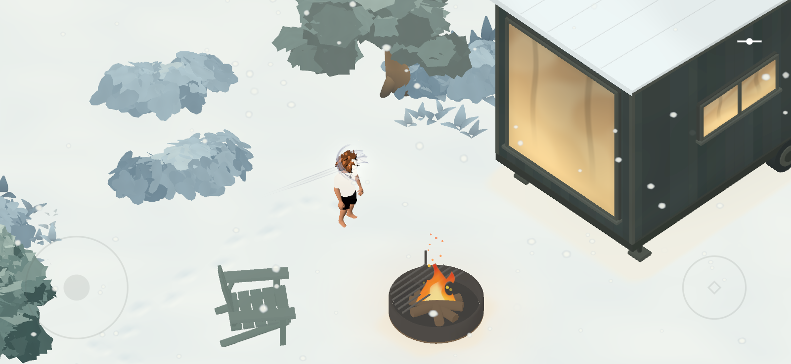

# Postcard Cabin · February 10, 2026

Two exterior zones recall a midwinter trip to northern Minnesota. A winding snowy
hike passes frosted pines, bare birches, a frozen pond and a narrow frozen stream.
The forest opens into a sheltered clearing with the existing charcoal Postcard
cabin, warm painted windows, two gray-green Adirondack chairs and a low steel fire
ring. One fragment and ambient bed belong to each zone. The cabin remains a closed
exterior; the composition contains no picnic table or interior destination.

Run `res://scenes/world/postcard_cabin_world.tscn`, or choose **Postcard Cabin —
FEB 10, 2026** in Memory Lane. The shared world supplies both avatar choices,
LAN partners, interaction, guidance, audio mixing and return to the timeline.

## Scene and editing

- `../postcard_cabin.tscn` owns the finite floor, continuous footprint snow,
  falling snow, Entry/Exit, guidance and the two zone instances.
- `hike_zone.tscn` owns the editable `Scenery/Trail` Curve3D, frozen water and
  layered forest. The paving mesh stays hidden below the snow. Edit the curve's
  handles for the winding route, then keep tree trunks and water banks clear of
  that route. The memory script derives the first fragment and requested guidance
  from the same curve; **Hike Fragment Ratio** moves its pause point. Low slate
  groups mark selected bends and ice banks.
- `clearing_zone.tscn` owns the cabin, fire pit, chairs and enclosing foliage.
  Cabin entry faces local +Z; its large window faces -X. The authored 90° rotation
  presents that warm window on arrival and leaves the steps reachable to the east.
  The picture window spills warm light onto the snow. The fire pit starts
  unlit. Tap it from nearby to toggle the flames, the firelight on the snow and
  chairs, and the crackle.
- Edit each zone's **Fragment → Interaction → Note Title / Notes** to replace
  “Through the quiet pines” and “A warm place in the woods.” Each Notes entry is
  one page. These are placeholder personal notes.
- `scripts/postcard_cabin_camera.gd` exposes **Trail Size** (3.5), **Pond Size**
  (4.1) and **Clearing Size** (5.2). Smooth render-frame blending keeps the hike
  intimate and gives the cabin a modest reveal, with a fireside framing bias.

The floor and snow share one concave outline, avoiding seams and internal
collision rims. Keep both outlines identical when extending the memory. Snow's
**Ground Exclusions** cut out ice, the cabin/steps and the fire bowl. Water outline
and stream Curve3D controls come from the existing water component. Ice uses a
new still, matte blue surface with quiet frost and fractures; shoreline barriers
keep the hike on snow. It is scenery rather than a skating surface.

## Reused pieces and additions

The scene reuses the existing cabin, trees, bushes, grass tufts, snow/footprints,
weather, curved path, warm light washes and fragments. The fire ring uses the
[sculpted 3D fire](../../../components/vfx/sculpted_fire/README.md) with a compact
flame, light smoke and small sparks.
New reusable pieces are [Adirondack chairs and a fire pit](../../../components/scenery/camp/README.md)
and [frozen water](../../../components/scenery/water/README.md). Snow-colored pine
crowns and the pale roof suggest settled snow; this is authored color, rather
than a dynamic accumulation simulation.

Scenery recalls independently and foliage responds to either explorer. The cabin,
pit and nested fire share the reachable `Scenery/Arrival` recall anchor so the
cozy destination resolves before reaching its collision. Floor, snow and guidance
stay available throughout the walk.

The hike and clearing use the soft wind bed. The pit plays the separate
`audio/samples/cabin_fire_crackle.wav` loop while lit. Regenerate the crackle
with `tools/generate_cabin_audio.py`. The wind and crackle play on Ambience.
Fragment chimes use SFX.

## Checks and previews

```sh
godot --headless --path . --fixed-fps 60 --script tests/postcard_cabin_memory.gd
godot --path . --fixed-fps 60 --script tests/postcard_cabin_memory.gd -- --capture
godot --headless --path . --script tests/memory_effects.gd
```

The walkthrough uses the real explorer to traverse the entire curve in both
directions, reach both notes, test fire-ring collision, climb the cabin steps and
return to the trail. It checks snow footprints, still ice, recall, camera sizes,
audio, finite-ground arrival and timeline character choice. For a two-process
loopback LAN check, run the same memory test with `-- host` and `-- guest` in two
terminals, host first. Physical-device performance and Wi-Fi remain unmeasured.

Native Mobile-renderer captures live in `docs/previews/winter-cabin-*.png`.


