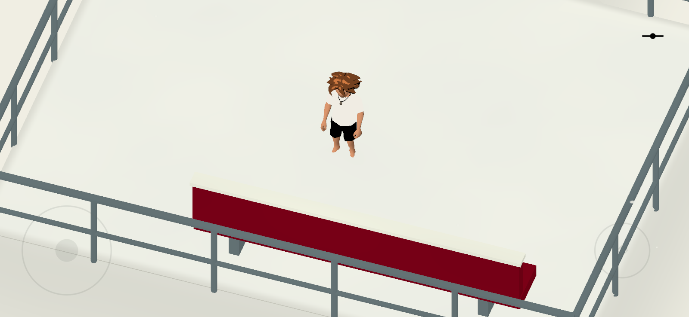
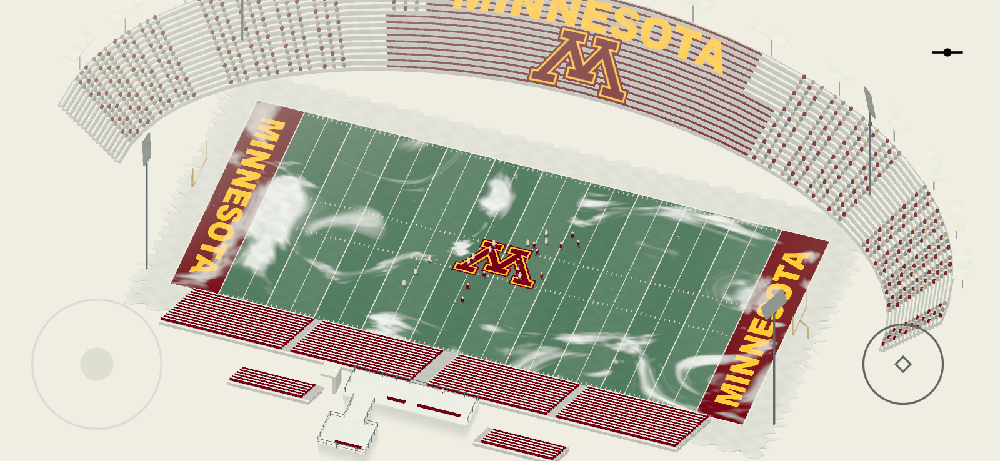

# Football in the snow

Recall the second timeline entry, **Football in the snow**, or run `scenes/world/snowy_stadium_world.tscn` with F6. The styling follows the supplied University of Minnesota stadium reference: maroon/gold seating, MINNESOTA wordmarks, and the supplied M on the field and opposite seating. The timeline retains **COLLEGE FOOTBALL** as its subtitle until the actual date is supplied.

The memory follows the [zone framework](../README.md). `snowy_stadium.tscn` contains Entry/Exit and shared Audio, and instances `stadium_zone.tscn` under **Zones/Stadium**. The zone owns its scenery, one fragment, and quiet wind ambience.

## Exploration and overlook

The local explorer arrives at `(−6, 10.54, 22.1)`, with the LAN guest 1.2 m to the right. The playable area has two visibly separate sections **inside the same MemoryZone**:

- **ArrivalSection**: a small snowy landing with a maroon bench, railings, and the fragment. The orthographic camera size is **3.5**, matching First Meeting.
- **ViewingPlatform**: a wider snowy bay overlooking the bowl. A narrow, railed **ConnectingAisle** joins the landing to this bay and stages the gradual camera reveal.

A single concave **MemoryPlatform** supplies continuous floor collision and an outer safety rim across both sections and their connector. There are no internal rim barriers to cross. Infinite ground is disabled.

The camera opens from size 3.5 to 64 along the connecting aisle, then frames a fixed stadium focus throughout the viewing bay. The tighter wide view allows the opposite upper stands and lights to extend past the top of the screen. Returning to the arrival landing restores the close view. Each device follows its own local explorer. Its yaw stays fixed, preserving movement directions. These settings live on **CameraRig** in the world wrapper (`scripts/stadium_camera.gd`); **CameraTransitionStart**, **CameraTransitionEnd**, and **StadiumViewFocus** in the zone define the reveal and composition. First Meeting and Seasonal Demo keep their existing cameras.

The football field sits at Y=0, centered on Z=−26, more than ten meters below the deck. Twenty-two small players run on individually staggered, bending routes, turn with their movement, bob, and swing their legs. Defenders follow with varied reaction delays, and a football travels with a carrier. This is lightweight scenic animation, without gameplay physics or network traffic. Disable **Animate Players** for a static pose; **Show Teams** removes the figures. The broad field and layered distant seating provide scale beyond the compact playable fragment.

## Editing

Open `stadium_zone.tscn`:

- **Scenery/Field**: field dimensions/colors, frost coverage, **Show Teams**, **Animate Players**, and **Minnesota Branding**.
- **Scenery/Stands**: painted seating, concrete, distant row count, Minnesota seating art, and inward-aimed light banks.
- **Scenery/WalkableDeck → Custom Outline**: shared floor shape and outer safety rim.
- **Scenery/ArrivalSection / ConnectingAisle**: landing, bench, and aisle railings.
- **CameraTransitionStart / CameraTransitionEnd / StadiumViewFocus**: camera reveal positions and wide framing.
- **Scenery/WalkableSnow**: one continuous snow surface with player footprints. Its **Custom Outline** shares the deck's `DeckOutline`, covering the landing, connector, and viewing bay together. **Footprint Quality** is Detailed to preserve impressions over the larger area.
- **Scenery/Field → Snow Coverage / Paint Seed**: organic, repeatable field snow drifts. The old oval field patches have been removed.
- **Scenery/StandSnowfall / FieldSnowfall**: existing snowfall components at deck/field elevations.
- **Fragment**: arrival position, **Note Title**, and **Notes**. The current page is placeholder text.
- Zone root: ambient wind clip, volume, coverage, and blending.

Music and the fragment chime remain on the parent memory's **Audio** node. All beds and cues follow the shared mixer, memory fades, and scene lifetime. Snow is decorative and does not change the collision floor.

The field/stands components are reusable; see [their guide](../../../components/scenery/stadium/README.md). They reuse First Meeting's vertex-color geometry builder and restrained pigment/lighting language. The field's frost and bench caps supplement the existing falling/ground snow components.

## Verification

```sh
godot --headless --path . --script tests/snowy_stadium.gd
godot --headless --path . --script tests/football_players.gd
godot --path . --script tests/football_players.gd
godot --path . --windowed --resolution 1600x738 --script tests/snowy_stadium.gd -- --capture
```

The scene test walks the actual explorer from arrival fragment through the aisle to the overlook and back, checks footstep impressions, safety bounds, camera widening/return, timeline Recall, and the elevated arrival. The motion test checks separate routes, bounds, turning, bobbing, pose timing, and actual mesh transforms when rendered. The capture mode saves the arrival and overlook screenshots under `docs/`.

Run the existing two-process LAN check with `-- host stadium` and `-- guest stadium` to check shared scene selection, both avatar choices, interpolation, contact, and reconnect at the raised spawn. The catalog protocol version has been advanced; both devices need the same build.



