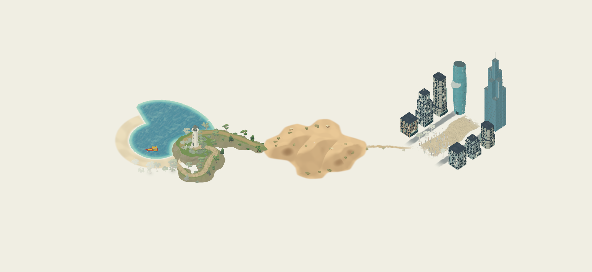

# Southern Vietnam · June 20, 2026

**Bai Mon / Mui Dien → sand dunes → Saigon**, the final three-zone Vietnam memory.
Recall it after Central Vietnam, or open
`res://scenes/world/southern_vietnam_world.tscn` with F6.

The confirmed context is June 20 and these three places. The dune location,
time of day and personal wording were not supplied. The scene keeps the shared
soft daylight and explicitly marked placeholder notes. It is a compressed memory
composition, with quiet coast and open dunes giving way to a crowded city.

## Zones and reused components

- **Bai Mon:** `bai_mon_zone.tscn` reuses the Da Nang crescent and sand component,
  with a brighter blue cove and jade shallows. Jungle foliage frames the beach
  walk. **HeadlandWalk** climbs flagstones set into the coastal ridge, and
  **ToDunes** descends on an earthen tread. Coastal tree canopies and shrub
  pockets shade both slopes, and meadow grass fills the lighthouse landing
  along the clear tread. Three white ground birds hop and scatter as explorers
  approach, and three more circle the tower. The fishing boat bobs in the cove
  and recalls from the beach. It is framed from both the sand and the overlook.
- **Dunes:** `dunes_zone.tscn` uses a single 30 × 30 m **PainterlySandPatch**, with
  a scalloped outline, three authored crests with two swales, and the existing
  two-player footprint field. **DuneRoute** samples the terrain for hints.
  Tufts, dry shrubs and low stones guide the walk across the sand and through
  the dissolve between dunes and city.
  **BlowingSand** follows the dune relief, outline and recall. Tune wind angle,
  speed, gust strength, grain size and glitter in its Inspector.
  [Blowing sand component](../../../components/weather/blowing_sand/painterly_blowing_sand.tscn)
- **Saigon:** `saigon_zone.tscn` stages shorter warm-toned street fronts against
  a cooler skyline. Wide, faded setts carry the walk into a moving crowd.
  Clusters of flowering shrubs and shade trees fill the verges between the
  promenade and streets. A bronze Hồ Chí Minh statue stands on the boulevard
  centerline, with a Vietnamese flag flying between the landmark towers at the
  far end. The hidden **CityRoute** bends around the pedestal and keeps room for
  both explorers. Crowd placement excludes both bases.

The [Vietnam scenery kit](../../../components/scenery/vietnam/README.md) contains
only the new supporting headland and skyline profiles. Buildings remain closed
exteriors and their tops may crop during close street exploration.

One hidden **Environment/VietnamFloor** supports all connections and safe outer
boundaries. `walk_outline.tres` merges the crescent, routes, headland, dune field
and city. After extending paths, regenerate it with:

```sh
godot --headless --path . --script tools/rebuild_southern_vietnam_floor.gd
```

## Authoring

Edit **Fragment → Note Title / Notes** in each zone:

| Zone | Placeholder title |
| --- | --- |
| Bai Mon | Above the cove |
| Dunes | Between the dunes |
| Saigon | Among the city towers |

`../../../scripts/southern_vietnam_memory.gd` samples actual sand height for Entry,
the dune fragment, dry planting, rocks and requested guidance. Hints follow the
same authored curves, including both cliff routes. Align the lighthouse, upper
paths and first fragment if changing **Headland → Cliff Height**. Keep a flat
landing before either path crosses the rock edge. The guest's 1.2 m X arrival
offset remains supported on the crescent.

The standard walking size is **4.7**. Framing opens to **10** midway around the
cove, **17.2** on the lighthouse landing, **12.4** near the dune fragment, and
**13.9** between the Saigon statue and flag. Each view holds briefly as the
explorer steps out of it, then eases back to the walking camera. Controls are exported from
`../../../scripts/southern_vietnam_camera.gd`.

Recall is enabled throughout. **HeadlandRecall** reveals the elevated lighthouse
from the reachable beach; **CityRecall** reveals the skyline from the avenue.
Foliage responds to both explorers. Each zone owns a quiet ambient bed: surf,
open-air wind and city crowd, all reused placeholder recordings. Music remains
available on Memory/Audio and fragments use the shared SFX cue. LAN shares avatars
and movement; notes, recall, audio, scenic motion and footprints remain local.

## Verification and views

```sh
godot --headless --path . --script tests/vietnam_components.gd
godot --headless --path . --fixed-fps 60 --script tests/southern_vietnam_memory.gd
godot --path . --fixed-fps 60 --script tests/southern_vietnam_memory.gd -- --capture
godot --headless --path . --script tests/memory_effects.gd
```

The real-explorer check walks both directions, climbs and descends the headland,
checks the fishing boat framing and bird behavior, crosses the dune swales, creates footprints, reads/taps each fragment, requests all
hints, and checks paired arrival, finite support, camera reveals, ambience, scenic
recall and timeline avatar choice. Separate `-- host` / `-- guest` processes use
UDP **24755** for LAN checks; production IP entry stays on 24680. Native Mobile
previews live in `docs/previews/southern_vietnam-memory-*.png`. Physical phone/Wi-Fi
performance is unmeasured. Existing headless material and macOS shader-cache/exit
resource warnings may appear.

[Before and after](../../../docs/previews/southern-vietnam-polish-comparison.jpg)

[Lighthouse overlook](../../../docs/previews/southern_vietnam-memory-lighthouse-overlook.png)
· [Dune crests and swales](../../../docs/previews/southern_vietnam-memory-dunes-overview.png)
· [Saigon promenade](../../../docs/previews/southern_vietnam-memory-saigon-center.png)


