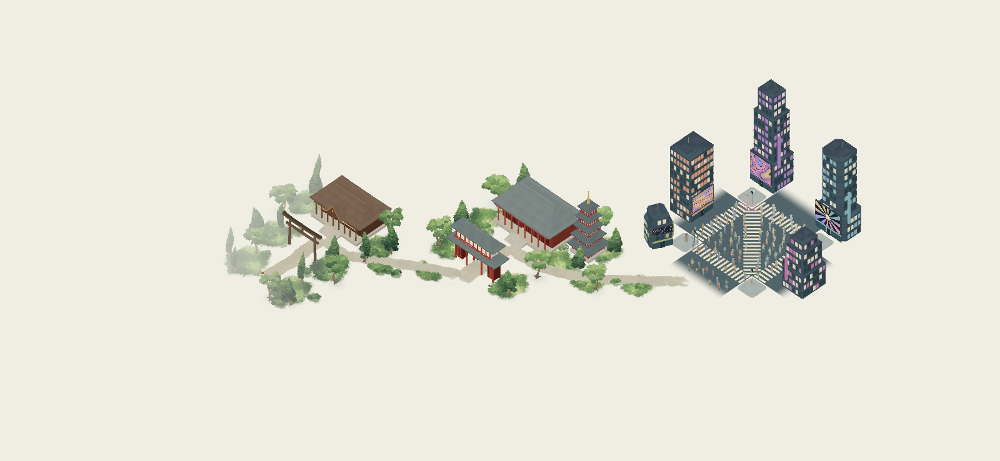

# Tokyo · May 28, 2026

Three zones connect a forest approach to Meiji Shrine, the lantern gate and
courtyard at Sensō-ji, and a busy Shibuya Crossing. The composition reuses all seven
Tokyo scenery presets. Dense green canopies, shrubs, groundcover and a few pale
flowers frame the shrine and temple; towers, screens, crossing stripes and small
crowds replace the planting in the city. Paths dissolve between the three places
through the warm ivory void. Their adjacency is a memory composition, not a street
map or a claim about the actual journey or time of day.

Recall **Tokyo — MAY 28, 2026** between Graduation and Vineyard, or open
`res://scenes/world/tokyo_world.tscn` with F6. The inherited world retains the shared
avatars, IP-entry LAN, reading panel, audio buses, requested guidance and return UI.

## Layout and reuse

- `../tokyo.tscn` owns Entry/Exit, three ordered zones, the fragment cue and one
  hidden finite **TokyoFloor**. Its concave outline supports the planted islands,
  connecting paths and crossing without platform rims across their joins. Both
  arrivals have room on the forest path, including the guest's 1.2 m offset.
- `meiji_zone.tscn` starts along **ForestWalk**, passes under the existing wooden
  **Torii**, and reaches **WorshipHall**. The first fragment is on its raised
  veranda, reached by the component's real steps/ramp. Sixteen trees combine
  columnar, layered and broadleaf forms with 20 bushes and eight groundcover
  patches. Distant trees recall from nearby path markers, keeping the forest
  visible without requiring a detour into each grove. **ToAsakusa** branches from the approach after descending the steps.
- `sensoji_zone.tscn` continues through **Hozomon**, then approaches **MainHall**
  and the second veranda fragment. The gate stands far enough in front of the
  hall to keep the player visible beyond its roof. The separate five-story **Pagoda** recalls
  from reachable **TempleView**. Ten trees, 14 shrubs, six flowering bushes and
  eight grass patches form uneven side gardens, preserving the gate, hall steps
  and the path out through **ToShibuya**.
- `shibuya_zone.tscn` uses **PainterlyScrambleCrossing**, five differently shaped
  city towers, animated billboards, two subtle sign-color washes and two existing
  crowd components. **CrossingRoute** is a hidden, non-colliding curved guide and
  crowd exclusion: it crosses the junction diagonally, bends around a signal post
  and reaches the final fragment at the far corner. People occupy the road while
  leaving a narrow route through it. The two crowd counts request 96 and 12;
  placement caps safely if authoring edits reduce capacity. Towers recall from
  the reachable **CityRecall** marker at the crossing arrival.

All 97 recallable components are enabled; all 82 foliage components respond to
both explorers. Solid scenery keeps its collision throughout recall. Outer temple trees also recall from the reachable gate/courtyard markers. Tree seeds,
shape variation and leaf density reuse the existing generators. **forest_green.tres**
and **temple_green.tres** supply restrained deep/soft green palettes. No new model
component is needed for the landmarks. The walks now use the
[surface-path family](../../../components/groundcover/paths/README.md): compacted
gravel at Meiji and running-bond stone paving at Sensō-ji and its outgoing
connection. Their original curves, heights and guidance links remain intact;
Shibuya's hidden route and road-marking component keep their existing roles.

## Authoring

Edit **Fragment → Interaction → Note Title / Notes** in each zone for personal text:
“Beneath the trees,” “Through the red gate” and “Across the city.” All three notes
are explicitly placeholders. The memory does not invent personal events or wording.

`../../../scripts/tokyo_memory.gd` samples the same editable curves for requested
brushstroke routes. Hall fragments follow each component's **PrayerFront** anchor;
hints return through **Approach** before joining the next path. Grounded guidance
supports their **Veranda** surfaces and validates capsule clearance over the ramp
profile, keeping walls and columns solid. When moving halls, update the adjacent
path endpoints as well. Keep the crossing's final bend clear of its signal post.

`../../../scripts/tokyo_camera.gd` keeps **Walking Size** at 3.5. It opens to 8.5 for
the torii, 10.5 for the shrine approach, 12 for the lantern gate, 12.5 for the main
hall approach and 9 around the crossing. **Veranda Size** 5.5 restores intimacy
beside the first two notes. All reveals are smooth and reversible with fixed yaw;
city tower tops may crop to retain a sense of scale at street level.

Zone roots reuse quiet forest breeze/bird-like audio, subdued courtyard murmur and
an outdoor city/crowd bed. Tune **Ambience Volume / Size / Blend Distance** on each
zone. Music is available on **Memory/Audio** but is unassigned. Fragment chimes use
SFX. Audio follows the local explorer; notes, recall and scenic animation stay
local, while LAN shares avatar identity and movement.

## Verification and views

```sh
godot --headless --path . --fixed-fps 60 --script tests/tokyo_memory.gd
godot --path . --fixed-fps 60 --script tests/tokyo_memory.gd -- --capture
godot --headless --path . --script tests/memory_effects.gd
# Quick, fully recalled composition views without walking the whole route:
godot --path . --script tests/tokyo_memory.gd -- --capture --views-only
```

The real-explorer check covers safe paired arrival, every path's containment,
both gates, both hall stairs/verandas, all three note tap targets, requested hints,
accessible scenic recall, crowd clearance, camera transitions, audio and timeline
avatar choice. It walks the full route in reverse as well. Separate `-- host` and
`-- guest` processes check partner presence, avatar identity and replicated movement
on isolated UDP 24725; production IP entry remains on 24680. Physical phone/Wi-Fi
performance has not been measured. Existing headless renderer/exit resource warnings
remain; inspect the rendered Mobile views for visual review.

[Meiji](../../../docs/previews/tokyo-memory-meiji-overview.png) ·
[Sensō-ji](../../../docs/previews/tokyo-memory-sensoji-overview.png) ·
[Shibuya](../../../docs/previews/tokyo-memory-shibuya-overview.png)


