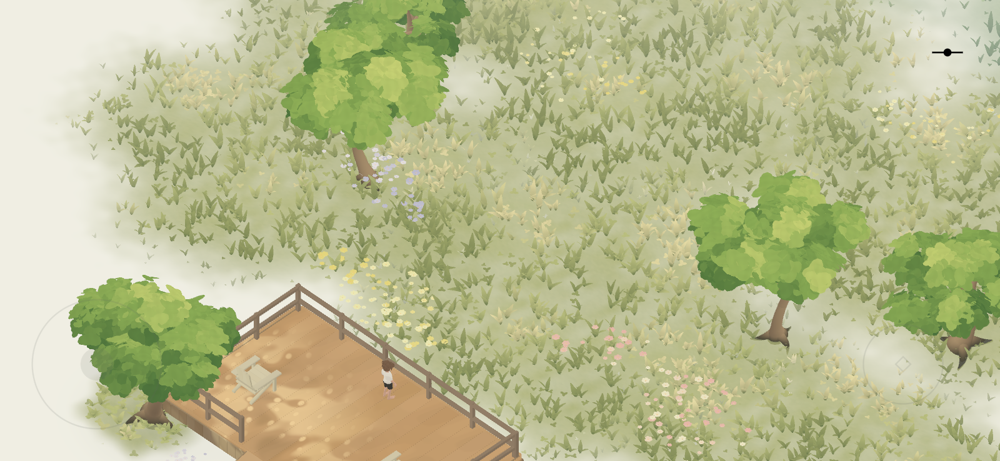

# Vineyard · August 1, 2026

Two zones recall a late-summer walk between grape rows and a quiet wooden deck
looking across a meadow. Six rows of tall rooted grapevines carry olive canopies and plum-colored bunches
on timber and wire trellises.
Two softly worn field-track lanes lead onto the deck; pale chairs, simple wooden rails and a wide
field of grass, flowers and distant trees carry the second place. The location,
winery name and personal story were not supplied, so neither signage nor exact
geography is invented. Both notes are explicitly marked placeholders.

Recall **Vineyard — AUG 1, 2026** in Memory Lane, or run
`res://scenes/world/vineyard_world.tscn`. The inherited world retains both avatars,
LAN, interaction, requested guidance, audio mixing and timeline return.

## Authoring

- `../vineyard.tscn` owns Entry/Exit, one hidden finite MemoryPlatform, the two
  ordered zones, shared fragment cue and requested routes. The platform covers
  all vine aisles, row-end crossings, the approach ramp and deck. The meadow
  extends beyond supported ground as scenery, behind solid deck rails.
- `rows_zone.tscn` contains the editable **Scenery/Trail** Curve3D, 36 reusable
  grapevine instances in six rows, groundcover and a few perimeter trees. Keep the
  main aisle and row ends clear when widening plants or moving trellis posts.
  `vine_leaves.tres` is the shared summer-green palette. Varied vine heights
  and small flower groups mark the arrival, aisle and ramp.
- `scripts/vineyard_memory.gd` places the first fragment and samples both requested
  guidance legs from that same trail. **Rows Fragment Ratio** moves the note
  along the aisle. Deck waypoints follow the ramp and stop before the chairs.
- `overlook_zone.tscn` reuses the existing stage as **TimberDeck**: Timber Skirt,
  warm wood colors, 0.55 m height, 2.4 m ramp and a 9 × 5.4 m deck. Simple timber
  rails guard its field/side edges; two entry spans leave the ramp open. Two
  existing Adirondack chairs frame the clear viewing approach.
  The tree beside the ramp frames the deck. `DeckDapple` uses the Canopy Shade
  pattern for soft, drifting shadows on the timber. Adjust its reach and
  strength in the Inspector.
- **FieldGrass**, **FieldFlowers** and **FieldTree** are existing foliage
  components, arranged in overlapping meadow islands with irregular fading
  margins. Tree groups in the middle distance frame the meadow. The cooler
  `field_distance.tres` palette softens the farthest grass and trees. These scenic
  pieces use **Recall Anchor → Scenery/Lookout**, so either explorer can remember
  the view from the accessible deck without walking into the distant field.
- Edit each zone's **Fragment → Interaction → Note Title / Notes** for personal
  text. Each Notes entry is one page: “Between the vines” and “Beyond the rows.”
- `scripts/vineyard_camera.gd` exposes **Rows Size** 3.5, **Deck Size** 5.2 and
  **Overlook Size** 13.0. Framing stays close until approaching the viewing rail,
  then opens toward the field. It reverses smoothly on the return walk; yaw stays
  fixed throughout.

[Vineyard Detail](../../../components/scenery/vineyard/README.md) supplies the
trellis and railing layouts. The [field-track path](../../../components/groundcover/paths/README.md)
adds two worn soil lanes with a grassy median along the original aisle curve.
Foliage, walkable deck/ramp, chairs, platform, fragments and audio framework are
reused. Scenic foliage supports optional reachable recall
anchors; ordinary instances keep their existing behavior. Guidance supports raised
walking surfaces while treating cabinets and house shells as obstacles.

## Sound

Both zones have quiet original breeze/bird-like ambience, generated without
recordings or speech by `tools/generate_vineyard_audio.py`. Beds blend on the
Ambience bus, independently of the camera and partner. Fragment chimes use SFX.
The memory's Music slot remains available for a chosen soundtrack.

## Verification and previews

```sh
godot --headless --path . --fixed-fps 60 --script tests/vineyard.gd
godot --path . --fixed-fps 60 --script tests/vineyard.gd -- --capture
godot --headless --path . --script tests/memory_effects.gd
godot --headless --path . --script tests/first_meeting_guidance.gd
```

The real explorer check covers safe paired arrival, the central and another vine
aisle, both fragments, requested guidance up the ramp, raised deck support, chair
clearance, the viewing rail, reversible camera reveal, anchored field recall,
ambience and timeline avatar choice. Run the same test with `-- host` and `-- guest`
in two terminals, host first, for isolated ENet loopback checks on UDP 24705.
Production IP entry still uses 24680. Physical-phone performance and Wi-Fi have
not been measured.

Native Mobile-renderer previews live in `docs/previews/vineyard-*.png`; the
complete overview is fully recalled. No exact winery layout is claimed.


